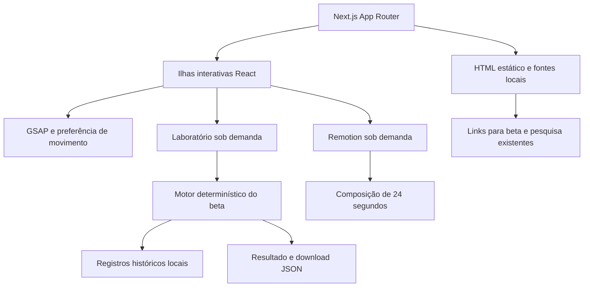

# Arquitetura da nova LP

O HTML de apresentação é produzido em `app/page.tsx`. Navigation, Roadmap e MotionSystem controlam interações. MiniLab é carregado perto do viewport e recalcula somente quando cenário/estratégia mudam. MissionPlayer importa ao abrir o dialog; a composição nunca é enviada na renderização inicial. Não existem rotas de escrita, banco, autenticação ou coleta analítica.

Dados imutáveis e caminhos de links ficam em `lib/content.ts`. O motor copiado fica em `lib/mission`. O manifesto de assets e as licenças fixam a procedência. `output: export` entrega arquivos estáticos. Node é necessário para desenvolvimento/build e para o servidor de conveniência; qualquer servidor HTTP estático pode publicar o diretório out.

O repositório raiz continua com seu runtime e processo de publicação próprios. A nova aplicação não altera o motor do jogo, migrations ou o schema Prisma existente. A imagem terrestre representa direção de arte; não é um mapa projetado nem uma fonte para cálculos.
