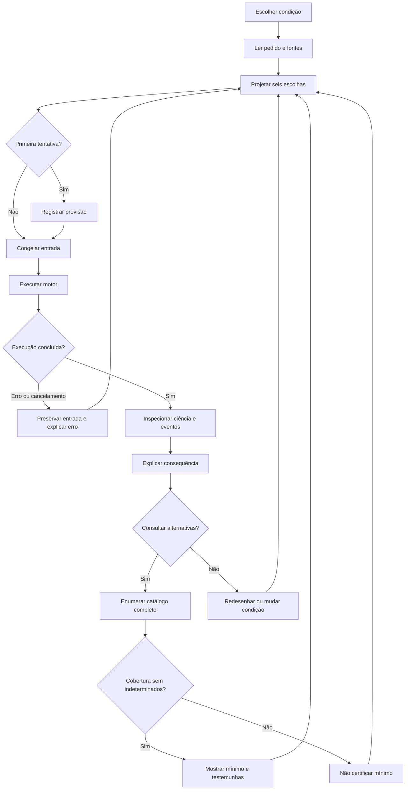
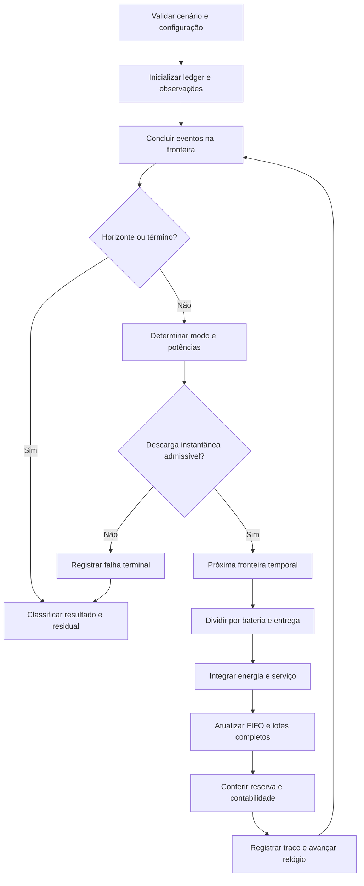
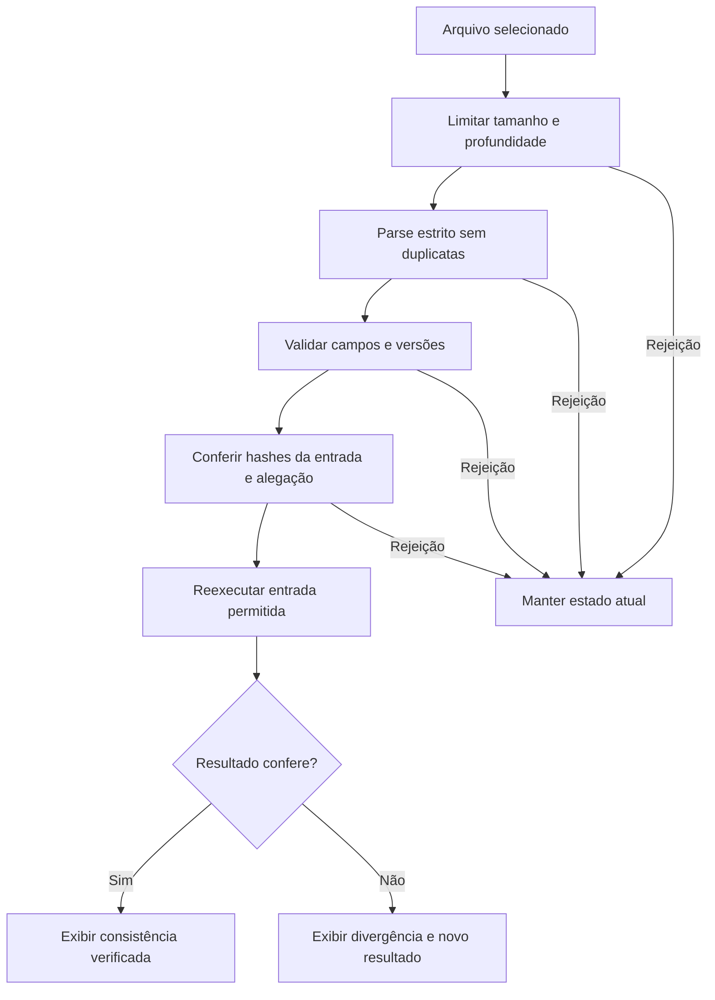
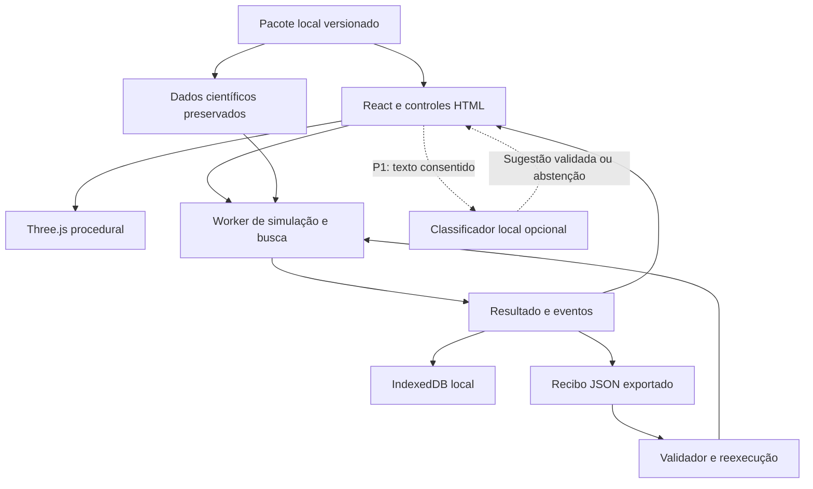

# 04 — Fluxos Mermaid e fronteiras do sistema

Os diagramas descrevem a versão de pesquisa. O fluxo do produto e a semântica do motor não mudam por animação ou por implantação. Os arquivos `.mmd` correspondentes ficam em `docs/diagrams`.

## 1. Jornada e proteção da primeira decisão

No caso de transferência, o controle de ajuda permanece indisponível antes da primeira execução. Essa barreira registra ordem de interação; não prova, por si, compreensão ou autoria de uma justificativa.

## 2. Simulação por eventos

A fração exata é a base da decisão. Os valores do tipo number exibidos na UI são conversões para apresentação. O último intervalo é integrado antes dos eventos de seu limite. A implementação tem testes específicos para último bit, último trabalho e energia zero.

## 3. Importação de resultado não confiável

Consistência verificada não é autenticidade, aprovação NASA ou correção física universal. O importador nunca executa uma URL, script ou trace fornecido pelo arquivo. O resultado recomputado permanece distinto da alegação importada.

## 4. Topologia local e ramo de IA opcional

A seta P1 não indica serviço já implementado. O modelo não acessa o ledger nem altera a condição de vitória. Na distribuição portátil, o motor ocupa a thread principal e não o Worker; a API matemática permanece a mesma. O schema Prisma descreve evolução relacional e não integra a topologia executada do browser.
