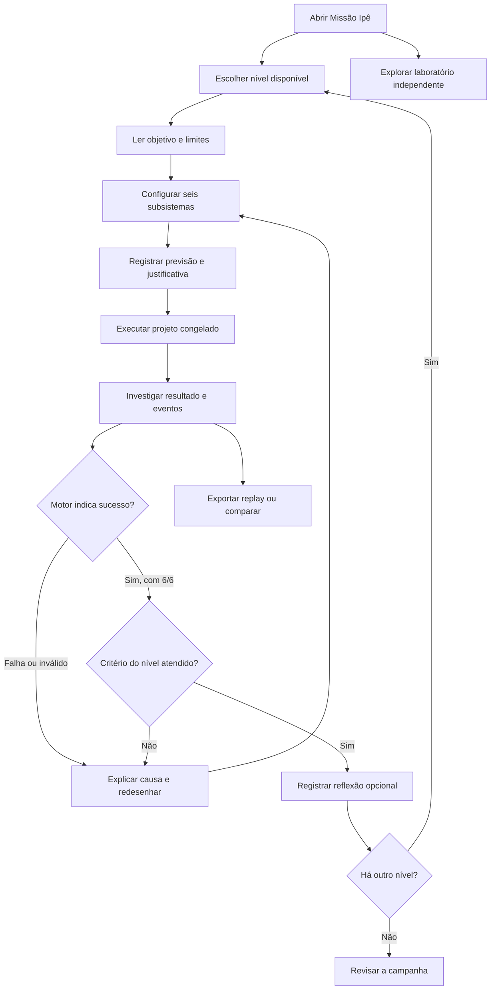
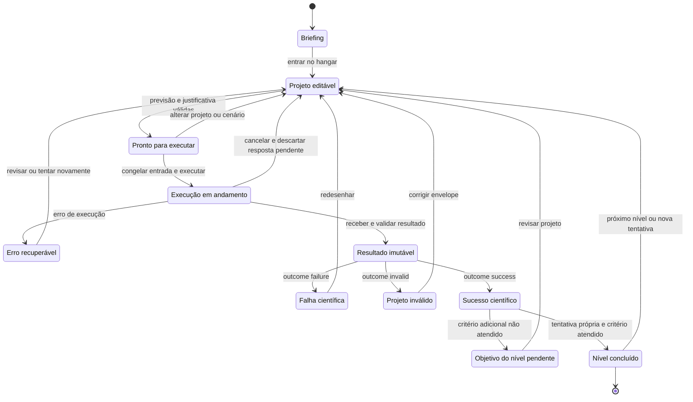
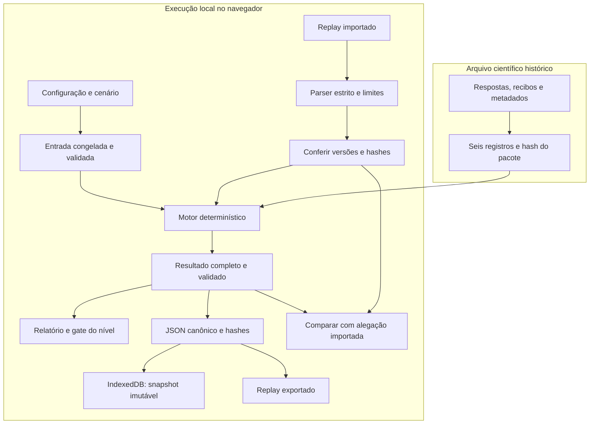
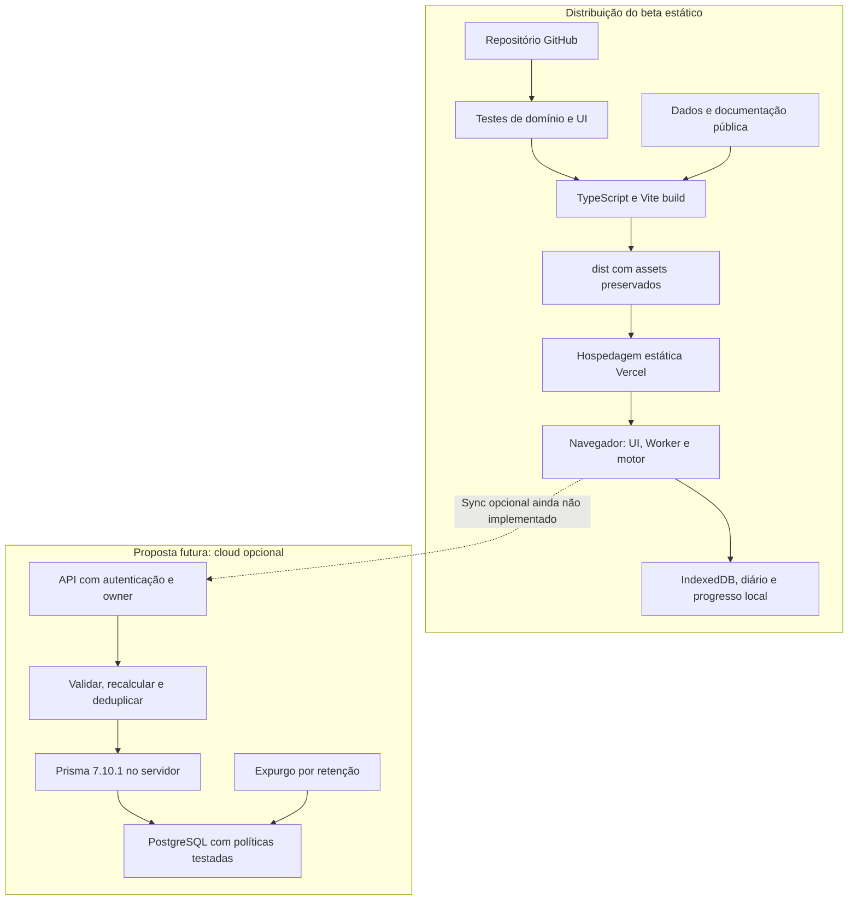
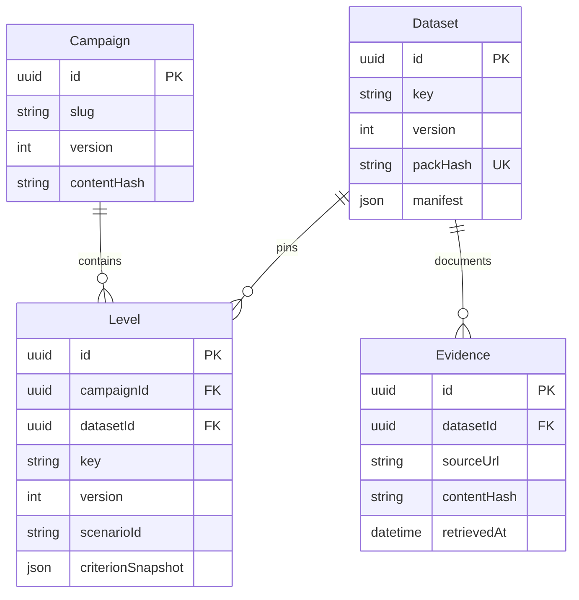
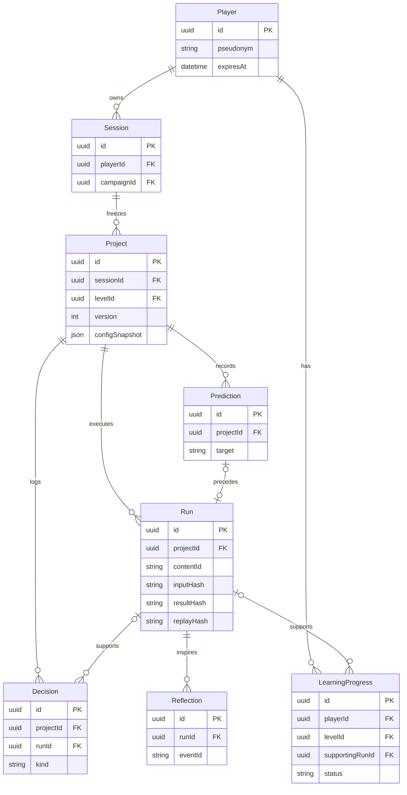

# Flowcharts e modelos — PROJETO IPÊ

Diagramas Mermaid de referência para o beta e sua evolução. As fontes `.mmd` em [`diagrams/`](../diagrams/) são editáveis e correspondem aos blocos abaixo. Layout vertical, labels curtas e diagramas separados mantêm a leitura compacta.

**Implementado/local** e **proposto/cloud** são contextos diferentes. A ciência continua exigindo 6/6 registros válidos e todas as restrições; os níveis acrescentam gates sem modificar o motor.

## 1. Jornada do jogador

O ciclo principal é prever, executar, investigar e redesenhar. O resultado científico e o critério adicional do nível recebem avaliações separadas. Os quatro níveis e seus critérios estão no PRT.

Fonte: [`01-user-flow.mmd`](../diagrams/01-user-flow.mmd).

## 2. Estados de uma tentativa

Este é o contrato conceitual da coordenação. As labels descrevem estados de produto; não afirmam existir um reducer ou enum com esses nomes no código. Falha do motor, invalidade do projeto e objetivo pedagógico pendente permanecem distintos.

Fonte: [`02-game-state.mmd`](../diagrams/02-game-state.mmd).

## 3. Dados, simulação e replay

A entrada original e a importada convergem no mesmo motor. O parser e a checagem de identidade antecedem o recálculo. Comparar a alegação importada nunca substitui o resultado recalculado. A figura resume dados científicos e snapshots; o diário pedagógico separado continua em armazenamento local.

Fonte: [`03-data-flow.mmd`](../diagrams/03-data-flow.mmd).

## 4. Distribuição e evolução opcional

O bloco superior mostra o caminho técnico da entrega estática para GitHub/Vercel. Ele não é recibo de publicação: URL e commit implantado devem ser conferidos no handoff. O bloco inferior é proposto e ainda não implementado; o beta não envia dados a essa API nem se conecta a PostgreSQL.

Fonte: [`04-deployment.mmd`](../diagrams/04-deployment.mmd).

## 5. Modelo de conteúdo e proveniência

Modelo cloud proposto. Cada nível fixa uma revisão de campanha e um dataset. Dataset referencia evidências com URL, datas e identidade dos arquivos preservados. Os campos mostrados são um recorte; o schema Prisma contém tipos e constraints completos.

Fonte: [`05-er-content.mmd`](../diagrams/05-er-content.mmd).

## 6. Modelo de atividade pseudônima

Modelo cloud proposto. O proprietário é derivado de Project → Session → Player. Run também referencia Dataset; Session referencia Campaign e Project/LearningProgress referenciam Level, mostrados no diagrama anterior. As relações opcionais não dispensam autorização e validação semântica no servidor.

Fonte: [`06-er-player.mmd`](../diagrams/06-er-player.mmd).

## Como manter os diagramas

Ao mudar um contrato, editar a fonte `.mmd` correspondente e atualizar o bloco deste documento com o mesmo conteúdo. A sintaxe pode ser verificada com um parser Mermaid; renderizar também é necessário para conferir legibilidade. Uma figura não substitui os testes dos fluxos representados.

**Verificação executada em 14/11/2026:** os seis arquivos passaram por `mermaid.parse` com Mermaid 11.14.0; os seis blocos deste documento foram comparados com suas fontes e são idênticos. A tentativa de QA visual via Chromium local foi bloqueada pelo ambiente antes de abrir o navegador (`socket: Operation not permitted`). Portanto, esta verificação comprova sintaxe aceita pelo parser, sem alegar inspeção visual dos gráficos renderizados. A sintaxe segue as referências oficiais de [uso da API](https://mermaid.js.org/config/usage.html) e [relações entre entidades](https://mermaid.js.org/syntax/entityRelationshipDiagram.html).

A distinção entre snapshot, tentativa e progresso, a idempotência e os controles ainda pendentes estão no [README Prisma](../prisma/README.md). As decisões de implementação estão em [ARQUITETURA](ARQUITETURA.md) e os critérios de aceite em [PRT](PRT.md).
