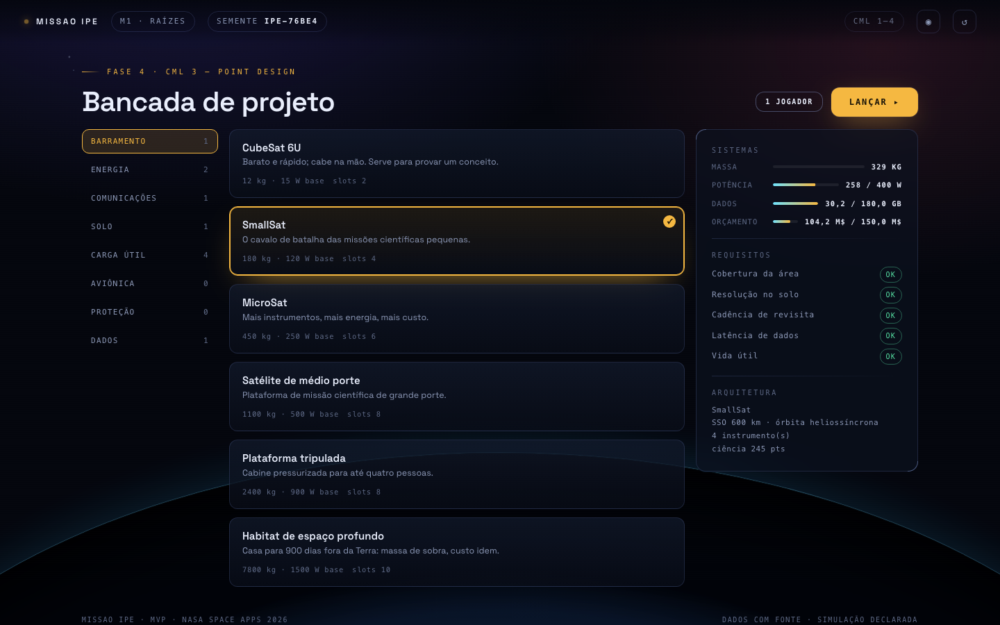
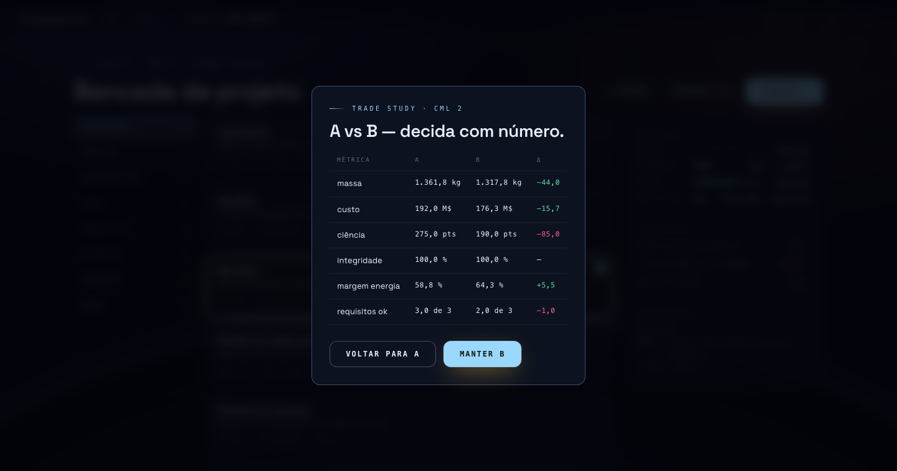

# MISSAO IPE — FASTMODE (MVP autônomo)

Jogo de projeto de missão espacial: **objetivo → requisitos → espaçonave → órbita → lançamento → operações → relatório**.
Roda no navegador, sem build, sem instalação, offline.





## O que este PR adiciona

Um modo **FASTMODE** independente do app R19: jogo completo em HTML/CSS/JS puro, sem build, sem servidor e sem dependências. Serve para demonstrar a experiência em qualquer máquina (inclusive offline) e para validar as mecânicas de requisitos, trade study e relatório causal.

## Rodar

```bash
cd missao-ipe/app
python3 -m http.server 8765
```

Abra `http://localhost:8765`.

Não precisa de Node, bundler nem internet. Os únicos recursos externos são as fontes do Google (com fallback para a fonte do sistema).

## O que já funciona

| Etapa | Estado | Detalhe |
|---|---|---|
| Briefing e seleção | ✅ | 4 missões: **M0 Semente** (tutorial), **M1 Raízes** (Terra), **M2 Gelo** (Lua), **M3 Travessia** (Marte, tripulada) |
| Objetivo | ✅ | 4 cartões por missão; o objetivo trava e a justificativa vale checkpoint |
| Requisitos | ✅ | 3 obrigatórios + 2 opcionais, níveis mín/esp/amb, com custo em massa e dinheiro |
| Bancada | ✅ | 8 categorias, 6 barramentos, 5 energias, 4 comunicações, 5 opções de solo, 11 instrumentos, 3 aviônicas, 3 proteções, 4 níveis de dados |
| Verificações | ✅ | massa × lançador × órbita, potência (com fator solar), dados (gerado × downlink), orçamento, dose |
| Lançamento | ✅ | escolha de órbita e veículo, verificação final, contagem e sequência animada |
| Operações | ✅ | 6 turnos, baralho determinístico por semente, 2–3 opções por evento, saúde e dose na missão tripulada |
| Relatório | ✅ | nota em 5 blocos, conformidade de requisitos, cadeia causal, missão análoga real, código da missão |
| Persistência | ✅ | save em `localStorage`, retomada automática, link compartilhável (`#c=…`) |
| Solo / 4 papéis | ✅ | alternância de modo; assinaturas e resolução de veto contam checkpoint |
| Trade study A/B | ✅ | capture a arquitetura A, mude para B e compare massa, custo, ciência, integridade e requisitos com Δ colorido |
| Identidade por missão | ✅ | paleta e horizonte mudam por destino (Terra, Lua, Marte) |
| Recorde e exportação | ✅ | melhor nota por missão em `localStorage`; relatório exportável em PDF via impressão |

## Regras implementadas (motor `js/engine.js`)

```
massa      = (componentes + requisitos) × 1,10
potência   = geração_solar × fator_solar(órbita)  ou  nuclear (sem fator)
dados      = Σ geração; downlink = min(comms, estação) × janela × 0,45
dose       = taxa × dias × fator_trajetória × blindagem  (+ SPE nas operações)
ciência    = Σ instrumentos × integridade × multiplicador_usuários
nota       = sucesso 350 + ciência 250 + eficiência 200 + decisão 150 + bônus 50
```

O motor é **determinístico**: mesma semente + mesmas escolhas = mesmo resultado. O código de missão é a base64 do estado.

## Estrutura

```
app/
├── index.html
├── css/hud.css          sistema visual (404-planet), responsivo, acessível
├── js/data.js           conteúdo (órbitas, veículos, instrumentos, eventos, missões)
├── js/engine.js         regras puras — sem DOM
├── js/fx.js             starfield, cometas, sequência de lançamento
├── js/app.js            telas, estado, eventos
└── docs/                capturas para o pitch
```

## Direção visual — "404-planet"

Um único mundo, não um conjunto de telas:

- **Horizonte de planeta** com rim light e respiração lenta (8–14 s).
- **Campo de estrelas** em três profundidades, com deriva e cometas raros.
- **Grão de filme + scanline** em opacidade baixa (5% / 35%), para tirar o aspecto "flat UI".
- **HUD de sala de controle**: painéis com cantos técnicos, tipografia mono para dados, amber de ipê como única cor de decisão.
- **Movimento medido**: entradas de 550–700 ms com `cubic-bezier(.22,1,.36,1)`, stagger de 60 ms, nenhuma animação esconde conteúdo (à prova de falha em captura).
- **Som** discreto (osciladores WebAudio), desligável.

## Como as referências foram usadas

| Referência | Papel no MVP |
|---|---|
| [craft-anything](https://github.com/storytold/craft-anything) | **pipeline de produção**, não dependência: os briefs seguem o formato "Study → Build → Check". A ferramenta não roda dentro do jogo. |
| [REA](https://github.com/morluto/rea) | **análise de referência**: a leitura das interfaces/jogos da CSA (jQuery + interact.js, cenas em JSON) veio desse tipo de inspeção. Nada do REA é embarcado. |
| [motionsites — 404-planet](https://motionsites.ai/?prompt=404-planet) | **direção de arte**: planeta, horizonte, grão, tipografia e luz rasante. |
| [motionmaxxing](https://github.com/Tejashmakwana/motionmaxxing) | **princípios de movimento**: uma ideia só, timing medido, corte no movimento, mundo com luz e textura — em vez de "slide deck que se mexe". |

> Transparência: o MVP foi construído à mão neste repositório. Craft Anything e REA exigem instalação local (Rust / Node + agente) e não foram executados nesta sessão; o que está implementado é o **resultado** do processo que eles aceleram.

## Limitações conhecidas

- 3 missões (M2, M4 e M5 ficam para a próxima rodada).
- Sem ranking online nem multiplayer em rede — o modo 4 papéis é local e simplificado.
- Sem tradução EN (i18n preparada por arquivo de dados, não implementada).
- O balanceamento é o do documento de design, ajustado para o MVP: solo e dados foram recalibrados para caber no orçamento de 150 M$ da M1.
- A verificação de requisitos usa métricas simplificadas (cobertura por órbita, resolução pelo melhor instrumento óptico), não um modelo de imageamento.

## Próximo passo

1. M2 (Gelo) reutilizando o mesmo template — 2 h com o pipeline.
2. Tela de comparação de arquiteturas (trade study) lado a lado.
3. Exportar o relatório em PDF/PNG para a banca.
4. Ranking por semente (Supabase) e código de turma.
