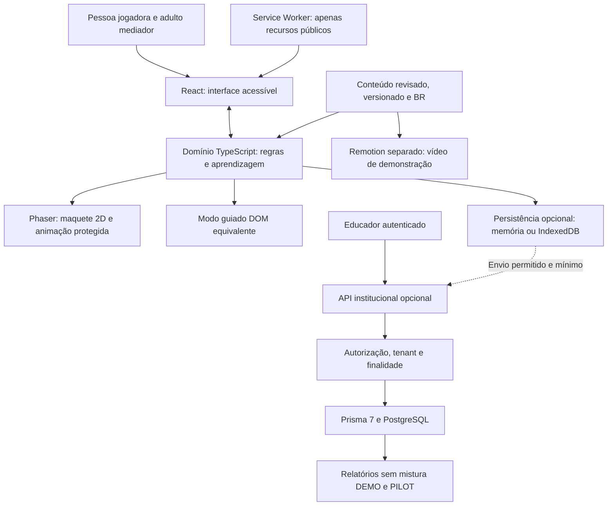
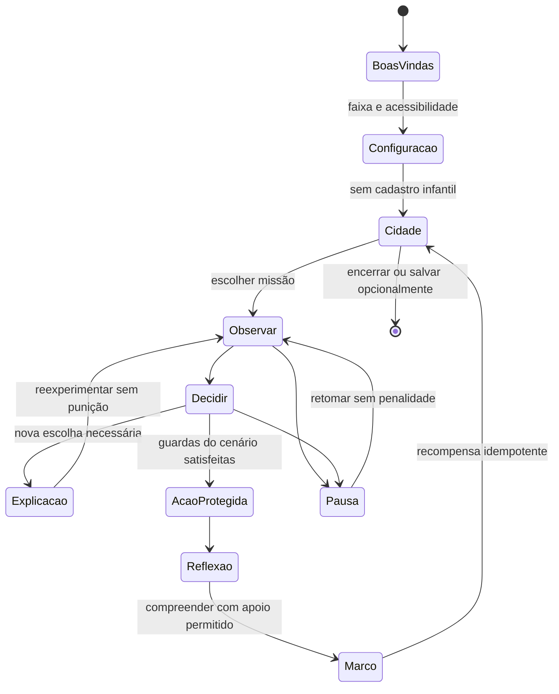
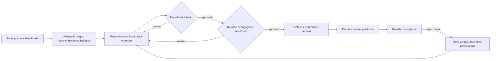
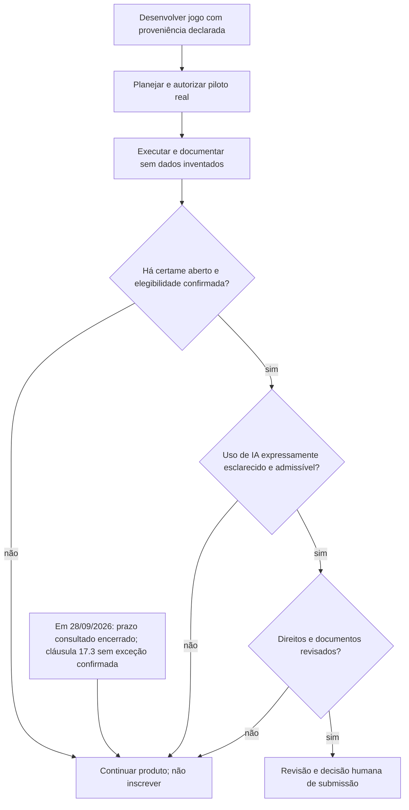
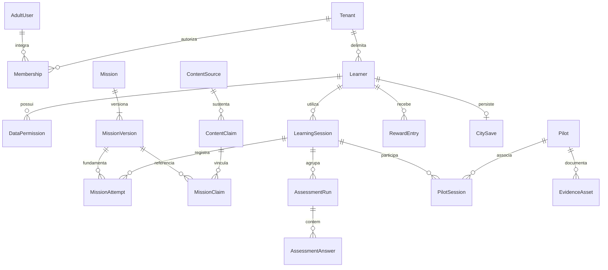
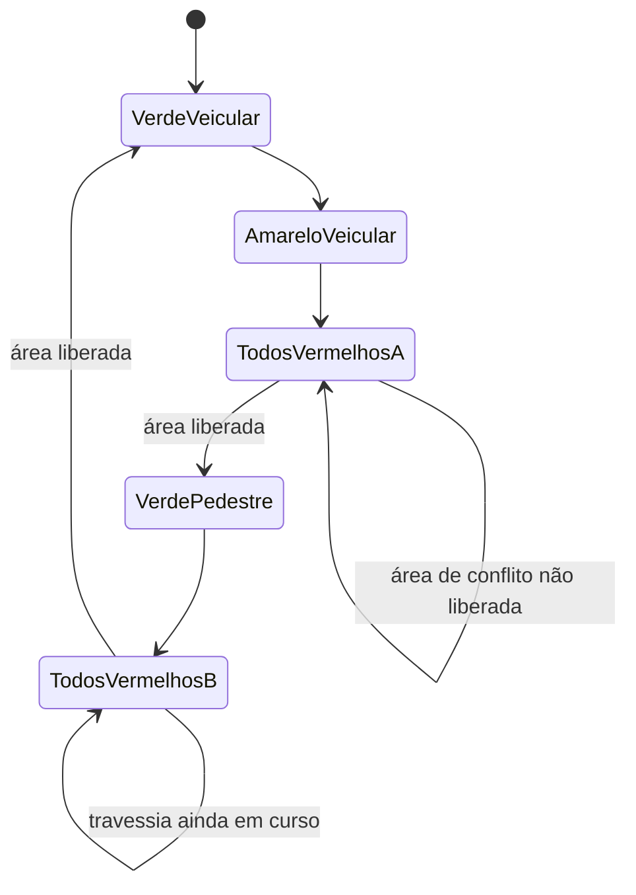

# Kit SmartCity Kids — referência histórica

**Projeção pública produzida em 14/11/2026. Corte da fonte: 28/09/2026, declarado no original.**

> Referência histórica de outro projeto. Os prompts, comandos e instruções internos pertencem ao SmartCity e não se aplicam ao PROJETO IPÊ. Afirmações, regras de concurso, elegibilidade, dependências e resultados não se transferem ao Ipê. Blocos de código são texto documental, não ações autorizadas.

Origem no acervo fornecido: `Estudos/SUPER_PROMPT_SMARTCITY_KIDS_ONE_SHOT.md`. O corpo preserva o texto original, exceto as transformações públicas declaradas no [índice de procedência](README.md). Não houve execução dos prompts, instalação das dependências ou revalidação das afirmações históricas para esta publicação.

Os arquivos externos citados pelo texto — ZIP, imagens, documentos legais, resultados de testes e projetos de referência — não foram fornecidos como arquivos separados nesta pasta de três Markdown e não foram fabricados nem anexados. Trechos incorporados no Markdown permanecem como exemplos.

---

# SUPER PROMPT — SMARTCITY KIDS: MISSÃO DESACELERE
## Kit executivo ONE SHOT para Antigravity · PRD + Prisma + Mermaid + i18n + game design

**Versão:** 1.0 · **Data de referência:** 28/09/2026  
**Público:** 5–14 anos, com adaptações 5–7, 8–10 e 11–14  
**Propósito:** construir uma cidade educativa jogável sobre cuidado, convivência e trânsito brasileiro.  
**Estado desta entrega:** especificação e referências de implementação; não é aplicação final, estudo realizado, aprovação jurídica ou inscrição no prêmio.

> **Alerta decisivo:** o prazo de inscrição consultado foi encerrado em 17/08/2026. O item 17.3 do edital prevê eliminação de trabalho desenvolvido por IA e não contém a exceção descrita no dossiê. Este material foi preparado com assistência de IA, não oculta sua proveniência e não resolve a admissibilidade. Desenvolver o produto e um piloto real é diferente de poder inscrevê-los. Fontes e auditoria abaixo.

## Como usar este arquivo sozinho

Disponibilize este Markdown integralmente ao agente no Antigravity. Execute o contrato da **seção 2**, usando todas as outras seções e anexos como especificação. O ZIP complementar contém os mesmos documentos divididos e arquivos de referência que podem ser copiados e testados. Não é necessário colar milhares de linhas manualmente quando o agente consegue ler o arquivo no workspace.

Instrução de partida:

```text
Leia este arquivo integralmente. Execute o SUPER PROMPT da seção 2. Construa o projeto em ./app/, preservando este kit. Implemente uma primeira missão jogável e validada, depois complete as 12 missões P0 com suas três adaptações, a cidade interativa, o modo guiado, a persistência opcional e o offline preparado. Produza código e testes, não apenas planejamento. Recursos sem integração real devem ficar desabilitados. Não publique, não inscreva no prêmio, não fabrique dados e não altere a proveniência de IA. Registre decisões, evidências de teste e bloqueios concretos.
```

## Mapa do conteúdo

| Parte | Conteúdo |
|---|---|
| 1 | Auditoria do edital, correções do dossiê e condições de elegibilidade |
| 2 | Prompt executivo para uma execução organizada em etapas internas |
| 3–4 | PRD, gamificação saudável, faixas pedagógicas, 12 mecânicas e 24 ideias de expansão |
| 5–6 | Arquitetura, API, segurança, i18n, offline, direção visual e Remotion |
| 7 | Repositórios globais, licenças, aproveitamento e exclusões |
| 8–9 | Testes, protocolo de piloto, documentação, execução e sustentabilidade |
| 10 | Fontes primárias, materiais do usuário e limites de verificação |
| Anexo A | Sete diagramas Mermaid completos |
| Anexo B | Schema Prisma com 23 modelos, configuração, adapter e SQL adicional |
| Anexo C | Catálogo completo de missões, claims e backlog em JSON |
| Anexo D | Catálogos de interface pt-BR, inglês e espanhol |
| Anexo E | Núcleo TypeScript, testes e comandos de referência |
| Anexo F | Composição Remotion ilustrativa |
| Anexo G | Relatório da validação realmente executada |

**Critério de qualidade:** uma experiência de jogo contextual, não um quiz decorado; aprendizado e acessibilidade, não tempo de tela; evidência verdadeira, não aparência de candidatura pronta.

---

# 1. Auditoria do edital e do dossiê de origem

**Data de referência: 28/09/2026.** Este kit é material de desenvolvimento assistido por IA, não um trabalho elegível já validado pela SENATRAN. O jogo pode ser desenvolvido e testado; sua eventual inscrição tem outra análise e não deve ser automatizada. Fontes [E01–E04, D01] estão no registro de fontes.

## 1.1. Quatro decisões antes de escrever código

**Prazo:** o edital original previa 27/07/2026. A Retificação nº 4 estendeu para **17/08/2026, às 17h**. A Retificação nº 8, publicada em 04/09/2026 e disponibilizada na página oficial, manteve esse encerramento e alterou o julgamento para 18/08–30/09. Não foi localizada reabertura posterior nas fontes consultadas. Em 28/09/2026, não tratar o certame como aberto nem sugerir retroagir datas. Desenvolver um piloto real e acompanhar oportunidades futuras sem supor que outro edital repetirá as regras. [E01–E04]

**Inteligência artificial:** o item 17.3 prevê eliminação de trabalho desenvolvido por IA; não apresenta a exceção por revisão humana ou declaração de uso sugerida no dossiê. Registrar a assistência de IA não equivale a obter autorização para concorrer. A extensão da restrição a código, ilustrações, ferramentas e documentação deve ser esclarecida formalmente pela SENATRAN. Até resposta aplicável e análise institucional, `awardSubmissionEnabled=false`. Não ocultar o processo criativo ou reescrever a proveniência. [E01, p.18, itens 17.2–17.3]

**Evidências:** os relatos de 120 estudantes, execução em 2025, percentuais de melhoria, significância estatística, fotos e vídeo não vieram acompanhados de comprovação. Não são dados utilizáveis como resultados reais. Removê-los da documentação executiva e de qualquer seed. Todos os exemplos devem ser DEMO e os resultados de campo permanecem “não coletados” até execução verificável. [D01, seções 6.7–6.10]

**Categoria:** a aderência conceitual é ao **Grupo 4, Categoria 6 — Projetos, campanhas e/ou ações de Educação para Trânsito**. A inscrição é institucional, pelas entidades admitidas e seu representante habilitado. A modalidade acadêmica individual acompanhada de orientador pertence à Categoria 5, não é uma alternativa automática para a Categoria 6. O edital não prevê prêmio monetário para a Categoria 6. [E01, itens 5.3.1, 5.4.1, 12–13]

## 1.2. Matriz de correções rastreável

| Afirmação no dossiê | Leitura sustentada / problema | Decisão do produto |
|---|---|---|
| IA permitida com rigor e autoria humana declarada | Essa ressalva não consta do item 17.3 | Bloquear inscrição; solicitar esclarecimento, preservar autoria real |
| Oficinas com 120 crianças e ganhos já observados | Sem evidência correspondente nos anexos | Não importar resultados; relatórios vazios ou DEMO identificado |
| Calendário de desenvolvimento já executado em 2025 | Não comprovado | Cronograma prospectivo relativo ao início real |
| Inscrição no primeiro dia ainda disponível | Prazo alterado e já encerrado nas fontes oficiais consultadas | Separar produto de inscrição e verificar novo ato antes de qualquer candidatura |
| Kolb, software aberto, 60 FPS e simulador complexo como requisitos para nota máxima | São estratégias propostas pelo dossiê, não condições expressas da tabela do edital | Investir em didática, replicabilidade e evidência; complexidade apenas quando útil |
| Dez seções obrigatórias | O edital lista onze rótulos, contando materiais complementares e bibliografia separadamente | Preservar todos os onze e o limite de dez páginas |
| LocalStorage é memória temporária e garante anonimato | Persiste no dispositivo; código e perfil podem permitir associação a uma pessoa | Modo efêmero por padrão em turma; explicar salvamento e exclusão; tratar pseudonimização com cautela |
| Capacete de bicicleta é sempre obrigação nacional do CTB | Não assumir essa universalidade a partir do CTB art.105, VI | Recomendar proteção adequada e diferenciar recomendação de obrigação regulamentar |
| Gesto com a mão assegura travessia / é regra nacional universal | Não substitui observar sinalização e condições; a generalização não foi demonstrada | Não ensinar “gesto mágico”, nem responsabilizar a criança pela conduta do motorista |
| Toda frente de escola tem limite legal nacional de 30 km/h | O art.61 não sustenta essa generalização | Usar “nesta via fictícia sinalizada a 30”; explicar competência e sinalização locais |
| Tempo de reação universal de 0,75 s | Premissa não fundamentada como constante humana universal | Modelo exploratório com hipóteses explícitas, sem prometer distâncias reais |
| Percentuais de sobrevivência e risco individuais | Referências insuficientes para aqueles números e desnecessários para o público | Excluir; ensinar cuidado sem imagens de lesão, medo ou probabilidades de dano |
| Qualquer repository público pode ser adaptado e cedido | Público não equivale a licenciado; componentes têm titulares próprios | Auditoria por arquivo, LICENSE/NOTICE e registro de proveniência |
| Vídeo de 2m45 e 1080p são exigência | Formato sugerido no dossiê, não duração/resolução obrigatória no trecho pertinente | Separar storyboard opcional de requisitos oficiais |
| Certidões da Categoria 4 são automaticamente exigidas na 6 | Não importar obrigações entre categorias | Checklist próprio do item 5.4.1; confirmar formulário atual |

As correções sobre legislação de trânsito são uma revisão externa do dossiê, não uma alteração do texto do edital. Publicar o currículo apenas após validação técnica e pedagógica humana dos trechos e versões aplicáveis. [L01]

## 1.3. Como o projeto pode responder aos critérios — sem prometer nota

| Critério da Categoria 6 | Pontos | Evidência planejada que ajuda a avaliá-lo |
|---|---:|---|
| Metodologia e didática | 2 | Objetivos observáveis, três faixas pedagógicas, explicação das escolhas, instrumentos pré/pós e guia de mediação |
| Sustentabilidade e continuidade | 2 | Modo local, conteúdo versionado, treinamento de professores, orçamento e responsável pela manutenção |
| Relevância e adequação do tema | 2 | Velocidade reduzida e proteção da vida como parte das decisões e da transformação da cidade |
| Aderência ao PNATRANS | 2 | Matriz principalmente com Pilar 4; intervenções simuladas relacionadas ao Pilar 2, sem alegar obra pública executada |
| Originalidade | 1 | Combinação autoral de missões, progressão cooperativa, acessibilidade e evidências; referências atribuídas |
| Complexidade | 1 | Complexidade pedagógica e técnica justificada; arquitetura mínima que funciona, não excesso de dependências |

A tabela de pontuação consta da página 15, item 10.4.1. As evidências sugeridas na terceira coluna são decisões deste kit, não obrigações textuais adicionais. [E01]

## 1.4. Documentação para uma análise de elegibilidade futura

Conferir categoria e entidade; representação legal; comprovação da condição jurídica; Anexo II; requisitos escolares quando aplicáveis; regras atuais de cessão e de originalidade; resultados realmente obtidos; permissões de uso das mídias; português brasileiro; PDF com até dez páginas; terceira pessoa; arquivos complementares nos formatos aceitos. O texto fornecido cita registro escolar junto ao MEC: não substituir silenciosamente por outro comprovante, solicitar confirmação à organização quando houver dúvida. [E01, pp.9–11]

O limite de 200 inscrições por categoria e o desempate cronológico existem, mas não legitimam uma inscrição incompleta ou fora do prazo. Direitos de terceiros não passam a ser da equipe porque uma biblioteca é aberta. O Anexo II e o item 17.5 merecem análise jurídica antes de ceder projeto ou materiais. Não usar o Selo Prêmio Senatran como se a iniciativa já tivesse sido premiada. [E01, itens 8.9, 10.6, 12, 17.5 e Anexo II]

### Minuta de consulta — NÃO ENVIADA

Destinatário indicado no item 17.10: `premio.senatran@transportes.gov.br`.

> Solicita-se esclarecimento sobre o alcance do item 17.3 do Edital nº 24/2026 quanto a ferramentas de IA utilizadas na programação de uma plataforma educativa, na preparação de protótipos, na criação de recursos visuais e na redação do projeto base. Há distinção entre essas atividades para fins de admissibilidade? Existe ato posterior que altere o prazo de inscrição ou essas condições? Como devem ser declarados componentes de código aberto e seus direitos de terceiros diante do Anexo II? A instituição pretende preservar a proveniência integral e não presume autorização pelo simples fato de haver revisão humana.

Uma resposta futura deve ser arquivada com data, origem e alcance. A equipe não pode transformar ausência de resposta em consentimento.


---

# 2. SUPER PROMPT — contrato de execução ONE SHOT

**Cole esta seção no agente e disponibilize o restante deste kit no workspace. O arquivo mestre também pode ser usado sozinho: ele inclui as especificações e os artefatos de referência.**

--- INÍCIO DO PROMPT ---

Você é o responsável técnico por transformar este contrato em um jogo educativo executável, não em uma landing page nem em uma demonstração de telas estáticas. Trabalhe como uma equipe coordenada de engenharia de jogos, pedagogia, UX infantil, acessibilidade, backend, segurança, QA e motion design. Esses são papéis de trabalho, não alegações de que especialistas humanos já aprovaram o produto.

Construa **SmartCity Kids — Missão Desacelere: a cidade do cuidado**, para crianças e adolescentes de 5 a 14 anos. O tema é “Desacelere. Seu bem maior é a vida”. A pessoa jogadora aprende a cuidar da mobilidade, toma decisões como pedestre, passageira ou planejadora de uma cidade fictícia e vê o bairro tornar-se mais seguro, acolhedor e acessível. Não criar corrida, direção por crianças, simulação de atropelamento, violência ou pontuação por velocidade.

O operador pretende usar Gemini 3.8 Flash no Antigravity com a configuração HIGH oferecida no ambiente. Não alterar modelo, plano, faturamento, permissões ou ferramentas sem autorização. Não inventar flags, limites de contexto ou recursos do produto. Descobrir capacidades realmente presentes. O contrato deve funcionar também com outro agente que consiga ler arquivos, editar código e executar testes.

## Resultado obrigatório

Entregue uma aplicação React + TypeScript + Vite com Phaser para o mundo 2D, e interface DOM equivalente para as decisões pedagógicas. O núcleo visitante deve funcionar sem conta, servidor, chave de API, LLM em produção ou banco. Após carregar e preparar os recursos, deve funcionar sem rede. O Prisma/PostgreSQL atende apenas o modo institucional opcional. Remotion é ferramenta separada de produção de vídeo, nunca dependência do ciclo do jogo.

Implementar as 12 missões P0 do catálogo com três adaptações pedagógicas, progressão real, cidade com seis intervenções educativas, coleção de conquistas sem competição pública e exportação local. Não aceitar como pronto um conjunto de cartões com um botão que soma pontos. Cada missão precisa de situação, ação significativa, regra, feedback, oportunidade de reexperimentar e evidência de conclusão. A cidade tem estado persistível e alterações visualmente verificáveis.

## Invariantes não negociáveis

1. Preservar a auditoria do edital. Prazo encerrado nas fontes verificadas; restrição a IA não resolvida. Não inscrever, enviar e-mail, gerar declaração falsa de autoria, usar selo do prêmio, retroagir execução ou fabricar dados. Entregar produto e materiais internos separadamente de candidatura. Não converter DEMO em PILOT.
2. Desenvolver em pasta e branch novas ou explicitamente autorizadas. Inspecionar o workspace e `git status` antes de editar. Preservar trabalho existente. Não usar `reset --hard`, não apagar arquivos externos, não publicar, não usar serviços pagos ou credenciais encontradas no ambiente. Mudanças remotas exigem autorização.
3. Resolver dependências com documentação e registro oficiais; fixar versões compatíveis e lockfile. O projeto de referência está desenhado para Prisma 7: não misturar sua configuração com exemplos de Prisma 6 ou migrar major silenciosamente. Sem acesso à rede, registrar o bloqueio e implementar o que for possível sem afirmar instalação bem-sucedida.
4. Não carregar rastreadores, anúncios, pixels, session replay, mapas de casas/escolas reais, chat, perfis públicos, geolocalização, câmera ou microfone. Não cadastrar e-mail, nome completo, foto, data de nascimento ou telefone de criança. Remover a rotina `log.js` de telemetria de build do template Phaser caso esse template seja adotado.
5. Faixa pedagógica não é prova de idade nem autorização de tratamento. “Área de adultos” com desafio aritmético não é autenticação ou consentimento verificável. Modo institucional indisponível até autenticação, isolamento, finalidade, documentação e teste de autorização reais.
6. Não usar contagem regressiva de pressão, vidas limitadas, streak que expira, sorteio de recompensas, ranking infantil, dinheiro real, compras, publicidade ou recompensa por ficar mais tempo online. Ajuda, pausas e recursos de acessibilidade não reduzem recompensas.
7. Conteúdo de trânsito precisa de fonte e natureza explícitas: regra legal, recomendação de segurança ou simplificação do cenário. Tradução não muda a jurisdição brasileira. Não inventar regra do CTB, correspondência da BNCC, certificação ou homologação.
8. Nunca representar lesões ou colisões com pessoas. A simulação congela antes de uma situação perigosa, explica e oferece nova escolha. Nenhuma missão manda a criança praticar em via pública, testar distância de carros, abordar motoristas ou fiscalizar pessoas.
9. Bibliotecas de terceiros não são produção autoral integral. Respeitar LICENSE/NOTICE; não incorporar repositório sem licença clara, copiar jogos comerciais ou imitar personagens protegidos. Usar arte original simples e funcional quando não houver asset aprovado.
10. Não declarar “100% pronto”, “LGPD garantida”, “certificado WCAG” ou “vencedor”. Relatar exatamente o que foi implementado, executado, validado e o que depende de pessoas, credenciais ou ambiente externo.

## Método autônomo: uma solicitação, etapas internas verificáveis

**Etapa A — reconhecimento e contrato.** Leia auditoria, PRD, catálogo, schema e fontes. Crie `docs/DECISOES.md`, `docs/IMPLEMENTACAO_STATUS.md` e uma lista de tarefas P0/P1/P2. Registre versões, estado inicial, riscos e plano de testes. Adote padrões seguros sem bombardear o operador com dúvidas resolvíveis por inspeção; só interrompa por consentimento, segredos, custo, perda de dados ou decisão externa indispensável.

**Etapa B — fatia vertical primeiro.** Implemente M01 com mapa, avatar original, movimento/seleção, situação de travessia protegida, feedback DOM, pausar, áudio opcional, pontuação determinística e salvar/apagar local. Faça teste de ponta a ponta dessa fatia antes de replicá-la. Deve ser jogável com mouse, toque, teclado e modo guiado sem arrastar.

**Etapa C — motor de missões e cidade.** Extraia regras para `packages/domain`. Conecte o catálogo validado, as três faixas e as 12 missões. Renderizador não decide a correção das respostas. Implementar as intervenções e as moedas sem farm; qualquer progresso visível corresponde ao estado real. Testar repetição, pausa, reload, redução de movimento e ausência de armazenamento.

**Etapa D — conteúdo e inclusão.** Todo texto visível passa pelo catálogo de idiomas, sem strings soltas em sprites. Português completo. Inglês e espanhol completos para a interface; narrativas traduzidas incompletas ficam explicitamente desativadas por pacote. Não exibir um seletor que sugira suporte integral inexistente. Voz pré-gravada opcional e local; nunca bloquear o jogo sem som. O modo 5–7 deve ser mediado e não exigir leitura autônoma.

**Etapa E — offline e relatórios.** Precache somente recursos públicos estáticos. Atualizações apenas no menu, nunca no meio da missão. Demonstrar jogo e exportação após desligar a rede, tendo preparado o cache antes. Exportar CSV/JSON agregado com metadados, qualidade dos dados e identificação DEMO. Sem piloto real, exibir “Ainda não há resultados de campo”.

**Etapa F — institucional preparado, não fingido.** Materialize o schema Prisma, configurações e contratos. Rode `prisma format`, `prisma validate`, gere client e migrations em banco de teste quando disponível. Só habilite o portal com autenticação real e testes entre instituições A/B. Sem banco ou provedor de identidade, deixe o módulo desabilitado, mantenha visitante plenamente funcional e descreva o bloqueio. Não substituir autenticação por um botão de login fictício.

**Etapa G — acabamento visual.** Aplicar design system, estados vazios/erro/carregamento, transições curtas, feedback de escolha, câmera suave opcional, ilustrações consistentes e tipografia legível. O mapa jogável ocupa a maior área da tela. Nada de decorar um dashboard e chamar isso de game.

**Etapa H — vídeo e documentação.** Preparar composição Remotion independente, com arte própria e marca “DEMONSTRAÇÃO — SEM RESULTADOS DE CAMPO”. Renderizar somente se dependências e licença aplicável estiverem resolvidas. Não inventar sala de aula, depoimento, rosto, autorização ou estatística. Produzir guia do professor, protocolo de piloto, inventário de fontes e bibliotecas, checklist de publicação e minuta de projeto base não submetível automaticamente.

**Etapa I — auditoria final.** Rodar lint, typecheck, unitários, validação de conteúdo, testes de navegador, acessibilidade automatizada e inspeção manual. Anexar comandos, saídas, screenshots reais e limitações. Corrigir as falhas reproduzíveis antes de finalizar. Proibir testes desativados para obter verde.

## Organização e continuidade

Se houver subagentes, distribua tarefas sem concorrência no mesmo arquivo: domínio/testes; experiência visual; conteúdo/i18n; modo institucional/segurança; vídeo/documentação. Um integrador é responsável por compilar e executar tudo junto. Sem subagentes, execute esses papéis em sequência; não alegue paralelismo que não ocorreu.

Ao aproximar-se de um limite de contexto ou execução, escreva checkpoint com último comando, arquivos alterados, testes, bloqueios e próxima ação concreta. Não invente conclusão para terminar a resposta. `ONE SHOT` significa uma instrução de trabalho organizada, não a garantia de que infraestrutura, avaliação humana e validação em escola surgirão automaticamente.

## Critério de encerramento da primeira entrega

Visitante jogável com 12 missões, três faixas, cidade interativa, modo guiado equivalente, pt-BR, persistência opcional, offline preparado, testes e documentação; nenhum dado real coletado; todos os módulos não concluídos explicitamente desabilitados. Entregar também lista exata dos comandos locais, variáveis necessárias, estrutura de arquivos e evidências de teste. Não publicar nem inscrever.

Aplique as seções seguintes como especificação detalhada e os arquivos de referência como base de implementação. Revise-os criticamente, valide-os no seu ambiente e preserve a separação entre requisito, hipótese e resultado observado.

--- FIM DO PROMPT ---


---

# 3. PRD — SmartCity Kids: Missão Desacelere

## 3.1. Tese de produto

**Promessa:** aprender a cuidar de quem circula pela cidade e perceber como escolhas coletivas tornam o trânsito mais seguro. A cidade é o espaço de experimentação, não um simulador de habilitação. A diferença não é ter mais perguntas de placas: é conectar **decisão → explicação → transformação do bairro → nova situação de aprendizagem**.

O nome do dossiê é preservado; “a cidade do cuidado” é subtítulo criativo provisório, não marca registrada. A visão e a arquitetura abaixo são propostas novas, não constatação de produto já implementado. O público foi ampliado de 7–12 no dossiê para **5–14**, como solicitado.

**Objetivo de produto:** viabilizar uma experiência educativa curta, inclusiva e repetível em escola ou família, com um núcleo local de baixo atrito e uma forma honesta de avaliar aprendizagem. A meta não é tempo de tela, dependência ou velocidade de conclusão.

**Hipóteses a testar:** as crianças compreenderão melhor por que veículos precisam de espaço para parar; o feedback explicativo ajudará a transferir a regra a cenas diferentes; professores conseguirão mediar sem treinamento técnico; o modo guiado preservará os objetivos sem exigir destreza em jogos. Nenhuma hipótese é apresentada como comprovada.

## 3.2. Públicos, autonomia e modos

| Faixa pedagógica | Forma de interação | Profundidade | Mediação |
|---|---|---|---|
| 5–7 — Exploradores do Cuidado | Ícones, uma decisão por vez, seleção direta, leitura/narração pelo adulto | Reconhecer local de espera, perceber sinalização, pedir ajuda e cuidar do passageiro | Adulto presente; sem pressupor leitura, cálculo ou circulação autônoma |
| 8–10 — Guardiões do Bairro | Pequenas sequências e escolhas explicadas; mapa com objetivos claros | Comparar rotas fictícias, distinguir prioridade de garantia, observar visibilidade | Educador acompanha e contextualiza |
| 11–14 — Projetistas da Mobilidade | Cenários com alternativas e efeitos; tabelas simples e editor com restrições | Responsabilidade compartilhada, acessibilidade, moderação de velocidade e leitura crítica de modelos | Discussão orientada; sem conteúdo de habilitação ou fiscalização real |

A seleção informa apenas adaptação didática. Não calcular idade exata nem coletar data de nascimento. Não inferir capacidade cognitiva, deficiência, condição médica ou autonomia no trânsito. Uma pessoa pode escolher um modo mais guiado sem rótulo depreciativo.

**Visitante familiar:** sem cadastro; progresso opcional no dispositivo; aviso de dispositivo compartilhado; apagar tudo em uma ação confirmada. **Oficina escolar:** sessão efêmera por padrão; o adulto decide exportar um resumo. **Institucional conectado:** etapa posterior, controles reais de acesso, minimização e governança; nunca obrigatório para aprender.

## 3.3. Jornada e telas

A entrada é um convite para conhecer a cidade, com “Jogar”, “Jogar com orientação”, “Acessibilidade” e “Área de educadores”. Sem formulário infantil. O adulto ou usuário escolhe faixa pedagógica, idioma disponível e salvamento local. O tutorial mostra três ações: observar, escolher e explicar com ajuda quando necessário.

A praça central é o hub. Os lugares — escola, praça, ponto de ônibus, biblioteca, ciclovia fictícia e cruzamento — são claramente diferentes e conduzem a desafios. Uma missão apresenta uma situação, oferece ações, explica a relação com o cuidado e transforma algo observável no bairro. Concluída uma atividade, a pessoa pode fazer uma pausa, revisitar ou escolher a seguinte. Não há “volte amanhã para não perder”.

Telas P0: abertura; seleção pedagógica; configuração acessível; cidade/hub; missão; explicação e nova tentativa; laboratório de parada; editor orientado; coleção; resumo de oficina; guia do adulto; créditos/privacidade. Painel institucional não autenticado não deve aparecer como funcional.

## 3.4. Escopo e critérios de aceite

| ID | Prioridade | Requisito | Aceite verificável |
|---|---|---|---|
| F01 | P0 | Jogar sem conta | Primeira missão abre sem banco, token, login ou chave externa |
| F02 | P0 | 12 missões com significado | Todas têm ação contextual, regra, feedback e conclusão verificável; não apenas questionário |
| F03 | P0 | Três adaptações | Vocabulário, carga visual e número de etapas mudam; objetivos permanecem equivalentes |
| F04 | P0 | Cidade que responde | Seis intervenções educativas alteram rotas, espera, visibilidade ou representação de acesso na simulação |
| F05 | P0 | Sem farm | Concluir a mesma missão dez vezes não multiplica a recompensa de marco |
| F06 | P0 | Aprender com ajuda | Pausar, pedir explicação e usar modo guiado não reduz moedas nem bloqueia conteúdo |
| F07 | P0 | Alternativa DOM | Todas as decisões e recompensas essenciais existem sem operar o canvas |
| F08 | P0 | Offline preparado | Após pacote preparado, abrir, jogar, salvar e exportar sem rede; primeiro acesso offline explica o limite |
| F09 | P0 | Salvar/apagar | Reload restaura estado compatível; falha de storage usa sessão em memória e avisa; exclusão limpa bases/cache pessoal |
| F10 | P0 | Conteúdo rastreável | Cada missão referencia afirmações revisáveis; nenhum artigo inventado ou claim sem natureza |
| F11 | P0 | Relatório honesto | Nenhum participante real no seed; relatório de campo vazio informa ausência de dados, não zero aprendizagem |
| F12 | P0 | Idioma coerente | Todas as chaves pt-BR resolvem; suporte anunciado corresponde ao conteúdo disponível |
| F13 | P1 | Educador autenticado | Sessão real, roles, proteção CSRF quando aplicável, testes de negação entre tenants |
| F14 | P1 | Sincronização limitada | Reenvio idempotente; permissão revogada impede ingestão; pontuação calculada no serviço |
| F15 | P1 | Piloto documentado | Instrumentos e consentimentos aplicáveis validados por pessoas; sem preenchimento automático de resultados |
| F16 | P1 | Remotion | Composição independente e render de demonstração, sem resultados inventados; licença verificada |
| F17 | P2 | Blockly protegido | DSL limitada, interpretador sem eval, semáforo intertravado; sem execução arbitrária |
| F18 | P2 | Catálogo ampliado | 24 missões adicionais só depois da qualidade das 12 iniciais |

**Fora do primeiro ciclo:** 3D/WebXR, mapa geográfico real, direção de veículos pela criança, multiplayer aberto, LLM tutor em tempo real, login social infantil, monetização dentro do jogo, conteúdo gerado por alunos, integração com fiscalização, CityFlow/SUMO em produção, hardware de trânsito e publicação automática em lojas.

## 3.5. Métricas e critérios de valor

Medir conclusão acompanhada de compreensão, clareza do feedback, necessidade de ajuda por desenho da interface, facilidade do educador, funcionamento sem rede e acessibilidade. Não usar ranking, retorno diário ou horas jogadas como meta de sucesso.

Para um piloto autorizado, comparar pré/pós pareados por competência e faixa, informar tamanho da amostra válida, faltantes, instrumento, condições de ajuda e intervalo real entre avaliações. A diferença em pontos percentuais é uma descrição, não prova de causalidade. Não atribuir ao jogo redução de sinistros reais com base em acertos ou colisões simuladas. A telemetria não mede comportamento da criança na rua.

**Metas internas de produto, ainda não medidas:** abrir o modo visitante em até 10 s em dispositivo de referência e rede documentados; não ter erro de console em fluxo P0; permitir todos os objetivos sem arrastar ou usar som; professor iniciar oficina com guia de uma página. A equipe mede e ajusta em vez de declarar cumprimento por intenção.

## 3.6. Gamificação saudável e economia

O ciclo é **curiosidade → escolha → explicação → reexperimentação → contribuição para o bairro**. O primeiro contato com um conceito não exige acertar para continuar. Conteúdo de cuidado e recursos de acessibilidade nunca ficam atrás de moedas. Recompensas não dependem de tempo, rapidez, habilidade motora ou uso de ajuda.

Cada missão P0 concluída com sua etapa explicativa concede **20 Moedas do Cuidado, uma única vez por marco**, além de um selo descritivo: “Observou com atenção”, “Pensou no passageiro”, “Planejou uma rota acessível”. São fichas locais sem valor monetário, sem transferência e sem compra. Saldo inicial: 40. Doze missões: 240. Total disponível: 280.

Seis personalizações opcionais custam 30, 40, 50, 40, 50 e 70, totalizando 280. Exemplos: bandeirolas na praça, painel comunitário fora da sinalização oficial, plantas de cenário e pinturas em mobiliário que não alterem legibilidade de placas. As obras educativas e rotas acessíveis são desbloqueadas pela exploração do conceito, **gratuitamente**; não se cobra para tornar a cidade segura nem para usar adaptações.

A cidade coletiva de uma turma, em P1, combina contribuições sem identificar quem “foi melhor”. Não exibir desempenho individual para colegas. Certificados de participação são locais, opcionais e não afirmam habilitação ou certificação oficial; evitar nomes de crianças em links públicos.

## 3.7. Intervenções educativas na cidade

1. **Rota escolar legível:** sinalização regulamentar do cenário, local de espera e percurso contínuo. Efeito: veículo NPC reduz velocidade conforme regra fictícia validada.
2. **Travessia com maior visibilidade:** remover obstáculo cenográfico da linha de visão; não atribuir segurança garantida à pintura.
3. **Travessia acessível:** continuidade de calçada, espaço desobstruído e recursos representados corretamente após revisão. Toda pessoa do jogo já tem alternativas acessíveis.
4. **Ponto de ônibus organizado:** espera afastada da área de circulação, embarque apenas com veículo parado, prioridade acolhedora.
5. **Sinalização semafórica intertravada:** fases não conflitantes e tempo de travessia fictício escolhido por teste de cenário, não por norma inventada.
6. **Zona de velocidade moderada:** comparar ocupação, visibilidade e distância de parada de NPCs. Não afirmar que implantar uma placa sozinho garante cumprimento.

As intervenções são escolhas em um tabuleiro fictício, não instruções de projeto de engenharia ou instalação em rua real.


---

# 4. Currículo, catálogo e avaliação formativa

As missões abaixo são **conteúdo editorial proposto, ainda não homologado**. Os arquivos JSON permanecem `NEEDS_REVIEW`, `DEMO` e `publicationAllowed=false`. A implementação deve funcionar em demonstração local sem confundir isso com aprovação para uso com crianças. [L01, E01, P01]

## 4.1. Missões P0

| ID | Missão | Competência | Ação contextual | Fonte / natureza |
|---|---|---|---|---|
| M01 | O lugar de esperar | LOCAL_DE_ESPERA | Escolher o lugar protegido antes de decidir a travessia. | CTB-PEDESTRE, CTB-CUIDADO |
| M02 | Cada sinal tem sua vez | FASE_PROTEGIDA | Distinguir os sinais destinados a pedestres e veículos. | CTB-PEDESTRE, CTB-CUIDADO |
| M03 | Ver e ser percebido | VISIBILIDADE | Reconhecer que um obstáculo pode impedir a visão. | PED-ATENCAO, CTB-CUIDADO |
| M04 | Todo passageiro importa | TRANSPORTE_CUIDADOSO | Reconhecer que a preparação da viagem é responsabilidade dos adultos. | CTB-PASSAGEIRO, CTB-CUIDADO |
| M05 | O ponto de encontro | EMBARQUE_PROTEGIDO | Planejar espera e embarque em uma situação mediada. | PED-ATENCAO, CTB-CUIDADO |
| M06 | Bicicleta também caminha | BICICLETA_PEDESTRE | Entender a mudança de papel ao desmontar e empurrar a bicicleta. | CTB-BICICLETA, CTB-CUIDADO |
| M07 | Preparar é cuidar | EQUIPAMENTOS | Separar recomendação de proteção de obrigação legal verificada. | CTB-BICICLETA, CTB-CUIDADO |
| M08 | O espaço para parar | DISTANCIA_PARADA | Perceber que parar exige espaço e depende de parâmetros. | SIM-PARADA, CTB-CUIDADO |
| M09 | A regra desta via | LIMITE_SINALIZADO | Ler o limite indicado no contexto sem generalização nacional. | CTB-LIMITE, CTB-CUIDADO |
| M10 | A cidade cabe em todos | ROTA_CONTINUA | Planejar continuidade e espaço de circulação para pessoas diversas. | PED-ACESSO, CTB-CUIDADO |
| M11 | O tempo de cada pessoa | FASES_SEM_CONFLITO | Compreender que o controle do cenário precisa proteger a travessia. | PED-SEMAFORO, CTB-CUIDADO |
| M12 | Nossa rota do cuidado | SISTEMA_SEGURO | Transferir os conceitos para uma nova composição de bairro. | CTB-CUIDADO, CTB-CUIDADO |

As doze definições completas incluem situação, três escolhas, feedback de acerto e reexperimentação, três adaptações pedagógicas, efeito na cidade, fonte e política de recompensa. Estão em `content/missions.mvp.json` e também nos anexos do arquivo mestre. São **12 missões com adaptações**, não 36 minijogos prontos.

## 4.2. Expansão P2 — 24 ideias, não funcionalidades implementadas

- **M13:** Calçada sem obstáculos.
- **M14:** Sinais com forma e texto.
- **M15:** Distrações no tabuleiro.
- **M16:** A volta da biblioteca.
- **M17:** Noite e visibilidade.
- **M18:** Chuva e planejamento.
- **M19:** Porta do veículo e cuidado.
- **M20:** Transporte escolar acolhedor.
- **M21:** Prioridades no transporte coletivo.
- **M22:** Bagagem organizada pelo adulto.
- **M23:** Diferentes rotas de bicicleta.
- **M24:** Entendendo a sinalização local.
- **M25:** A praça e o entorno.
- **M26:** Ambiente rural fictício.
- **M27:** Comunidade ribeirinha e acesso ao transporte.
- **M28:** Rua compartilhada: contexto importa.
- **M29:** Escolhendo melhorias com orçamento fictício.
- **M30:** Fluxo não é sinônimo de segurança.
- **M31:** Leitura crítica de um gráfico.
- **M32:** Como revisar uma afirmação de trânsito.
- **M33:** Blocos para fases protegidas.
- **M34:** O que o modelo não mostra.
- **M35:** Conselho mirim da cidade fictícia.
- **M36:** Revisitando conceitos após uma pausa.

## 4.3. Contrato editorial

Toda escolha recebe feedback que explica o cuidado, sem chamar a pessoa de imprudente, ruim ou culpada. Não se usa medo como reforço. “Tente de outro jeito” sempre mantém o personagem protegido. As intervenções visuais são coerentes com o objetivo, sem inventar norma brasileira.

Uma afirmação tem `claimKey`, fonte primária, localizador, jurisdição, natureza, versão, revisor e data de revisão. Mudança de regra exige nova versão e revisão das missões dependentes. Regras brasileiras não são importadas de questionários russos, japoneses ou americanos. A correspondência com a BNCC fica em documento separado a validar por pedagogo; nenhum código de habilidade é inventado para dar aparência de conformidade.

## 4.4. Avaliação sem confundir jogo e pesquisa

O feedback de uma missão é formativo e pode orientar a resposta. Já a avaliação independente usa situação paralela, ordem balanceada, mesma competência e primeira resposta registrada antes do feedback, com opção de não responder. Apoio de leitura é registrado separadamente de uma dica que fornece a resposta. Não comparar a faixa 5–7 com 11–14 como se usassem o mesmo instrumento.

No piloto, selecionar seis itens dentre M01, M02, M04, M08, M10 e M12 para forma A; criar forma B com cenário diferente e dificuldade revisada. Contrabalancear A→B e B→A quando viável. Usar itens ilustrados e mediação padronizada na faixa inicial. A equivalência entre formas é hipótese que precisa de revisão/teste, não uma propriedade garantida por trocar palavras.

Exemplos de transferência: outra calçada com área protegida de espera; um cruzamento com sinal de pedestres em posição diferente; veículo estacionado preparado por adulto; dois rastros de parada com velocidade/atrito explicitados; percurso mais curto com barreira versus percurso contínuo; mapa novo que combina as competências. Nenhum item solicita ensaio na rua.

Não reduzir a avaliação a repetir literalmente as perguntas ensinadas. Não usar o erro, o tempo ou pedidos de ajuda para produzir rótulos sobre inteligência, saúde ou valor pessoal. O professor interpreta dados de uso com o contexto real da oficina.

## 4.5. Mecânicas: não transformar o catálogo em doze quizzes

Cada missão possui um tipo de interação próprio e flags de evidência. O botão de resposta final não pode completar uma missão sem suas ações de cenário. O modo guiado executa as mesmas decisões sem impor arrastar, coordenação motora ou percepção visual.

| Missão | Mecânica | Evidência de interação |
|---|---|---|
| M01 | SAFE_WAIT_POINT | Selecionar pontos de observação no mapa; só então confirmar a espera protegida. |
| M02 | SIGNAL_SEQUENCE | Ordenar cartões de fases; o cenário demonstra somente sequências intertravadas. |
| M03 | VISIBILITY_EDITOR | Ativar camada de visibilidade e reorganizar um obstáculo cenográfico pelo editor. |
| M04 | PASSENGER_CHECKLIST | Conferir etapas com adulto virtual em veículo estacionado; não dirigir. |
| M05 | BUS_STOP_LAYOUT | Organizar fila em zonas protegidas por seleção e posicionamento, sem pressa. |
| M06 | BIKE_ROLE_SWITCH | Alternar papel na representação e selecionar o percurso com bicicleta empurrada. |
| M07 | GEAR_SOURCE_SORT | Classificar cartões por natureza da orientação, sem simular circulação real. |
| M08 | STOPPING_COMPARISON | Executar dois cenários de NPCs, ver barras e rastros; velocidade nunca gera prêmio. |
| M09 | SIGN_CONTEXT_MATCH | Associar o limite à via correspondente; outra rua tem contexto diferente. |
| M10 | CONTINUOUS_ROUTE_BUILDER | Ligar pontos por percurso contínuo e explicar por que menor distância não basta. |
| M11 | INTERLOCK_PUZZLE | Montar a sequência do controlador fictício; fase inválida é bloqueada antes de animar. |
| M12 | CARE_ROUTE_CHALLENGE | Compor rota em mapa novo e aplicar uma melhoria, reunindo os conceitos anteriores. |

O agente deve criar adaptadores de interação para esses tipos, e não duplicar doze telas idênticas. Reutilizar componentes e domínio, mas manter ações significativas: observar camadas, ordenar fases, comparar parâmetros, construir uma rota, organizar uma espera ou conferir etapas. O schema de conteúdo precisa validar os parâmetros específicos de cada tipo.


---

# 5. Arquitetura, persistência, API e segurança

## 5.1. Decisão técnica principal

**Um motor de jogo, um domínio de regras, dois modos de apresentação.** Usar Phaser + React + Vite + TypeScript. Phaser desenha o bairro e anima agentes; React apresenta menus, escolhas, foco, feedback, configurações e relatórios. O modo guiado DOM usa as mesmas regras sem exigir canvas. Não empilhar Godot, Cocos, Pixi como motor adicional, CityFlow, SUMO e Blockly no mesmo MVP. [T01–T02]

A separação é intencional: a lógica pedagógica e a persistência não podem depender de um sprite, de uma tela específica ou de FPS. Remotion reutiliza dados e conceitos visuais em uma aplicação de vídeo isolada. O serviço institucional é um monólito modular pequeno, não uma constelação de microsserviços.

### Árvore de destino a construir pelo agente

```text
smartcity-kids/
  apps/
    web/src/{app,components,game/scenes,game/adapters,features,workers}/
    web/public/{assets,content,audio,icons}/
    api/src/{auth,tenancy,content,sessions,sync,rewards,reports,retention}/
    video/src/{compositions,components}/
  packages/
    domain/src/{missions,simulation,rewards,assessments,contracts}/
    content/{claims,missions,assessments,locales}/
    database/{prisma,generated,src}/
    ui/src/{tokens,controls,a11y}/
  tests/{unit,integration,e2e,content,fixtures}/
  docs/{decisions,pedagogy,privacy,licenses,pilot,evidence}/
  scripts/{verify-content,verify-locales,verify-licenses}/
```

Esta árvore é o destino do desenvolvimento. O ZIP entregue agora contém especificações e referências, não essa aplicação já construída.

## 5.2. Bibliotecas e limites de adoção

| Camada | Escolha | Responsabilidade / limite |
|---|---|---|
| Mundo 2D | `phaser` | Tilemap, câmera, sprites, animação; regras de aprendizagem fora das cenas |
| Interface | `react`, `react-dom`, `vite`, TypeScript | UI semântica e ciclo de vida; template oficial ajuda a integrar [T02] |
| Validação | `zod` | Contratos estritos de conteúdo, entradas e eventos; rejeitar campos desconhecidos [T11] |
| Estado | Estado React + stores pequenos do domínio | Não adicionar gerenciador global antes de haver necessidade; nunca gravar a cada frame |
| Idiomas | `i18next`, `react-i18next` | Chaves, namespaces, fallback explícito, pluralização [T05] |
| Dados locais | `dexie` sobre IndexedDB | Progresso e outbox opcionais, versionados; não anunciar criptografia automática [T10] |
| Offline | `vite-plugin-pwa` / Workbox | Shell e assets públicos; não cachear credenciais ou respostas privadas [T06] |
| UI motion | `motion` | Microinterações DOM e preferência de movimento reduzido; opcional [T07] |
| API opcional | `fastify` | Auth, tenancy e ingestão limitada; não necessário para visitante [T12] |
| Banco opcional | Prisma ORM 7 + `@prisma/adapter-pg` + `pg` | Só servidor; migrations, transações e tipos gerados [T04] |
| Testes | `vitest`, `@playwright/test` | Domínio e navegador real; acrescentar axe-core e revisão manual [T08–T09, T13] |
| Vídeo separado | `remotion`, `@remotion/cli` | Gerar MP4 no ambiente de produção de materiais, sob licença aplicável [T03] |
| Programação futura | `blockly` | Apenas editor de DSL limitada de fases; não gerar/evaluar JavaScript arbitrário [R11] |

O agente deve selecionar releases estáveis compatíveis, resolver a instalação, gerar lockfile e registrar as versões efetivas. Não usar `latest` em CI, não afirmar que a versão principal escolhida é a mais recente e não mudar major no meio do trabalho sem ADR. O schema deste kit é para Prisma 7; versões posteriores exigem migração explícita. Para a base Node, verificar as versões suportadas pelo conjunto escolhido; o núcleo de referência deste kit foi compilado no ambiente descrito no relatório de validação.

## 5.3. Motor de simulação e integração React/Phaser

Criar `GameHost` uma vez por montagem; destruir game, listeners, timers e áudio no cleanup. Testar React StrictMode sem duplicar canvas. Comunicação por eventos tipados, com unsubscribe e payloads pequenos; sem singleton de sessão compartilhando progresso entre crianças.

Simulação com passo fixo de 1/60 s e acumulador, limitando recuperação a cinco passos por frame. Ao perder foco, abrir pausa e não conceder recompensas por tempo transcorrido. `requestAnimationFrame` atualiza apresentação, não é unidade de tempo pedagógico. Semente reproduzível por cenário permite testar a mesma sequência; incluir versão do motor e tolerância numérica em replays.

NPCs seguem rotas determinísticas no tabuleiro. O primeiro ciclo não precisa portar IDM ou executar redes de tráfego reais. Verificações de segurança devem impedir animação de conflito: em decisão inadequada, congelar antes do movimento, mostrar a explicação e permitir reescolha. Uma falha de lógica nunca deve virar cena de choque com uma criança.

Usar pool de objetos, atlas pequeno, culling de tiles e câmera sem tremor. UI não deve receber uma atualização React a cada frame; atualizar apenas mudanças relevantes e, quando necessário, amostras limitadas. Ativar modo econômico com menos agentes/partículas e 30 FPS de apresentação, preservando regras.

### Orçamento inicial de performance — alvos, não resultados medidos

Shell/interface até 2 MB transferidos comprimidos; primeiro bairro até 8 MB de imagens/dados; áudio opcional em pacote separado; mapa inicial limitado a aproximadamente 32×32 tiles e 20 NPCs simultâneos. Medir em dispositivo e navegador identificados, rede controlada e modos WebGL/alternativa guiada. Aumentar esses limites exige medição, não promessa genérica de 60 FPS em qualquer computador de 2 GB.

Imagens redimensionadas, sem vídeo pesado no primeiro acesso. Não usar CDN externo obrigatório para fonte, sprite ou narração. `prefers-reduced-motion` desliga partículas e movimentos de câmera; as informações permanecem em texto e símbolos.

## 5.4. Modelo didático de parada

```text
v = velocidade_kmh / 3,6
reação = v × tempo_de_reação
frenagem = v² / (2 × atrito × gravidade)
parada = reação + frenagem
```

Hipóteses de demonstração: pista horizontal; desaceleração simplificada constante; sem modelar pneus, freios, inclinação, desgaste ou variabilidade humana. O painel pode usar `tempo_de_reação=1,5 s`, `gravidade=9,81 m/s²` e atrito ilustrativo 0,7 versus 0,4, sempre visíveis para a faixa avançada. São parâmetros de projeto, não recomendações normativas ou medição de uma pessoa. A função de referência rejeita valores inválidos. [P01]

A duplicação da velocidade quadruplica a parcela quadrática de frenagem e duplica a parcela de reação quando os demais parâmetros ficam fixos. **Não** afirmar que a distância total sempre triplica ou quadruplica. Nunca converter esses números em orientação para uma criança estimar se consegue atravessar uma via real. O laboratório tem veículos automáticos de brinquedo, pista vazia e nenhuma pessoa na área simulada.

## 5.5. i18n com jurisdição independente

`pt-BR` é a referência editorial. `en` e `es` têm catálogos de interface incluídos. O conteúdo das 12 missões está redigido em pt-BR; traduções completas do currículo são uma tarefa explícita, com revisão humana, antes de anunciar suporte integral. Russo e chinês podem ser adicionados futuramente, mas não mostrar bandeiras ou seletores de idiomas ainda inexistentes. Não confundir idioma com país ou lei aplicável. [T05]

```ts
await i18n.init({
  lng: storedInterfaceLocale ?? 'pt-BR',
  fallbackLng: 'pt-BR',
  supportedLngs: ['pt-BR', 'en', 'es'],
  ns: ['interface', 'missions', 'educator'],
  defaultNS: 'interface',
  interpolation: { escapeValue: true },
  resources: reviewedResources,
});
```

Não usar HTML vindo de tradução nem `dangerouslySetInnerHTML`. Para React, harmonizar a política de escaping sem desativar a proteção para HTML cru. Valores, moedas fictícias e percentuais usam `Intl.NumberFormat`; datas armazenadas em UTC e apresentadas conforme contexto. Separar `interfaceLocale`, `contentLocale` e `jurisdiction='BR'`. A frase oficial em documentos de candidatura permanece em português, sem substituir pelo equivalente traduzido.

Verificar chaves faltantes, chaves órfãs, pluralização e interpolação. Descrições de imagem, rótulos de controle e mensagens de erro também são conteúdo localizado. Narração não pode ser a única forma de perceber informação.

## 5.6. Offline e ciclo de dados

IndexedDB é persistência local, não memória efêmera. O usuário escolhe salvar; oficina compartilhada usa memória por padrão. Caso o armazenamento esteja indisponível ou a quota esgote, manter a sessão em memória e avisar sem interromper a aprendizagem. Criptografia com chave ao lado do dado no navegador não deve ser vendida como proteção robusta. [T10]

Cada save contém `schemaVersion`, `curriculumVersion`, `engineVersion`, revisão e checksum para detectar corrupção acidental; checksum não prova autenticidade. Validar tamanho, tipos e migrações. Não confiar em progresso importado para estatísticas oficiais. Política de versão: manter o pacote utilizado pela sessão até seu fim; ativar nova versão no menu; não apagar cache ativo de uma missão.

Cachear apenas shell, arte, áudio e conteúdo público revisado. Não guardar `/api`, relatórios individuais, tokens ou páginas administrativas no service worker. Instalação/PWA depende do navegador e de contexto seguro; primeiro acesso sem rede não pode carregar recursos que nunca foram baixados. [T06]

Sincronização P1 é opt-in institucional com finalidade documentada. Outbox guarda eventos mínimos, aplica backoff e limite de fila; nova permissão não é inferida por haver conexão. Retirar a permissão interrompe envio e inicia o fluxo de exclusão aplicável. Eventos antigos enviados depois de revogação são recusados, não reativam o perfil. Tokens de adulto não vão para LocalStorage; preferir sessão de servidor em cookie HttpOnly, Secure e SameSite com proteção CSRF/origem adequada.

## 5.7. API do módulo institucional

| Método e rota | Quem pode usar | Contrato / controle |
|---|---|---|
| `GET /health` | Público | Estado mínimo; sem versões sensíveis ou conexão exposta |
| `GET /v1/content/manifest` | Público | Somente pacotes publicados e revisados; hash/versão |
| `POST /v1/educator/sessions` | Educador autenticado da turma | Emite sessão limitada ao learner e finalidade; não recebe tenant arbitrário do body |
| `POST /v1/session/events:batch` | Sessão curta e escopada | Máximo inicial 50 eventos/64 KB; enum e payload estritos; deduplicação |
| `POST /v1/session/attempts/:id/complete` | Sessão autorizada | Serviço reavalia sequência; transação idempotente para marco e ledger |
| `POST /v1/session/city/decorations` | Sessão autorizada | Chave de catálogo, revisão esperada, transação e saldo; nunca preço do cliente |
| `GET /v1/educator/reports` | Educador/coordenador autorizado | Filtro de turma próprio, exclusão DEMO por padrão, ausência representada como null |
| `POST /v1/educator/exports` | Adulto com permissão específica | Exportação mínima, trilha auditável, prevenção de fórmula CSV |
| `POST /v1/educator/learners/:id/erase` | Papel autorizado e confirmação | Expurgo documentado, proteção contra IDOR e interrupção de sincronização |

Exemplo conceitual de evento aceito:

```json
{
  "clientEventId": "00000000-0000-4000-8000-000000000001",
  "sessionId": "00000000-0000-4000-8000-000000000002",
  "kind": "CHOICE_SELECTED",
  "occurredAtClient": "2026-09-28T12:00:00.000Z",
  "payload": {"missionKey": "M01", "missionVersion": 1, "choiceKey": "choice-1"}
}
```

Esses UUIDs são exemplos, não credenciais. `tenantId`, `learnerId`, pontuação, papel, permissões, `dataKind` e data real de execução não são aceitos como autoridade fornecida pelo cliente. Derivar identidade do contexto autenticado. Horário do cliente não prova prazo do edital.

Falhas: 401 sessão inexistente; 403 acesso/finalidade não autorizados; 409 revisão concorrente ou conflito de idempotência; 422 conteúdo inválido; 429 limite de uso. Respostas genéricas não revelam se um identificador infantil existe em outra instituição. Retentativas com a mesma chave e payload retornam o mesmo resultado; mesma chave com payload diferente deve ser rejeitada.

As escolhas de um cliente controlado pelo usuário podem ser fabricadas mesmo quando o servidor calcula a pontuação. Por isso, telemetria não substitui documentação de execução do piloto nem comprova comportamento no mundo real.

## 5.8. Integridade do Prisma e transações

O schema completo está em `prisma/schema.prisma` e no anexo correspondente do arquivo mestre. Identidades institucionais usam chaves compostas para evitar relações entre tenants; versões de missão são imutáveis; `DEMO` é o padrão; relatórios de piloto exigem classificação e autorização próprias.

`prisma.config.ts` define a URL e o caminho do schema; `client.ts` usa adapter PostgreSQL. Copiar ambos para os locais indicados ao montar o pacote. Executar `prisma generate` explicitamente; no Prisma 7, não pressupor geração automática após migrations. [T04]

Algumas garantias exigem SQL e serviço, não apenas schema: contadores não negativos; versões positivas; PILOT com permissão; prova de que permissão está ACTIVE, ainda válida e cobre a finalidade; revisão de conteúdo; início/fim real de um piloto; manifesto assinado pela instituição quando cabível. Aplicar as restrições de `constraints.sql` na migration e testar sua execução.

Para conceder moedas: autenticar → carregar tentativa/versão → verificar conclusão → bloquear estado do learner → inserir ledger com chave única de marco → atualizar projeção → commit. Duplicidade legítima retorna o grant existente; não gera nova recompensa. Para compra cosmética: bloquear `CitySave`, conferir revisão e saldo calculado, inserir débito, alterar estado, incrementar revisão e confirmar na mesma transação. Testar duas compras simultâneas; CHECK em uma linha não garante saldo global não negativo.

## 5.9. Privacidade, crianças e publicação responsável

LGPD e ECA Digital são referências de revisão, não selos obtidos por escolher tecnologias. O melhor interesse da criança orienta as decisões; não afirmar que um código aleatório torna todos os dados anônimos. A base legal deve ser documentada para a finalidade e o contexto reais, sem usar “interesse legítimo” ou um checkbox como atalho genérico. O enquadramento e as obrigações do ECA Digital precisam de verificação jurídica e das orientações atuais da ANPD antes da publicação. [L02–L04]

Adotar minimização, privacidade por padrão, comunicação compreensível, nenhuma publicidade comportamental, nenhuma mecânica comercial infantil, nenhum contato livre entre usuários e nenhum uso de dados de crianças em prompts de fornecedores. A assistência de IA é para desenvolver o software com exemplos sintéticos, não para monitorar os jogadores.

Proposta inicial de retenção **a validar, não prazo legal**: sessões efêmeras não persistem; saves familiares duram enquanto o usuário optar; eventos institucionais mínimos até 30 dias; registros de avaliação por até 90 dias após o fechamento do piloto quando justificado; documentos de autorização e evidência conforme política específica aprovada. Não manter tudo indefinidamente “para o prêmio”. Expurgo inclui storage, relatórios temporários e backups conforme procedimento documentado; não prometer exclusão física instantânea de backups imutáveis.

Não coletar diagnóstico de deficiência para habilitar controles acessíveis. Não solicitar imagem, biometria ou documento infantil sem necessidade e processo adequados. A verificação de faixa e de responsabilidade parental deve minimizar dados e atender ao enquadramento real, não ser inventada pelo agente.

### Ameaças prioritárias

Isolamento de instituição; URL previsível de exportação; XSS em traduções ou conteúdo importado; vazamento em logs; cookie/CSRF; reenvio duplicado; importação de save adulterado; dados DEMO contaminando piloto; dependência maliciosa; rastreadores de templates; bucket público com mídia infantil; professor mantendo sessão aberta em computador compartilhado. Criar testes de negação e logs técnicos sem corpo de requisição, token, voz, imagem ou identificador desnecessário.

Segredos somente no servidor. Não expor banco diretamente ao navegador. CSP, validação estrita, HTTPS na publicação, limites de request, atualização de dependências e rollback fazem parte da operação; uma lista de bibliotecas não implementa esses controles sozinha.

### Expurgo e relações compostas

Ao expurgar uma sessão sem excluir todo o learner, desvincular `RewardEntry.attemptId` das tentativas a remover antes de apagar a sessão, preservando apenas o marco mínimo enquanto houver finalidade válida. As relações compostas `NoAction` não são um expurgo automático. Excluir/encerrar sessões antes de remover sua autorização; não zerar `permissionId` em uma sessão PILOT que exige permissão. Ao excluir o learner integralmente, planejar e testar a ordem transacional e os cascades; retirar também outboxes e mídias relacionadas segundo a política aprovada. Criar um teste de integração específico de expurgo: esquema coerente não prova que o procedimento de exclusão funciona.


---

# 6. Direção de arte, interação e Remotion

## 6.1. Direção visual

Construir uma **maquete urbana brasileira acolhedora**, com personagens originais, árvores, praça, escola, ponto de ônibus e ruas legíveis. Preferir top-down com volume 2,5D leve a um mundo 3D pesado. A cidade deve comunicar função e fluxo sem parecer um dashboard corporativo. Evitar infantilização excessiva para 11–14: mesma linguagem visual, com mais autonomia no editor e conteúdo mais analítico.

Paleta de proposta: fundo quente `#FFF8ED`; tinta `#17324D`; ação principal `#146B63`; destaque `#F4B942`; superfície `#FFFFFF`; feedback informativo `#DDEDF7`. Verificar contraste de cada combinação antes de publicar, não presumir conformidade pela paleta. Vermelho/verde de sinalização obedecem ao contexto revisado e nunca são o único canal de informação. Não alterar placas para combinar com a identidade visual.

Tipografia: fontes de sistema legíveis inicialmente; fontes extras somente com licença e carregamento local autorizados. Não incluir arquivos de fonte neste kit. Texto de ação com 18–20 px no modo inicial, botões confortáveis com área-alvo de projeto de 48×48 px ou maior, espaçamento amplo e foco visível. Esse tamanho é decisão de design, não descrição do mínimo de todos os critérios WCAG.

Personagens: proporções cartunizadas não realistas, variações diversas de cabelo/roupa, pessoas com diferentes modos de mobilidade e agência. Não usar diagnósticos, sotaques ou características corporais como piada. Ninguém é “culpado por atrapalhar o trânsito”. Mascote opcional: uma coruja geométrica original, sem imitar personagens conhecidos. O mascote orienta a tarefa e incentiva pedir ajuda, sem criar vínculo de dependência.

## 6.2. Layout e microinterações

Desktop: mundo ocupando aproximadamente 70% da área útil, painel de missão contextual à direita, cabeçalho discreto com pausa e acessibilidade. Mobile: mapa em área superior/central e painel DOM com duas ou três escolhas grandes, sem exigir orientação horizontal. Todos os controles cabem sem recortar textos ao aumentar zoom.

Estados desenhados: início, preparando recursos, pronto offline, em missão, decisão, explicação, revisita, pausa, conclusão, armazenamento indisponível, conteúdo não revisado, modo institucional indisponível e ausência de dados. Evitar “estado vazio bonito” com números aleatórios.

Movimento: 150–250 ms para transições de UI como alvo inicial; nenhuma informação apenas em animação. Câmera suave opcional; zero tremor ou flashes; partículas comemorativas breves e desativáveis; respeitar movimento reduzido. Pausar não reduz moedas. Sons curtos com volume baixo por padrão, controles de mudo sempre disponíveis, sem autoplay de voz. [T07]

A cena reage à escolha: destaca um local de espera; mostra campo de visão no tabuleiro; transforma um trecho de calçada; apresenta dois rastros de parada em pista vazia. Essa reação é a linguagem do jogo. Uma chuva de confetes em cima de um quiz não substitui a mecânica contextual.

## 6.3. Acessibilidade como critério funcional

Usar WCAG 2.2 AA como referência de avaliação, não como certificação automática. Teclado, foco ordenado, texto alternativo, contraste, zoom, orientação, pausa e alternativas a gestos complexos são parte do aceite. O canvas pode ser decorativo para tecnologia assistiva quando todo o conteúdo equivalente está no DOM; não ocultar informação única. [T13]

O modo guiado permite observar descrição do estado, selecionar alternativas, aplicar intervenção e compreender consequência sem movimentar um avatar. Utilizar a mesma regra, mesma conquista e mesma progressão. Não chamar esse modo de “fácil para quem não consegue”. Realizar testes com pessoas e recursos assistivos; axe ou Lighthouse isoladamente não validam a experiência de jogo.

## 6.4. Assets e autoria

Arte inicial pode ser produzida pelo agente como SVG/Canvas simples original, deixando sua proveniência declarada. No runtime, empacotar os recursos localmente e impedir URLs externas imprevistas. O kit não contém sprites de terceiros, fotos de crianças ou fontes tipográficas.

O City Kit (Roads) de Kenney é referência de asset com CC0 informado na página, mas contém material para 3D; não é automaticamente um tilemap 2D pronto para Phaser. Para usá-lo, converter/renderizar o que for útil após validar os arquivos e a licença da versão, ou preferir arte 2D original no primeiro ciclo. Não misturar estilos apenas por serem gratuitos. [R15]

A revisão para um edital pode distinguir arte produzida com IA de arte desenhada por pessoas; este kit não resolve a admissibilidade. Registrar ferramenta, autoria, modificações e fontes. Não usar o selo SENATRAN, logotipos oficiais ou “premiado” como decoração antes de autorização cabível. [E01]

## 6.5. Remotion: vídeo explicativo, não engine do jogo

Usar uma aplicação separada. A documentação de licença consultada prevê uso gratuito para pessoas e empresas de até três pessoas e licença de empresa em situações descritas para quatro ou mais; termos e tipo de uso precisam ser conferidos na adoção. Não rotular todo o Remotion como MIT ou como gratuito para qualquer organização. Este kit não contrata licença nem renderiza em serviço pago. [T03]

Storyboard sugerido de **60 segundos**, sem alegar requisito do edital:

| Trecho | Conteúdo | Tratamento |
|---|---|---|
| 0–10 s | Cidade do cuidado e tema | Título original; identificação de demonstração |
| 10–25 s | Observar, escolher, compreender | Captura real do protótipo quando houver; antes disso, composição claramente ilustrativa |
| 25–40 s | Bairro responde às decisões | Intervenções e rastros de parada sem pessoas na pista |
| 40–52 s | Inclusão e funcionamento local | Mostrar modo guiado e indicação verdadeira de offline preparado |
| 52–60 s | Convite a um piloto supervisionado | “Proposta em desenvolvimento”; sem resultado, prêmio ou depoimento inventado |

A composição de referência em `video/` contém só elementos originais em CSS/React e texto. Não foi renderizada neste ambiente porque as dependências Remotion não estão instaladas. O agente deve substituir as telas ilustrativas por capturas reais do produto ao disponibilizá-las, mantendo rótulos honestos. Material de aplicação em escola exige processo distinto, direitos de imagem e revisão institucional.

Após resolver licença e dependências no workspace do projeto:

```bash
# Exemplo de comandos a criar no pacote de vídeo, não confirmação de execução neste kit.
remotion studio video/index.ts
remotion render video/index.ts SmartCityDemo out/smartcity-demo.mp4 --codec=h264
```

Manter `remotion` e `@remotion/cli` na mesma versão resolvida. Áudio opcional e legendas; não gerar voz de criança, depoimento ou trilha protegida sem autorização. Hash do vídeo e descrição de seu caráter ilustrativo entram no inventário, não na tabela de resultados reais.


---

# 7. Repositórios globais: adotar, estudar ou evitar

**Consulta: 28/09/2026.** As licenças abaixo foram identificadas nas páginas/arquivos indicados; a incorporação exige auditoria do commit e de seus componentes. Visitar o README não é teste de compatibilidade ou segurança. Estrelas não foram usadas como substituto de qualidade. Os projetos não foram clonados nem seus arquivos redistribuídos neste kit.

A busca distinguiu origem institucional, idioma do conteúdo e nacionalidade. Um repositório em russo não prova que seu autor esteja na Rússia. “Russófono” abaixo descreve o conteúdo/ecossistema documentado; projetos bielorrussos ou globais não são rotulados como russos. Na Ásia, aproveitar padrões técnicos, nunca importar sinalização ou regras estrangeiras para o currículo brasileiro.

## 7.1. Matriz de engenharia

| Projeto / localização exata | Ecossistema documentado | Licença observada | Melhor aproveitamento | Decisão |
|---|---|---|---|---|
| [Phaser](https://github.com/phaserjs/phaser) e [template React/TS](https://github.com/phaserjs/template-react-ts) | Comunidade global | MIT | Integração real React + engine 2D + Vite; cenas e eventos | **P0, base escolhida**. Remover telemetria de build do template; não reutilizar marcas/personagens [T01–T02] |
| [A/B Street](https://github.com/a-b-street/abstreet) | Origem ligada a Seattle; evolução internacional, incluindo Reino Unido | Apache-2.0 | Ideia de transformar ruas e comparar mobilidade | Referência de design; não portar o simulador Rust inteiro nem mapas reais de crianças [R01] |
| [Microsoft MakeCode Arcade](https://github.com/microsoft/pxt-arcade) | Microsoft / ecossistema americano e global | MIT, com avisos de terceiros | Minijogos educativos e experiência de criação orientada | Extensão de oficina ou estudo de UX, não motor adicional do MVP [R02] |
| [Blockly Games](https://github.com/blockly-games/blockly-games) | Projeto educacional originado no ecossistema Google, comunidade global | Apache-2.0 | Progressão por conceitos, feedback e aprendizagem por blocos | Estudar a didática; uso de Blockly futuro limitado à DSL protegida [R03] |
| [ct.js](https://github.com/ct-js/ct-js) | Ecossistema com documentação oficial em russo; nacionalidade não inferida | MIT | Editor visual e fluxo leve de criação de jogos 2D | Alternativa para prototipagem por educadores, não empilhar com Phaser [R04] |
| [PDD-2026](https://github.com/chibsaabji/PDD-2026) | Conteúdo de regras de trânsito russo; autoria nacional não confirmada | MIT identificada na página pesquisada | Organização de banco de conteúdo e suporte de idioma | Projeto comunitário a auditar. Não usar perguntas, condução ou regras russas no jogo infantil [R05] |
| [CityFlow](https://github.com/cityflow-project/CityFlow) | Pesquisa internacional de tráfego; referência relevante ao levantamento asiático | Apache-2.0 | Modelagem de fases e cenários de tráfego para pesquisa | **P2/laboratório externo**, C++/Python; não é engine HTML5 de jogo infantil [R06] |
| [Cocos Engine](https://github.com/cocos/cocos-engine) | Ecossistema chinês; titulares citados no arquivo LICENSE | MIT no `LICENSE.md` do tag `v3.8.9` examinado | Produção 2D/3D multiplataforma | Alternativa completa, não dependência do Phaser. Termos de Creator/serviços/terceiros devem ser examinados separadamente [R07] |
| [LayaAir](https://github.com/layabox/LayaAir) | Ecossistema Layabox, documentação chinesa e inglesa | MIT | Engine web 2D/3D e ferramentas de publicação | Alternativa arquitetural; não usar SDK de miniapps/rastreamento por padrão [R08] |
| [Akashic Engine](https://github.com/akashic-games/akashic-engine) | Documentação japonesa | MIT para o código; README diferencia imagens/áudios sob CC BY 2.1 JP | Padrões de jogos JS e módulos independentes do ambiente | Estudar ou testar isoladamente; core sozinho não é o ambiente completo; assets exigem tratamento próprio [R09] |
| [Eclipse SUMO](https://github.com/eclipse-sumo/sumo) | Desenvolvimento principal ligado ao DLR, Alemanha | EPL-2.0; licenças de componentes separadas | Pesquisa e comparação de modelos de mobilidade | Fora do runtime infantil. Não dizer que SUMO é americano nem que seu modelo padrão é necessariamente IDM [R10] |
| [Godot Road Generator](https://github.com/TheDuckCow/godot-road-generator) | Comunidade global Godot | MIT | Malha viária procedural e tráfego em 3D | Alternativa P2 para uma edição Godot; o README ainda alerta que não está feature-complete [R12] |
| [Blockly-Traffic](https://github.com/Aayushadh/Blockly-Traffic) | País do autor não confirmado | Não foi localizada licença explícita na inspeção da raiz | Referência visual de blocos e semáforo | **Não incorporar código/assets sem licença ou autorização**; não repetir “Índia/Singapura” como fato [R13] |
| [GCompris Qt](https://github.com/gcompris/GCompris-qt) | Ecossistema KDE, global | Licenças por arquivo não auditadas neste kit | Organização de atividades e autonomia de uso em contexto educativo | Inspiração, não copiar assets/atividades ou declarar licença única sem verificar [R14] |
| [Kenney City Kit (Roads)](https://kenney.nl/assets/city-kit-roads) | Autor/fornecedor internacional de assets | CC0 indicada na página | Referência modular de ruas para pipeline de arte | Opcional; é asset de cidade 3D, não aplicativo pronto nem tilemap Phaser automático [R15] |
| [Remotion](https://github.com/remotion-dev/remotion) | Ferramenta global de vídeo com React | Licença própria e condições de uso | Vídeo explicativo com composição reproduzível | Aplicação separada e gate de licença; não afirmar “MIT/grátis para todos” [T03] |

## 7.2. O que realmente usar agora

**Base de implementação:** Phaser/React/Vite/TypeScript, conteúdo original versionado, i18next, IndexedDB, testes e PWA. **Inspiração de mecânica:** A/B Street para transformação de ruas; Blockly Games para sequência didática; ct.js para simplicidade do fluxo de criação. **Materiais de apresentação:** Remotion separado e arte própria. **Pesquisa posterior:** CityFlow/SUMO; nenhuma integração deve ser fingida apenas por constar na bibliografia.

**Não incorporados:** `bath-drivers-ed-game` não foi confirmado como repositório utilizável com proprietário, código e licença; “movimento ЮИД” não é um repositório de software. O dossier citou ambos de maneira insuficiente para iniciar uma integração. Não completar o que falta por adivinhação. [D01, R16]

Aceleração real vem de reutilizar infraestrutura bem delimitada. Um fork completo de city builder ou simulador científico pode aumentar custos de adaptação, licença, manutenção e acessibilidade. O núcleo autoral deve continuar sendo currículo, missões, experiência inclusiva e avaliação honesta, não a soma de engines.

## 7.3. Checklist de adoção por dependência

Registrar URL canônica, commit/tag, licença SPDX quando aplicável, arquivo LICENSE, NOTICE, origem de assets, modificações e responsável. Conferir maturidade por teste reproduzível: instalar em sandbox, verificar build, integração pequena, remover telemetria não necessária e observar tráfego de rede. Falhas ou licença indefinida impedem incorporação, mas não obrigam abandonar o projeto: implementar a funcionalidade mínima com código próprio.

Não presumir que engine MIT torna o editor, marketplace, modelo 3D, fonte, voz, mapa e exemplo comercial também MIT. Para submissão ao prêmio, a existência de licença aberta não resolve sozinha a cessão exigida no Anexo II. Revisão jurídica deve delimitar o que é da equipe e o que continua sendo de terceiros.

Formato de inventário a preencher, sem dados fictícios:

```json
{
  "name": "componente-a-incorporar",
  "sourceUrl": "URL_VERIFICADA",
  "commitOrVersion": "PREENCHER_APOS_INSTALACAO",
  "licenseSpdx": "PREENCHER_APOS_AUDITORIA",
  "licenseFile": "caminho-no-projeto",
  "noticeRequired": null,
  "assetLicenses": [],
  "modified": false,
  "redistributedFiles": [],
  "reviewStatus": "PENDING"
}
```


---

# 8. Qualidade, piloto e evidências

## 8.1. Pirâmide de testes e critérios de bloqueio

O kit inclui testes reais de um núcleo de referência, mas isso não equivale a testar o jogo, o banco ou crianças. A aplicação deve acrescentar integração e navegador. Ferramentas de referência: Vitest e Playwright; acessibilidade requer também revisão manual. [T08–T09, T13]

| Área | Teste obrigatório no produto | Bloqueio de publicação |
|---|---|---|
| Domínio | Mesma sequência produz mesma regra; argumentos físicos inválidos são rejeitados | NaN, estado impossível ou decisão pedagógica divergente entre modos |
| Trânsito virtual | Nenhum movimento conflitante; guardas impedem cena perigosa | Animação de choque, sinalização contraditória ou instrução para prática arriscada |
| Recompensas | Repetição, reenvio e concorrência não duplicam marco; saldo nunca negativo | Farm, perda por pausa/ajuda, compra real ou deadlock econômico |
| Persistência | Reload, arquivo corrompido, versão antiga, quota e modo privado | Perda silenciosa, mistura de perfis, importação confiada como evidência real |
| Conteúdo | Missões/claims/chaves completos; regra tem localizador e revisão | Conteúdo publicado sem revisor ou afirmação legal inventada |
| Idiomas | Mesmas chaves de interface; cobertura do currículo declarada | Seletor promete idioma que a missão não oferece |
| Acessibilidade | Teclado, foco, zoom 200%, sem som, sem arrastar, modo guiado, contraste | Objetivo essencial impossível por alternativa acessível |
| Offline | Cache preparado; rede desligada; jogo e exportação funcionam | API externa obrigatória para iniciar/terminar missão visitante |
| Segurança | A/B tenants; adulto sem role; cookie/CSRF; export; revogação; payload extra | Criança ou instituição acessa dado de outra; sessão recuperada sem autorização |
| Relatórios | DEMO excluído; pares únicos; ausentes em null; CSV escapado | Percentual inventado, dado de teste contado como piloto, causalidade indevida |
| Operação | Build, migrations, backup/restauração de teste, logs sanitizados | Segredo frontend, bucket público ou build que só funciona na máquina do autor |

### Roteiros E2E prioritários

**Jornada visitante:** abrir em armazenamento limpo, escolher faixa, fazer M01 errando uma decisão e depois compreendendo, pausar, retomar, receber uma única recompensa, mudar uma intervenção gratuita da cidade, salvar opcionalmente, recarregar e apagar. Verificar que não houve request de analytics nem cadastro infantil.

**Jornada equivalente:** executar a mesma missão somente com teclado e modo guiado; comparar objetivo, explicação e recompensa. O resultado pedagógico não pode depender de movimento fino do avatar ou de ouvir áudio.

**Jornada offline:** carregar e preparar recursos, desativar a rede, recarregar quando o navegador suportar a estratégia, concluir duas missões, exportar. Testar também primeiro acesso offline sem cache: mensagem clara e nenhum estado falso de pronto.

**Jornada institucional:** educador A autentica e inicia sessão autorizada; educador B de outro tenant tenta ler, concluir ou exportar usando IDs de A; todas as tentativas são negadas. Revogar permissão e reenviar outbox antiga; eventos são recusados. Duplicar requisições e disparar duas compras simultâneas; estado permanece consistente.

**Jornada editorial:** retirar uma claim e tentar publicar missão que a referencia; publicação deve falhar. Atualizar versão não altera tentativa antiga nem concede novamente moedas por simples bump de conteúdo.

## 8.2. Protocolo de piloto — proposta, não pesquisa executada

**Responsáveis a nomear:** instituição parceira, coordenação pedagógica, educador de trânsito, responsável por privacidade e equipe de implementação. Definir também responsável por direitos autorais/imagem. Nenhum nome de parceiro foi inferido dos arquivos fornecidos.

**Etapa técnica:** antes de incluir crianças, testar com adultos as jornadas, leitura, desempenho, rede, recuperação e acessibilidade. Corrigir falhas de segurança. Depois, realizar avaliação de usabilidade supervisionada com autorização institucional e procedimentos de participação adequados, sem coleta excessiva.

**Desenho de avaliação:** descrever perguntas de pesquisa, competências, faixa, instrumento, tamanho de amostra planejado e forma de recrutamento. O tamanho da amostra é decisão metodológica a justificar; não adotar 120 só porque o dossiê o mencionou. Uma aplicação pequena pode avaliar usabilidade sem pretender comprovar eficácia estatística.

**Proteção de participantes:** informação clara ao responsável e assentimento compreensível à criança/adolescente conforme contexto; participação voluntária; recusa ou saída sem prejuízo escolar; adulto presente; nenhuma tarefa em rua real; nenhuma filmagem necessária para usar o jogo. Verificar exigências éticas de pesquisa quando se pretender produzir investigação envolvendo pessoas; o agente não emite aprovação ética. A documentação jurídica e institucional deve ser analisada no contexto real. [L02–L04]

**Oficina sugerida:** acolhimento e explicação pelo educador; atividade diagnóstica breve; duas ou três missões com pausas livres; conversa sobre as escolhas; atividade de transferência; encerramento. Ajustar duração e número de missões à turma em vez de exigir completar o catálogo inteiro. Para 5–7, observação e mediação têm prioridade sobre formulários escritos.

**Registros mínimos:** data real, versão do aplicativo/currículo, faixa pedagógica, tipo de mediação, dispositivos, quantidade de sessões e pares válidos, desistências/ausências, problemas técnicos e instrumentos usados. Código aleatório não significa anonimato se a escola mantiver uma chave de ligação; guardar tal chave fora do aplicativo e restringir acesso quando necessária.

## 8.3. Plano analítico honesto

Primeiro relatar contagens e distribuição de respostas por competência. Depois, calcular diferenças pré/pós apenas para pares válidos comparáveis. A média pós menos a média pré é diferença em pontos percentuais quando a escala é percentual; aumento relativo exige dividir pela base e pode ser inadequado se a base é zero ou pequena.

Informar faltantes, uso de apoio, forma do instrumento, efeito de reapresentação, amostra de conveniência, possíveis diferenças entre mediadores e limitações do desenho. Não declarar significância estatística sem análise adequada e não declarar causalidade a partir de pré/pós sem controles compatíveis. Não transformar “acertou no jogo” em “mudou comportamento na rua” ou “reduziu mortes”.

Uma avaliação posterior de retenção pode ser planejada em data combinada pela escola, sem notificação pressionando a criança. Preferir retorno mediado pelo educador. Somente executar coleta após autorizações aplicáveis, não por disparo automático do produto.

## 8.4. Evidências para prestação de contas

O conjunto mais seguro começa com screenshots do software sem identificação infantil, relatório metodológico, registros do educador e resultados agregados verificáveis. Fotos, voz ou vídeo de participantes só entram com processo de direitos e proteção próprio, quando necessários. Recusar uso de foto não exclui a criança da aprendizagem.

Todo arquivo de evidência contém ID, data real, tipo, origem, hash, autorização quando cabível e revisão. Hash detecta alteração, não prova que a cena ocorreu como descrita. Separar `demo/`, `pilot-private/` e `public-reviewed/`. Exportação pública deve omitir identificadores, links duradouros de mídia e células que permitam reidentificação; grupos muito pequenos podem exigir supressão/agregação adicional.

Os CSVs em `evidence/` contêm **somente cabeçalhos**. Não há estudantes, percentuais ou resultados de campo neste kit. Mesmo fixtures dos testes de software nunca são dados de pesquisa.

## 8.5. Minuta do projeto base — estrutura a preencher por pessoas

Documento futuro em português, terceira pessoa e no máximo dez páginas, conforme o edital fornecido. Manter todos os rótulos; distribuir o espaço segundo a evidência disponível. Uma minuta interna não se torna elegível por preencher os títulos. [E01, pp.10–11]

| Seção | Conteúdo a preencher com evidência | Limite de honestidade |
|---|---|---|
| 1. Justificativa | Problema local documentado, contexto e pertinência | Não inventar estatísticas municipais ou escolares |
| 2. Metodologia | Como foram conduzidas as ações, instrumentos e acompanhamento | Diferenciar planejado de realizado |
| 3. Objetivo | Resultado educativo buscado | Não prometer redução de sinistros já demonstrada |
| 4. Público-alvo | Faixa e contexto reais de participação | Não expor identidade de crianças |
| 5. Proposta | Ações efetivamente implementadas | Não listar backlog como execução |
| 6. Estratégia de implementação | Parcerias e papéis, meios e continuidade | Não afirmar apoio institucional sem documento |
| 7. Cronograma de execução | Datas reais e fases concluídas | Não retroagir para satisfazer o edital |
| 8. Desenvolvimento | Execução observável, ajustes e limitações | Não converter relato gerado em evidência |
| 9. Resultado | Dados coletados, análise adequada, incertezas | Se ainda não coletados, declarar isso na minuta interna |
| 10. Materiais complementares | Referência a arquivos reais e direitos de uso | Não inventar vídeo, autorização ou depoimento |
| 11. Bibliografia | Fontes efetivamente utilizadas | Preservar fontes primárias e autoria de terceiros |

Versão inicial a escrever: “A iniciativa encontra-se em desenvolvimento. Ainda não há aplicação de campo documentada neste material.” Atualizar apenas após fatos reais. O item 17.3 permanece um impedimento potencial independente da qualidade da redação e da revisão humana.


---

# 9. Plano de execução, sustentabilidade e oportunidades

## 9.1. Sequência de entrega e gates

| Marco | Entrega | Evidência para avançar |
|---|---|---|
| G0 — contrato | Workspace seguro, auditoria, versões, backlog e decisões | Arquivos lidos, branch identificada, flags seguras |
| G1 — uma missão real | M01 com mapa, decisão, explicação, modo guiado e save | Teste E2E reproduzível e screenshot do produto |
| G2 — sistema completo P0 | 12 missões, adaptação por idade, cidade, economia | Catálogo íntegro, regras e recompensas testadas |
| G3 — inclusão/offline | Teclado, foco, modo guiado, ausência de áudio/rede/storage | Matriz de testes e limitações registradas |
| G4 — editorial | Revisão de trânsito, didática e proteção infantil | Pessoas responsáveis e versões aprovadas, não checkboxes fictícios |
| G5 — institucional opcional | API, Prisma, auth, relatórios e retenção | Banco de teste, migrations, isolamento A/B e revogação |
| G6 — piloto | Protocolo e execução autorizada | Evidências reais, datas e relatório sem dados DEMO |
| G7 — oportunidade pública | Análise de edital vigente, IA, autoria e documentos | Decisão humana e condição de elegibilidade confirmada |

O agente pode construir grande parte da implementação em um fluxo único, mas não substitui os gates humanos, a infraestrutura externa ou o tempo de observação em escola. Se G5 estiver bloqueado, G1–G3 continuam úteis no modo visitante. Não criar dezenas de telas vazias para aumentar a contagem de entregáveis.

### Contrato de scripts a implementar na aplicação

```text
pnpm dev                 # visitante, sem serviços externos obrigatórios
pnpm build               # produção estática do jogo
pnpm lint                # regras e higiene
pnpm typecheck           # todos os pacotes construídos
pnpm test                # domínio e conteúdo
pnpm test:e2e            # jornadas de navegador
pnpm verify:content      # claims, revisões, manifesto e variantes
pnpm verify:i18n         # cobertura real de idioma
pnpm verify:licenses     # inventário e arquivos incorporados
pnpm db:validate         # schema Prisma no pacote institucional
pnpm db:generate         # client explícito
pnpm db:migrate:test     # apenas banco isolado de testes
pnpm video:studio        # pacote separado, licença verificada
```

Os comandos acima são contrato para o produto a construir. Os comandos que já existem e foram usados **neste kit** são os indicados no README e em `validation/VALIDACAO.md`. Não confundir os dois.

## 9.2. Oportunidades estratégicas — propostas, não editais anunciados

**Escolas e redes de ensino:** oferecer oficina mediada, guia simples, modo sem cadastro e material impresso acessível. Validar com professores o tempo de preparação, dispositivos disponíveis e adequação da linguagem. O diferencial é reduzir barreiras para uso real, não vender coleta de dados.

**Órgãos de educação para o trânsito:** colaborar na revisão técnica e em pacotes de cenário locais, sem geolocalizar crianças nem transformar o jogo em vitrine de fiscalização. Instituições podem contribuir com revisão e formação; nenhum apoio está confirmado neste kit.

**Responsabilidade social de organizações:** estudar apoio à manutenção, revisão de conteúdo e oficinas, mantendo marcas comerciais fora da experiência infantil e sem publicidade comportamental. Não atribuir um selo oficial a patrocinador ou presumir contratação pública automática.

**Inclusão de famílias e estudantes de outros idiomas:** traduzir a interface e depois o currículo com revisão humana, preservando regras brasileiras. Testar linguagem e mediação com pessoas do contexto atendido; três JSONs de interface não provam adequação cultural.

**Kit físico complementar:** cartões de situações e tabuleiro de mesa para ambientes sem computador. As atividades permanecem em sala, sem desafios na rua. Fonte, autoria e revisão iguais às do jogo. Validar se a alternativa também atinge os objetivos, em vez de considerá-la inferior por não ter animação.

**Ferramenta de autoria para educadores:** etapa posterior com modelos controlados de missão, aprovação editorial e pré-visualização segura. Não permitir conteúdo livre infantil publicado automaticamente. O editor pode criar cenários sobre calçadas e convivência sem liberar JavaScript arbitrário.

**Pesquisa aplicada:** parceria formal com equipe pedagógica/universidade para validar instrumentos e desenho de avaliação. Essa oportunidade não implica categoria acadêmica elegível, financiamento garantido ou dispensa ética. Usar dados mínimos e acordos claros.

Não foram identificados ou prometidos neste kit outros prêmios abertos, valores de fomento ou contratos específicos. Qualquer busca de oportunidade vigente deve conferir edital, data, elegibilidade, direitos e permissões de IA no momento da candidatura.

## 9.3. Sustentabilidade e custos

Núcleo estático local reduz dependências, mas não significa custo zero. Prever domínio/hospedagem, manutenção de conteúdo, revisão normativa/pedagógica, suporte, avaliação de acessibilidade, testes, produção audiovisual e operação institucional quando houver banco.

Modelo a estimar com valores reais: custo mensal de infraestrutura + horas de revisão e suporte + custos de oficina e materiais + contingência. Registrar quem mantém o currículo após alteração normativa, quem responde ao professor, como restaurar dados e como desativar um recurso inseguro. Evitar prometer escalabilidade ilimitada em máquinas escolares sem medir.

Uma estratégia de software aberto deve esclarecer licença do código autoral, licenças de conteúdo e assets, contribuições, versão mantida e governança. Não publicar todo material de estudo ou dados de piloto em repositório aberto. A cessão a um concurso precisa de análise própria e não transfere direitos de terceiros por decreto do projeto.

## 9.4. Diferenciais defensáveis

A combinação a desenvolver é: currículo brasileiro rastreável; três adaptações sem rótulos sobre capacidade; cidade transformada pelas escolhas; acessibilidade com paridade real; autonomia de funcionamento local; avaliação que distingue demonstração de evidência; continuidade para educadores. Esses são diferenciais de projeto e hipóteses de valor — não uma afirmação de ineditismo mundial já comprovado.

O melhor argumento para uma futura banca será uma experiência consistente em funcionamento, pessoas responsáveis pela didática, registros reais de execução e uma explicação honesta do que se aprendeu com o piloto. Complexidade técnica pode apoiar isso, mas não substitui esses elementos.


---

# 10. Registro de fontes, proveniência e limites

**Pesquisa realizada para este kit em 28/09/2026.** Os links são referências para inspeção; repositórios podem mudar. Registrar commit e versão efetivos antes de incorporar qualquer dependência. As fontes fornecidas pelo usuário e a pesquisa externa estão separadas. Propostas deste kit não são fatos observados em escola.

## Documentos do usuário e atos oficiais

| ID | Documento | Localização e uso |
|---|---|---|
| E01 | Edital de Concurso nº 24, de 4 de maio de 2026 | PDF fornecido pelo usuário, 21 páginas. DOU: https://www.in.gov.br/web/dou/-/edital-de-concurso-n-24-de-4-de-maio-de-2026-703398914 . Categoria 6 pp.9–11; critérios p.15; premiação p.16; cronograma pp.17–18; IA e cessão pp.18–21 |
| D01 | Dossiê e projeto base fornecido | `dossi_completo_e_projeto_base_senatran_2026.md`. Fonte da ideia e de alegações auditadas; não comprova execução ou resultados |
| E02 | Página oficial do Prêmio Senatran 2026 | https://www.gov.br/transportes/pt-br/assuntos/transito/senatran/premio-senatran-2026 . Página consultada com edital e retificações |
| E03 | Retificação nº 4 | https://www.gov.br/transportes/pt-br/assuntos/transito/senatran/arquivos/RETIFICACAO_4.pdf . DOU de 30/07/2026; inscrição até 17/08/2026 às 17h; página única inspecionada |
| E04 | Retificação nº 8 | https://www.gov.br/transportes/pt-br/assuntos/transito/senatran/arquivos/RETIFICACAO_8.pdf . DOU de 04/09/2026; mantém encerramento da inscrição e altera julgamento para 18/08–30/09; página única inspecionada |

As tabelas das páginas 15, 17 e 18 do PDF fornecido e as páginas das duas retificações foram consideradas, não apenas o resumo anterior. O calendário do PDF inicial não prevalece sobre as alterações oficiais consultadas. Não foi localizada reabertura posterior nas fontes examinadas; isso não é promessa de monitoramento permanente.

## Legislação e proteção de crianças

| ID | Fonte primária | Escopo neste kit |
|---|---|---|
| L01 | Código de Trânsito Brasileiro compilado: https://www.planalto.gov.br/ccivil_03/leis/l9503compilado.htm | Cuidado, pedestres, bicicletas, limites, passageiros e educação; conferir regulamentação complementar antes de publicar detalhes |
| L02 | LGPD, Lei nº 13.709/2018: https://www.planalto.gov.br/ccivil_03/_ato2015-2018/2018/lei/l13709.htm | Base para revisão de finalidade, minimização, direitos e tratamento de dados de crianças/adolescentes |
| L03 | Lei nº 15.211/2025, ECA Digital: https://www.planalto.gov.br/ccivil_03/_ato2023-2026/2025/lei/l15211.htm | Proteção no ambiente digital e enquadramento a analisar na publicação |
| L04 | ANPD — ECA Digital: https://www.gov.br/anpd/pt-br/assuntos/eca-digital | Orientações e materiais oficiais a acompanhar na revisão de conformidade |

Este kit não é parecer jurídico. A decisão de tratamento de dados, execução de pesquisa, consentimento, imagem e submissão exige análise do contexto e dos atos vigentes. A revisão humana mencionada não afasta a restrição de IA do edital.

## Ferramentas e documentação primária

| ID | Fonte | O que foi verificado / utilizado |
|---|---|---|
| T01 | https://github.com/phaserjs/phaser | Engine 2D JavaScript/TypeScript como candidata principal |
| T02 | https://github.com/phaserjs/template-react-ts | Template React/TS/Vite; integração e aviso de telemetria de build via `log.js`; MIT |
| T03 | https://www.remotion.dev/docs/license/pricing e https://www.remotion.dev/docs/license | Condições próprias de licença; separação do vídeo; nenhuma licença adquirida neste kit |
| T04 | https://www.prisma.io/docs/guides/upgrade-prisma-orm/v7 | Configuração Prisma 7, adapter, geração explícita e diferenças para exemplos antigos |
| T05 | https://www.i18next.com/overview/configuration-options | Fallback, namespaces, idiomas e configuração |
| T06 | https://vite-pwa-org.netlify.app/guide/ | Preparação de PWA/cache e limites de primeiro acesso offline |
| T07 | https://motion.dev/docs/react-accessibility | Preferências de movimento e integração acessível |
| T08 | https://vitest.dev/guide/ | Estratégia de testes do produto a construir |
| T09 | https://playwright.dev/docs/intro | Testes de navegador do produto a construir |
| T10 | https://dexie.org/docs | IndexedDB e persistência local |
| T11 | https://zod.dev/ | Validação de contratos e conteúdo |
| T12 | https://fastify.dev/docs/latest/ | API opcional em monólito modular |
| T13 | https://www.w3.org/TR/WCAG22/ | Referência de acessibilidade; não certificação automática |
| T14 | https://antigravity.google/docs/agent e https://antigravity.google/blog/ | Capacidades gerais do agente e anúncio oficial de Gemini 3.8 Flash; a configuração HIGH deve ser conferida na interface do operador |

## Repositórios, projetos e assets complementares

| ID | Fonte canônica consultada | Observação de auditoria |
|---|---|---|
| R01 | https://github.com/a-b-street/abstreet | Apache-2.0; origem em Seattle e evolução internacional; inspiração de planejamento |
| R02 | https://github.com/microsoft/pxt-arcade | MIT e avisos de terceiros; ambiente educativo |
| R03 | https://github.com/blockly-games/blockly-games | Apache-2.0; o endereço antigo google/blockly-games redirecionou |
| R04 | https://github.com/ct-js/ct-js e https://ctjs.rocks/ru/ | MIT; presença de documentação oficial em russo, sem inferir nacionalidade |
| R05 | https://github.com/chibsaabji/PDD-2026 | Repositório de conteúdo russo identificado na pesquisa; MIT indicada; integração e manutenção não testadas |
| R06 | https://github.com/cityflow-project/CityFlow | Apache-2.0; motor de pesquisa em tráfego, não jogo HTML5 pronto |
| R07 | https://github.com/cocos/cocos-engine/blob/v3.8.9/LICENSE.md | MIT nesse arquivo/tag; não generalizar para todos os produtos, serviços e assets do ecossistema |
| R08 | https://github.com/layabox/LayaAir | MIT indicada na página; engine alternativa |
| R09 | https://github.com/akashic-games/akashic-engine | MIT no código; README separa imagens/áudio em CC BY 2.1 JP |
| R10 | https://github.com/eclipse-sumo/sumo | EPL-2.0, componentes próprios; desenvolvimento principal ligado ao DLR |
| R11 | https://docs.blockly.com/ | Biblioteca de blocos; uso proposto somente em DSL limitada e segura |
| R12 | https://github.com/TheDuckCow/godot-road-generator | MIT; conferir suporte à versão de Godot e aviso de incompletude |
| R13 | https://github.com/Aayushadh/Blockly-Traffic | Repositório existe; licença explícita não localizada na inspeção da raiz; não reutilizar sem autorização |
| R14 | https://github.com/gcompris/GCompris-qt | Mirror do KDE; apenas inspiração, licenças por arquivo não auditadas aqui |
| R15 | https://kenney.nl/assets/city-kit-roads | CC0 indicada; pacote de assets, não jogo nem tilemap 2D automaticamente utilizável |
| R16 | Referência `bath-drivers-ed-game` citada no dossiê | Não confirmada como repositório utilizável com owner/repo e licença; excluída da integração |

## Fonte de proposta e cálculo

**P01 — Modelo e desenho deste kit.** Mecânicas, catálogo, valores de recompensa, hipóteses físicas, orçamento de performance, cronograma, schema e critérios de teste são propostas de implementação. Os cálculos de parada aplicam um modelo idealizado de reação mais frenagem. Não foram calibrados com veículos reais e não são normas de engenharia. Nenhuma fonte externa deve ser citada como se tivesse aprovado essas escolhas.

## Limites da verificação realizada

Foram lidos os materiais fornecidos e pesquisadas fontes primárias. Não foram realizadas entrevista com a SENATRAN, auditoria jurídica, autorização institucional, aplicação com estudantes ou revisão pedagógica humana. Não foram clonadas ou executadas as engines pesquisadas. O registro de testes distingue o núcleo de referência realmente executado dos componentes que ainda dependem de instalação, compilação e testes no ambiente do agente.


---

# Anexo A — Fluxogramas e modelos Mermaid

As fontes abaixo são editáveis. A renderização deve ser testada pelo agente no ambiente de implementação.

## `diagrams/01_architecture.mmd`



## `diagrams/02_gameplay.mmd`



## `diagrams/03_offline_sync.mmd`

```mermaid
sequenceDiagram
  actor E as Educador
  participant W as App local
  participant Q as Outbox mínima
  participant A as API autorizada
  participant D as Banco
  E->>W: Habilitar sessão institucional com finalidade documentada
  W->>Q: Registrar evento tipado com UUID
  Note over W,Q: Visitante não sincroniza; recursos públicos preparados funcionam offline
  W->>A: Reenviar lote quando houver rede e permissão
  A->>A: Verificar sessão, tenant, finalidade e validade
  alt Permissão ausente ou revogada
    A-->>W: Recusar ingestão; não reativar perfil
  else Sessão válida
    A->>D: Transação e deduplicação por tenant e UUID
    D-->>A: Resultado já existente ou nova gravação
    A-->>W: Confirmação dos UUIDs aceitos
    W->>Q: Remover apenas eventos confirmados
  end
```

## `diagrams/04_content_review.mmd`



## `diagrams/05_award_gate.mmd`



## `diagrams/06_data_model.mmd`



## `diagrams/07_signal_interlock.mmd`



# Anexo B — Schema Prisma e configuração do módulo institucional

Schema destinado ao Prisma ORM 7 e PostgreSQL. O CLI Prisma não foi executado neste ambiente; executar validação, geração e migrations antes de habilitar o modo institucional. O visitante não depende deste banco.

## `prisma/schema.prisma`

```prisma
// SmartCity Kids — esquema de referência para o modo institucional opcional.
// Prisma ORM 7; PostgreSQL. URL em prisma.config.ts, nunca no frontend.
// O modo visitante NÃO depende deste banco. JSON exige validação Zod no serviço.
generator client {
  provider = "prisma-client"
  output   = "../generated/prisma"
}

datasource db {
  provider = "postgresql"
}

enum StaffRole {
  OWNER
  COORDINATOR
  EDUCATOR
  AUDITOR
}

enum AgeBand {
  AGE_5_7
  AGE_8_10
  AGE_11_14
}

enum DataKind {
  DEMO
  PILOT
}

enum ReviewStatus {
  DRAFT
  NEEDS_REVIEW
  APPROVED
  WITHDRAWN
}

enum ClaimKind {
  LEGAL_RULE
  SAFETY_RECOMMENDATION
  SIMULATION_ASSUMPTION
  PEDAGOGICAL_DESIGN
}

enum PermissionStatus {
  PENDING
  ACTIVE
  WITHDRAWN
  EXPIRED
}

enum LegalBasis {
  CONSENT
  LEGAL_OBLIGATION
  PUBLIC_POLICY
  STUDY_BY_RESEARCH_BODY
  OTHER_REVIEWED_BASIS
}

enum AttemptStatus {
  STARTED
  COMPLETED
  ABORTED
}

enum AssessmentPhase {
  PRE
  POST
  FOLLOW_UP
  FORMATIVE
}

enum PilotStatus {
  PROPOSED
  AUTHORIZED
  RUNNING
  COMPLETED
  CANCELLED
}

enum EvidenceKind {
  TEACHER_LOG
  SOFTWARE_SCREEN_CAPTURE
  AGGREGATE_REPORT
  INSTITUTION_AUTHORIZATION
  CLASSROOM_MEDIA
}

enum EventKind {
  ATTEMPT_STARTED
  CHOICE_SELECTED
  EXPLANATION_OPENED
  MISSION_COMPLETED
  SESSION_PAUSED
  SESSION_RESUMED
}

model Tenant {
  id          String   @id @default(uuid()) @db.Uuid
  name        String   @db.VarChar(160)
  createdAt   DateTime @default(now()) @db.Timestamptz(3)
  archivedAt  DateTime? @db.Timestamptz(3)
  memberships Membership[]
  classrooms  Classroom[]
  learners    Learner[]
  pilots      Pilot[]
  audits      AuditEntry[]
}

model AdultUser {
  id          String   @id @default(uuid()) @db.Uuid
  authSubject String   @unique @db.VarChar(255)
  // Contato profissional opcional. Nunca criar esta entidade para crianças.
  email       String?  @db.VarChar(254)
  createdAt   DateTime @default(now()) @db.Timestamptz(3)
  memberships Membership[]
  audits      AuditEntry[]
}

model Membership {
  tenantId String @db.Uuid
  userId   String @db.Uuid
  role     StaffRole
  active   Boolean @default(true)
  tenant   Tenant @relation(fields: [tenantId], references: [id], onDelete: Cascade)
  user     AdultUser @relation(fields: [userId], references: [id], onDelete: Cascade)
  @@id([tenantId, userId])
  @@index([userId, active])
}

model Classroom {
  tenantId String @db.Uuid
  id       String @default(uuid()) @db.Uuid
  label    String @db.VarChar(80)
  active   Boolean @default(true)
  tenant   Tenant @relation(fields: [tenantId], references: [id], onDelete: Cascade)
  learners Learner[]
  @@id([tenantId, id])
}

model Learner {
  tenantId    String @db.Uuid
  id          String @default(uuid()) @db.Uuid
  classroomId String? @db.Uuid
  // Código aleatório e avatar de catálogo; não usar nome, data de nascimento ou endereço.
  code        String @db.VarChar(32)
  avatarKey   String @db.VarChar(64)
  ageBand     AgeBand
  locale      String @default("pt-BR") @db.VarChar(16)
  createdAt   DateTime @default(now()) @db.Timestamptz(3)
  expiresAt   DateTime @db.Timestamptz(3)
  tenant      Tenant @relation(fields: [tenantId], references: [id], onDelete: Cascade)
  classroom   Classroom? @relation(fields: [tenantId, classroomId], references: [tenantId, id], onDelete: NoAction)
  permissions DataPermission[]
  sessions    LearningSession[]
  skills      SkillProgress[]
  rewards     RewardEntry[]
  city        CitySave?
  @@id([tenantId, id])
  @@unique([tenantId, code])
  @@index([tenantId, classroomId])
  @@index([expiresAt])
}

model DataPermission {
  tenantId     String @db.Uuid
  id           String @default(uuid()) @db.Uuid
  learnerId    String @db.Uuid
  purposeKey   String @db.VarChar(80)
  policyVersion String @db.VarChar(32)
  legalBasis   LegalBasis
  status       PermissionStatus @default(PENDING)
  // Referência opaca a registro protegido; não é assinatura nem prova criada pelo app.
  evidenceRef  String? @db.VarChar(180)
  recordedBy   String @db.Uuid
  grantedAt    DateTime? @db.Timestamptz(3)
  expiresAt    DateTime? @db.Timestamptz(3)
  withdrawnAt  DateTime? @db.Timestamptz(3)
  learner      Learner @relation(fields: [tenantId, learnerId], references: [tenantId, id], onDelete: Cascade)
  sessions     LearningSession[]
  @@id([tenantId, id])
  @@unique([tenantId, learnerId, id])
  @@index([tenantId, learnerId, status])
}

model ContentSource {
  id          String @id @default(uuid()) @db.Uuid
  sourceKey   String @unique @db.VarChar(64)
  title       String @db.VarChar(240)
  url         String @db.Text
  publisher   String @db.VarChar(160)
  checkedAt   DateTime @db.Timestamptz(3)
  versionNote String @db.VarChar(160)
  claims      ContentClaim[]
}

model ContentClaim {
  id           String @id @default(uuid()) @db.Uuid
  claimKey     String @unique @db.VarChar(80)
  sourceId     String @db.Uuid
  kind         ClaimKind
  jurisdiction String @default("BR") @db.VarChar(16)
  locator      String @db.VarChar(240)
  editorialText String @db.Text
  status       ReviewStatus @default(NEEDS_REVIEW)
  reviewedBy   String? @db.VarChar(120)
  reviewedAt   DateTime? @db.Timestamptz(3)
  reviewDueAt  DateTime? @db.Timestamptz(3)
  source       ContentSource @relation(fields: [sourceId], references: [id], onDelete: Restrict)
  missions     MissionClaim[]
}

model Mission {
  id       String @id @default(uuid()) @db.Uuid
  key      String @unique @db.VarChar(80)
  versions MissionVersion[]
}

model MissionVersion {
  missionId        String @db.Uuid
  version          Int
  curriculumVersion String @db.VarChar(32)
  ageBands         AgeBand[]
  status           ReviewStatus @default(DRAFT)
  config           Json
  contentHash      String @db.Char(64)
  createdAt        DateTime @default(now()) @db.Timestamptz(3)
  publishedAt      DateTime? @db.Timestamptz(3)
  mission          Mission @relation(fields: [missionId], references: [id], onDelete: Restrict)
  claims           MissionClaim[]
  attempts         MissionAttempt[]
  @@id([missionId, version])
}

model MissionClaim {
  missionId String @db.Uuid
  version   Int
  claimId   String @db.Uuid
  mission   MissionVersion @relation(fields: [missionId, version], references: [missionId, version], onDelete: Cascade)
  claim     ContentClaim @relation(fields: [claimId], references: [id], onDelete: Restrict)
  @@id([missionId, version, claimId])
}

model LearningSession {
  tenantId     String @db.Uuid
  id           String @default(uuid()) @db.Uuid
  learnerId    String @db.Uuid
  permissionId String? @db.Uuid
  dataKind     DataKind @default(DEMO)
  curriculumVersion String @db.VarChar(32)
  startedAt    DateTime @default(now()) @db.Timestamptz(3)
  endedAt      DateTime? @db.Timestamptz(3)
  expiresAt    DateTime @db.Timestamptz(3)
  learner      Learner @relation(fields: [tenantId, learnerId], references: [tenantId, id], onDelete: Cascade)
  permission   DataPermission? @relation(fields: [tenantId, learnerId, permissionId], references: [tenantId, learnerId, id], onDelete: NoAction)
  attempts     MissionAttempt[]
  assessments  AssessmentRun[]
  events       EventReceipt[]
  pilots       PilotSession[]
  @@id([tenantId, id])
  @@unique([tenantId, learnerId, id])
  @@index([tenantId, dataKind, startedAt])
  @@index([expiresAt])
}

model MissionAttempt {
  tenantId       String @db.Uuid
  id             String @default(uuid()) @db.Uuid
  learnerId      String @db.Uuid
  sessionId      String @db.Uuid
  missionId      String @db.Uuid
  missionVersion Int
  clientAttemptId String @db.Uuid
  status         AttemptStatus @default(STARTED)
  firstChoiceCorrect Boolean?
  supportUsed    Boolean @default(false)
  completedAt    DateTime? @db.Timestamptz(3)
  createdAt      DateTime @default(now()) @db.Timestamptz(3)
  // Histórico de escolhas é tipado e limitado pelo serviço; não aceitar pontuação do cliente.
  decisionLog    Json
  session        LearningSession @relation(fields: [tenantId, learnerId, sessionId], references: [tenantId, learnerId, id], onDelete: Cascade)
  mission        MissionVersion @relation(fields: [missionId, missionVersion], references: [missionId, version], onDelete: Restrict)
  rewards        RewardEntry[]
  @@id([tenantId, id])
  @@unique([tenantId, clientAttemptId])
  @@unique([tenantId, learnerId, id])
  @@index([tenantId, learnerId, missionId, completedAt])
}

model SkillProgress {
  tenantId       String @db.Uuid
  learnerId      String @db.Uuid
  competencyKey  String @db.VarChar(80)
  curriculumVersion String @db.VarChar(32)
  independentTrials Int @default(0)
  independentCorrect Int @default(0)
  // Projeção reconstruível, não diagnóstico cognitivo nem comparação pública.
  updatedAt      DateTime @updatedAt @db.Timestamptz(3)
  learner        Learner @relation(fields: [tenantId, learnerId], references: [tenantId, id], onDelete: Cascade)
  @@id([tenantId, learnerId, competencyKey, curriculumVersion])
}

model RewardEntry {
  tenantId      String @db.Uuid
  id            String @default(uuid()) @db.Uuid
  learnerId     String @db.Uuid
  attemptId     String? @db.Uuid
  // grantKey inclui política + marco; não incluir tentativa nem versão para multiplicar ganhos.
  grantKey      String @db.VarChar(180)
  amount        Int
  reasonKey     String @db.VarChar(80)
  createdAt     DateTime @default(now()) @db.Timestamptz(3)
  learner       Learner @relation(fields: [tenantId, learnerId], references: [tenantId, id], onDelete: Cascade)
  attempt       MissionAttempt? @relation(fields: [tenantId, learnerId, attemptId], references: [tenantId, learnerId, id], onDelete: NoAction)
  @@id([tenantId, id])
  @@unique([tenantId, learnerId, grantKey])
  @@index([tenantId, learnerId, createdAt])
}

model CitySave {
  tenantId   String @db.Uuid
  learnerId  String @db.Uuid
  revision   Int @default(0)
  schemaVersion Int @default(1)
  state      Json
  updatedAt  DateTime @updatedAt @db.Timestamptz(3)
  learner    Learner @relation(fields: [tenantId, learnerId], references: [tenantId, id], onDelete: Cascade)
  @@id([tenantId, learnerId])
}

model AssessmentRun {
  tenantId    String @db.Uuid
  id          String @default(uuid()) @db.Uuid
  learnerId   String @db.Uuid
  sessionId   String @db.Uuid
  phase       AssessmentPhase
  formKey     String @db.VarChar(80)
  formVersion Int
  startedAt   DateTime @default(now()) @db.Timestamptz(3)
  finishedAt  DateTime? @db.Timestamptz(3)
  session     LearningSession @relation(fields: [tenantId, learnerId, sessionId], references: [tenantId, learnerId, id], onDelete: Cascade)
  answers     AssessmentAnswer[]
  @@id([tenantId, id])
  @@index([tenantId, learnerId, phase])
}

model AssessmentAnswer {
  tenantId      String @db.Uuid
  assessmentId  String @db.Uuid
  itemKey       String @db.VarChar(80)
  itemVersion   Int
  selectedKey   String? @db.VarChar(80)
  correct       Boolean?
  skipped       Boolean @default(false)
  supportUsed   Boolean @default(false)
  assessment    AssessmentRun @relation(fields: [tenantId, assessmentId], references: [tenantId, id], onDelete: Cascade)
  @@id([tenantId, assessmentId, itemKey, itemVersion])
}

model EventReceipt {
  tenantId      String @db.Uuid
  clientEventId String @db.Uuid
  sessionId     String @db.Uuid
  kind          EventKind
  payload       Json
  // Horário do cliente não comprova cronologia de execução em campo.
  occurredAtClient DateTime @db.Timestamptz(3)
  receivedAt    DateTime @default(now()) @db.Timestamptz(3)
  expiresAt     DateTime @db.Timestamptz(3)
  session       LearningSession @relation(fields: [tenantId, sessionId], references: [tenantId, id], onDelete: Cascade)
  @@id([tenantId, clientEventId])
  @@index([expiresAt])
}

model Pilot {
  tenantId   String @db.Uuid
  id         String @default(uuid()) @db.Uuid
  label      String @db.VarChar(160)
  protocolVersion String @db.VarChar(32)
  status     PilotStatus @default(PROPOSED)
  plannedStart DateTime? @db.Date
  actualStart DateTime? @db.Date
  actualEnd   DateTime? @db.Date
  // Autorizações éticas/institucionais reais; não produzir números, nomes ou assinaturas fictícios.
  authorizationRef String? @db.VarChar(180)
  tenant     Tenant @relation(fields: [tenantId], references: [id], onDelete: Cascade)
  sessions   PilotSession[]
  evidence   EvidenceAsset[]
  @@id([tenantId, id])
}

model PilotSession {
  tenantId  String @db.Uuid
  pilotId   String @db.Uuid
  sessionId String @db.Uuid
  pilot     Pilot @relation(fields: [tenantId, pilotId], references: [tenantId, id], onDelete: Cascade)
  session   LearningSession @relation(fields: [tenantId, sessionId], references: [tenantId, id], onDelete: Cascade)
  @@id([tenantId, pilotId, sessionId])
}

model EvidenceAsset {
  tenantId   String @db.Uuid
  id         String @default(uuid()) @db.Uuid
  pilotId    String @db.Uuid
  kind       EvidenceKind
  storageKey String @db.VarChar(240)
  sha256     String @db.Char(64)
  mimeType   String @db.VarChar(100)
  capturedAt DateTime @db.Timestamptz(3)
  rightsRecordRef String? @db.VarChar(180)
  reviewedAt DateTime? @db.Timestamptz(3)
  // Armazenamento privado. Nunca expor URL pública duradoura de mídia de crianças.
  expiresAt  DateTime @db.Timestamptz(3)
  pilot      Pilot @relation(fields: [tenantId, pilotId], references: [tenantId, id], onDelete: Cascade)
  @@id([tenantId, id])
  @@unique([tenantId, pilotId, sha256])
}

model AuditEntry {
  tenantId    String @db.Uuid
  id          String @default(uuid()) @db.Uuid
  actorUserId String? @db.Uuid
  actionKey   String @db.VarChar(80)
  targetType  String @db.VarChar(80)
  targetId    String? @db.VarChar(80)
  createdAt   DateTime @default(now()) @db.Timestamptz(3)
  expiresAt   DateTime @db.Timestamptz(3)
  tenant      Tenant @relation(fields: [tenantId], references: [id], onDelete: Cascade)
  actor       AdultUser? @relation(fields: [actorUserId], references: [id], onDelete: SetNull)
  @@id([tenantId, id])
  @@index([tenantId, createdAt])
  @@index([expiresAt])
}
```

## `prisma.config.ts`

```typescript
import 'dotenv/config';
import { defineConfig, env } from 'prisma/config';

// Este arquivo fica na raiz do pacote de banco, junto do respectivo package.json.
export default defineConfig({
  schema: 'prisma/schema.prisma',
  migrations: { path: 'prisma/migrations' },
  datasource: { url: env('DATABASE_URL') },
});
```

## `prisma/client.ts`

```typescript
// Arquivo de servidor; jamais exportar por um barrel importado pelo navegador.
import { PrismaClient } from '../generated/prisma/client.js';
import { PrismaPg } from '@prisma/adapter-pg';

const connectionString = process.env.DATABASE_URL;
if (!connectionString) throw new Error('DATABASE_URL não configurada.');
const adapter = new PrismaPg({ connectionString });
export const prisma = new PrismaClient({ adapter });
// O processo deve chamar prisma.$disconnect() no encerramento gracioso.
```

## `prisma/constraints.sql`

```sql
-- Incorporar na migration inicial APÓS as tabelas; não executar isoladamente duas vezes.
-- Estas restrições não substituem autenticação, autorização nem políticas de retenção.
ALTER TABLE "MissionVersion" ADD CONSTRAINT "mission_version_positive" CHECK (version > 0);
ALTER TABLE "SkillProgress" ADD CONSTRAINT "skill_counts_valid"
CHECK ("independentTrials" >= 0 AND "independentCorrect" >= 0 AND "independentCorrect" <= "independentTrials");
ALTER TABLE "CitySave" ADD CONSTRAINT "city_revision_nonnegative" CHECK (revision >= 0 AND "schemaVersion" > 0);
ALTER TABLE "RewardEntry" ADD CONSTRAINT "reward_amount_valid" CHECK (amount <> 0 AND amount BETWEEN -1000 AND 1000);
ALTER TABLE "LearningSession" ADD CONSTRAINT "pilot_requires_permission" CHECK ("dataKind" = 'DEMO' OR "permissionId" IS NOT NULL);
ALTER TABLE "LearningSession" ADD CONSTRAINT "session_time_order" CHECK ("endedAt" IS NULL OR "endedAt" >= "startedAt");
ALTER TABLE "AssessmentAnswer" ADD CONSTRAINT "assessment_skip_consistency"
CHECK (NOT skipped OR ("selectedKey" IS NULL AND correct IS NULL));
-- Status ACTIVE, finalidade e validade de DataPermission exigem consulta transacional no serviço.
-- Saldo >= 0 depende do conjunto de linhas: travar CitySave por SELECT ... FOR UPDATE
-- antes de inserir débito e atualizar revisão na MESMA transação. CHECK simples não basta.
-- A criação de PILOT e o vínculo PilotSession exigem validação de autorização real e do dataKind.
```

## `.env.example`

```dotenv
# Apenas exemplos locais. Nenhum segredo real está incluído.
VITE_APP_MODE=guest
VITE_EDUCATOR_PORTAL_ENABLED=false
VITE_CLOUD_SYNC_ENABLED=false
VITE_AWARD_SUBMISSION_ENABLED=false
VITE_ANALYTICS_ENABLED=false
VITE_DEFAULT_LOCALE=pt-BR
VITE_JURISDICTION=BR
# Apenas no servidor, sem prefixo VITE_. A credencial abaixo é fictícia para DEV.
DATABASE_URL=[VALOR OMITIDO NA PROJEÇÃO PÚBLICA]
INSTITUTIONAL_MODE_ENABLED=false
ALLOW_DEMO_SEED=true
REMOTION_LICENSE_REVIEWED=false
```

# Anexo C — Conteúdo estruturado completo

Conteúdo editorial proposto, com revisão pendente. As escolhas e flags de cenário precisam ser validadas por contratos estritos na aplicação. Dados de demonstração não são resultados escolares.

## `content/claims.json`

```json
{
  "jurisdiction": "BR",
  "reviewStatus": "NEEDS_REVIEW",
  "checkedAt": "2026-09-28",
  "claims": [
    {
      "key": "CTB-CUIDADO",
      "kind": "LEGAL_RULE",
      "sourceId": "L01",
      "locator": "Art. 29, § 2º",
      "text": "O cuidado no trânsito inclui a proteção dos usuários mais vulneráveis; a segurança não é responsabilidade exclusiva da criança.",
      "status": "NEEDS_REVIEW"
    },
    {
      "key": "CTB-PEDESTRE",
      "kind": "LEGAL_RULE",
      "sourceId": "L01",
      "locator": "Arts. 68 a 71",
      "text": "A circulação e a travessia do pedestre dependem da situação e da sinalização; a preferência não torna os veículos incapazes de causar risco.",
      "status": "NEEDS_REVIEW"
    },
    {
      "key": "CTB-PASSAGEIRO",
      "kind": "LEGAL_RULE",
      "sourceId": "L01",
      "locator": "Arts. 64 e 65; regulamentação complementar a conferir antes da publicação",
      "text": "Cinto e transporte adequado de crianças são temas próprios de segurança do passageiro. A missão não ensina limites de idade/altura sem a regulamentação completa.",
      "status": "NEEDS_REVIEW"
    },
    {
      "key": "CTB-BICICLETA",
      "kind": "LEGAL_RULE",
      "sourceId": "L01",
      "locator": "Arts. 58, 59, 68 § 1º e 105 VI",
      "text": "O ciclista desmontado empurrando a bicicleta equipara-se ao pedestre. Requisitos de equipamento e circulação precisam de contexto; capacete é tratado aqui como recomendação, não obrigação nacional universal.",
      "status": "NEEDS_REVIEW"
    },
    {
      "key": "CTB-LIMITE",
      "kind": "LEGAL_RULE",
      "sourceId": "L01",
      "locator": "Art. 61",
      "text": "O limite do cenário é indicado por sua sinalização. Não generalizar 30 km/h como limite nacional obrigatório de toda área escolar.",
      "status": "NEEDS_REVIEW"
    },
    {
      "key": "CTB-EDUCACAO",
      "kind": "LEGAL_RULE",
      "sourceId": "L01",
      "locator": "Arts. 74 a 76",
      "text": "Educação para o trânsito é o enquadramento desta proposta educativa.",
      "status": "NEEDS_REVIEW"
    },
    {
      "key": "SIM-PARADA",
      "kind": "SIMULATION_ASSUMPTION",
      "sourceId": "P01",
      "locator": "Modelo didático deste kit: d = vt + v²/(2μg)",
      "text": "Valores representam um cenário idealizado com parâmetros explícitos, não previsão de frenagem de um veículo real.",
      "status": "NEEDS_REVIEW"
    },
    {
      "key": "PED-ATENCAO",
      "kind": "SAFETY_RECOMMENDATION",
      "sourceId": "P01",
      "locator": "Desenho pedagógico; revisão por educador de trânsito pendente",
      "text": "Observar a situação, reduzir distrações e pedir ajuda são princípios de cuidado ensinados sem culpar usuários vulneráveis.",
      "status": "NEEDS_REVIEW"
    },
    {
      "key": "PED-ACESSO",
      "kind": "PEDAGOGICAL_DESIGN",
      "sourceId": "E01",
      "locator": "Pilar 2, descrição no edital p.9; aplicação didática proposta",
      "text": "Planejar ruas para diferentes pessoas é uma atividade virtual; não substitui projeto de engenharia ou avaliação de acessibilidade física.",
      "status": "NEEDS_REVIEW"
    },
    {
      "key": "PED-SEMAFORO",
      "kind": "SIMULATION_ASSUMPTION",
      "sourceId": "P01",
      "locator": "Máquina de estados intertravada definida neste kit",
      "text": "Fases do tabuleiro são mutuamente exclusivas; durações fictícias não são uma norma de programação semafórica real.",
      "status": "NEEDS_REVIEW"
    }
  ]
}
```

## `content/missions.mvp.json`

```json
{
  "schemaVersion": 1,
  "dataKind": "DEMO",
  "localeCoverage": {
    "pt-BR": "DRAFT_COMPLETE",
    "en": "NOT_TRANSLATED",
    "es": "NOT_TRANSLATED"
  },
  "publicationAllowed": false,
  "missions": [
    {
      "key": "M01",
      "version": 1,
      "curriculumVersion": "br-ctb-demo-1",
      "status": "NEEDS_REVIEW",
      "jurisdiction": "BR",
      "topic": "travessia",
      "competencyKey": "LOCAL_DE_ESPERA",
      "claimIds": [
        "CTB-PEDESTRE",
        "CTB-CUIDADO"
      ],
      "reward": {
        "policy": "care-v1",
        "milestone": "M01",
        "coins": 20,
        "once": true
      },
      "scene": {
        "district": "Escola",
        "safeFreeze": true,
        "role": "OBSERVER_PLANNER",
        "allowsDriving": false
      },
      "copy": {
        "pt-BR": {
          "title": "O lugar de esperar",
          "objective": "Escolher o lugar protegido antes de decidir a travessia.",
          "situation": "Uma pessoa adulta acompanha o personagem na calçada do cenário. Há um ponto de espera protegido e o sinal de pedestres está fechado.",
          "choices": [
            {
              "key": "choice-1",
              "text": "Esperar no local protegido e observar com a pessoa adulta.",
              "correct": true
            },
            {
              "key": "choice-2",
              "text": "Iniciar a travessia imediatamente.",
              "correct": false
            },
            {
              "key": "choice-3",
              "text": "Olhar apenas o veículo mais próximo.",
              "correct": false
            }
          ],
          "feedbackCorrect": "Esperar permite observar a sinalização e a situação. A faixa não faz os veículos pararem por mágica.",
          "feedbackRetry": "Vamos observar de novo, sem pressa. O cenário foi pausado antes de qualquer situação perigosa.",
          "cityEffect": "Liberar a rota escolar orientada.",
          "ageAdaptations": {
            "AGE_5_7": {
              "prompt": "Escolha onde o personagem pode esperar com o adulto.",
              "adultMediationRequired": true,
              "maxDecisionSteps": 1
            },
            "AGE_8_10": {
              "prompt": "Explique por que olhar apenas um veículo não basta.",
              "adultMediationRequired": true,
              "maxDecisionSteps": 3
            },
            "AGE_11_14": {
              "prompt": "Compare dois locais de espera sem atribuir toda a responsabilidade ao pedestre.",
              "adultMediationRequired": true,
              "maxDecisionSteps": 5
            }
          }
        }
      },
      "assessmentTransferKey": "M01-B",
      "completionRule": "all-mechanic-evidence-flags-and-correct-decision-and-explanation-reviewed",
      "timeBonus": false,
      "mechanic": {
        "type": "SAFE_WAIT_POINT",
        "requiredEvidenceFlags": [
          "observeSignal",
          "observeConflictLanes",
          "chooseProtectedWait"
        ],
        "config": {
          "sceneSize": [
            16,
            12
          ],
          "requiresAdultGuidedCheck": true
        },
        "interactionInstruction": "Selecionar pontos de observação no mapa; só então confirmar a espera protegida.",
        "guidedEquivalent": "Selecionar os mesmos objetos e etapas por controles DOM; obter as mesmas evidências e recompensas."
      }
    },
    {
      "key": "M02",
      "version": 1,
      "curriculumVersion": "br-ctb-demo-1",
      "status": "NEEDS_REVIEW",
      "jurisdiction": "BR",
      "topic": "sinalizacao",
      "competencyKey": "FASE_PROTEGIDA",
      "claimIds": [
        "CTB-PEDESTRE",
        "CTB-CUIDADO"
      ],
      "reward": {
        "policy": "care-v1",
        "milestone": "M02",
        "coins": 20,
        "once": true
      },
      "scene": {
        "district": "Cruzamento",
        "safeFreeze": true,
        "role": "OBSERVER_PLANNER",
        "allowsDriving": false
      },
      "copy": {
        "pt-BR": {
          "title": "Cada sinal tem sua vez",
          "objective": "Distinguir os sinais destinados a pedestres e veículos.",
          "situation": "No tabuleiro, o sinal dos veículos está verde e o dos pedestres indica aguardar. A pessoa jogadora observa, mas não dirige.",
          "choices": [
            {
              "key": "choice-1",
              "text": "Seguir o verde dos veículos como se fosse o seu.",
              "correct": false
            },
            {
              "key": "choice-2",
              "text": "Aguardar o sinal destinado aos pedestres e a verificação orientada da cena.",
              "correct": true
            },
            {
              "key": "choice-3",
              "text": "Escolher somente pela cor de uma luz distante.",
              "correct": false
            }
          ],
          "feedbackCorrect": "Sinais diferentes orientam pessoas diferentes. Mesmo com indicação favorável, a travessia não deve ser tratada como uma garantia automática.",
          "feedbackRetry": "Vamos identificar a quem cada sinal se destina. Nenhum personagem entra em conflito.",
          "cityEffect": "Ativar painel explicativo de fases não conflitantes.",
          "ageAdaptations": {
            "AGE_5_7": {
              "prompt": "Encontre o sinal com o símbolo do pedestre.",
              "adultMediationRequired": true,
              "maxDecisionSteps": 1
            },
            "AGE_8_10": {
              "prompt": "Escolha a sequência de observar e aguardar.",
              "adultMediationRequired": true,
              "maxDecisionSteps": 3
            },
            "AGE_11_14": {
              "prompt": "Identifique uma situação em que uma indicação isolada não descreve todo o cruzamento.",
              "adultMediationRequired": true,
              "maxDecisionSteps": 5
            }
          }
        }
      },
      "assessmentTransferKey": "M02-B",
      "completionRule": "all-mechanic-evidence-flags-and-correct-decision-and-explanation-reviewed",
      "timeBonus": false,
      "mechanic": {
        "type": "SIGNAL_SEQUENCE",
        "requiredEvidenceFlags": [
          "identifyPedestrianSignal",
          "orderProtectedSequence"
        ],
        "config": {
          "phaseCount": 5,
          "neverAllowConflictingGreens": true
        },
        "interactionInstruction": "Ordenar cartões de fases; o cenário demonstra somente sequências intertravadas.",
        "guidedEquivalent": "Selecionar os mesmos objetos e etapas por controles DOM; obter as mesmas evidências e recompensas."
      }
    },
    {
      "key": "M03",
      "version": 1,
      "curriculumVersion": "br-ctb-demo-1",
      "status": "NEEDS_REVIEW",
      "jurisdiction": "BR",
      "topic": "visibilidade",
      "competencyKey": "VISIBILIDADE",
      "claimIds": [
        "PED-ATENCAO",
        "CTB-CUIDADO"
      ],
      "reward": {
        "policy": "care-v1",
        "milestone": "M03",
        "coins": 20,
        "once": true
      },
      "scene": {
        "district": "Biblioteca",
        "safeFreeze": true,
        "role": "OBSERVER_PLANNER",
        "allowsDriving": false
      },
      "copy": {
        "pt-BR": {
          "title": "Ver e ser percebido",
          "objective": "Reconhecer que um obstáculo pode impedir a visão.",
          "situation": "Um veículo estacionado bloqueia a visão do cruzamento fictício. O personagem permanece na área protegida acompanhado.",
          "choices": [
            {
              "key": "choice-1",
              "text": "Adivinhar o que existe atrás do obstáculo.",
              "correct": false
            },
            {
              "key": "choice-2",
              "text": "Avançar para descobrir rapidamente.",
              "correct": false
            },
            {
              "key": "choice-3",
              "text": "Continuar protegido e pedir ao adulto ajuda para escolher alternativa apropriada.",
              "correct": true
            }
          ],
          "feedbackCorrect": "Quando a visão está bloqueada, não é necessário arriscar para descobrir. O planejamento da rua também precisa ajudar as pessoas a serem vistas.",
          "feedbackRetry": "O jogo pausa e mostra o campo de visão. Vamos escolher outra solução protegida.",
          "cityEffect": "Reorganizar obstáculo cenográfico fora da linha de visão.",
          "ageAdaptations": {
            "AGE_5_7": {
              "prompt": "Aponte o objeto que esconde parte da cena.",
              "adultMediationRequired": true,
              "maxDecisionSteps": 1
            },
            "AGE_8_10": {
              "prompt": "Escolha uma alternativa com apoio do adulto.",
              "adultMediationRequired": true,
              "maxDecisionSteps": 3
            },
            "AGE_11_14": {
              "prompt": "No editor, compare visibilidade antes e depois de reorganizar o cenário.",
              "adultMediationRequired": true,
              "maxDecisionSteps": 5
            }
          }
        }
      },
      "assessmentTransferKey": "M03-B",
      "completionRule": "all-mechanic-evidence-flags-and-correct-decision-and-explanation-reviewed",
      "timeBonus": false,
      "mechanic": {
        "type": "VISIBILITY_EDITOR",
        "requiredEvidenceFlags": [
          "revealViewOverlay",
          "compareRoutes",
          "selectProtectedAlternative"
        ],
        "config": {
          "obstacleCount": 2,
          "forbidEnteringRoadToPeek": true
        },
        "interactionInstruction": "Ativar camada de visibilidade e reorganizar um obstáculo cenográfico pelo editor.",
        "guidedEquivalent": "Selecionar os mesmos objetos e etapas por controles DOM; obter as mesmas evidências e recompensas."
      }
    },
    {
      "key": "M04",
      "version": 1,
      "curriculumVersion": "br-ctb-demo-1",
      "status": "NEEDS_REVIEW",
      "jurisdiction": "BR",
      "topic": "passageiro",
      "competencyKey": "TRANSPORTE_CUIDADOSO",
      "claimIds": [
        "CTB-PASSAGEIRO",
        "CTB-CUIDADO"
      ],
      "reward": {
        "policy": "care-v1",
        "milestone": "M04",
        "coins": 20,
        "once": true
      },
      "scene": {
        "district": "Garagem cenografica",
        "safeFreeze": true,
        "role": "OBSERVER_PLANNER",
        "allowsDriving": false
      },
      "copy": {
        "pt-BR": {
          "title": "Todo passageiro importa",
          "objective": "Reconhecer que a preparação da viagem é responsabilidade dos adultos.",
          "situation": "Um veículo está estacionado, desligado e com uma pessoa adulta responsável preparando os passageiros. Não há controle de direção.",
          "choices": [
            {
              "key": "choice-1",
              "text": "Pedir ao adulto que confira a proteção adequada e o cinto antes da viagem.",
              "correct": true
            },
            {
              "key": "choice-2",
              "text": "Tratar uma viagem curta como dispensa de cuidado.",
              "correct": false
            },
            {
              "key": "choice-3",
              "text": "Decidir sozinho qualquer equipamento pela aparência.",
              "correct": false
            }
          ],
          "feedbackCorrect": "A pessoa responsável confere as regras e a proteção adequada. O jogo não substitui o manual do dispositivo nem a regulamentação aplicável.",
          "feedbackRetry": "Vamos voltar à preparação da viagem. Cuidado não depende de o trajeto ser curto.",
          "cityEffect": "Ganhar o selo de cuidado com passageiros.",
          "ageAdaptations": {
            "AGE_5_7": {
              "prompt": "Encontre o cinto e peça ajuda à pessoa adulta.",
              "adultMediationRequired": true,
              "maxDecisionSteps": 1
            },
            "AGE_8_10": {
              "prompt": "Explique por que o trajeto curto também precisa de preparação.",
              "adultMediationRequired": true,
              "maxDecisionSteps": 3
            },
            "AGE_11_14": {
              "prompt": "Diferencie recomendação geral de especificação que exige consulta à regra e ao fabricante.",
              "adultMediationRequired": true,
              "maxDecisionSteps": 5
            }
          }
        }
      },
      "assessmentTransferKey": "M04-B",
      "completionRule": "all-mechanic-evidence-flags-and-correct-decision-and-explanation-reviewed",
      "timeBonus": false,
      "mechanic": {
        "type": "PASSENGER_CHECKLIST",
        "requiredEvidenceFlags": [
          "vehicleStationary",
          "adultProtectionCheck",
          "explainPreparation"
        ],
        "config": {
          "drivingControls": false,
          "collectBodyMeasurements": false
        },
        "interactionInstruction": "Conferir etapas com adulto virtual em veículo estacionado; não dirigir.",
        "guidedEquivalent": "Selecionar os mesmos objetos e etapas por controles DOM; obter as mesmas evidências e recompensas."
      }
    },
    {
      "key": "M05",
      "version": 1,
      "curriculumVersion": "br-ctb-demo-1",
      "status": "NEEDS_REVIEW",
      "jurisdiction": "BR",
      "topic": "transporte_coletivo",
      "competencyKey": "EMBARQUE_PROTEGIDO",
      "claimIds": [
        "PED-ATENCAO",
        "CTB-CUIDADO"
      ],
      "reward": {
        "policy": "care-v1",
        "milestone": "M05",
        "coins": 20,
        "once": true
      },
      "scene": {
        "district": "Ponto de onibus",
        "safeFreeze": true,
        "role": "OBSERVER_PLANNER",
        "allowsDriving": false
      },
      "copy": {
        "pt-BR": {
          "title": "O ponto de encontro",
          "objective": "Planejar espera e embarque em uma situação mediada.",
          "situation": "O ônibus NPC se aproxima do ponto. Os personagens aguardam em espaço protegido, com o adulto mediador.",
          "choices": [
            {
              "key": "choice-1",
              "text": "Disputar o primeiro lugar no embarque.",
              "correct": false
            },
            {
              "key": "choice-2",
              "text": "Aguardar o veículo parar e seguir a orientação do adulto para embarcar.",
              "correct": true
            },
            {
              "key": "choice-3",
              "text": "Usar a área de circulação como fila.",
              "correct": false
            }
          ],
          "feedbackCorrect": "Uma espera organizada protege o grupo. O veículo precisa estar parado e a situação de embarque deve ser conferida pela pessoa responsável.",
          "feedbackRetry": "Podemos reorganizar a fila sem pressa e sem deixar ninguém para trás.",
          "cityEffect": "Organizar o ponto de ônibus inclusivo.",
          "ageAdaptations": {
            "AGE_5_7": {
              "prompt": "Escolha o local da fila fora da circulação.",
              "adultMediationRequired": true,
              "maxDecisionSteps": 1
            },
            "AGE_8_10": {
              "prompt": "Ordene esperar, conferir e embarcar com orientação.",
              "adultMediationRequired": true,
              "maxDecisionSteps": 3
            },
            "AGE_11_14": {
              "prompt": "Redesenhe a espera para incluir pessoas com diferentes necessidades.",
              "adultMediationRequired": true,
              "maxDecisionSteps": 5
            }
          }
        }
      },
      "assessmentTransferKey": "M05-B",
      "completionRule": "all-mechanic-evidence-flags-and-correct-decision-and-explanation-reviewed",
      "timeBonus": false,
      "mechanic": {
        "type": "BUS_STOP_LAYOUT",
        "requiredEvidenceFlags": [
          "chooseWaitingZone",
          "organizeAccessibleQueue",
          "waitForStop"
        ],
        "config": {
          "zones": 3,
          "dragAlternative": "select-and-place"
        },
        "interactionInstruction": "Organizar fila em zonas protegidas por seleção e posicionamento, sem pressa.",
        "guidedEquivalent": "Selecionar os mesmos objetos e etapas por controles DOM; obter as mesmas evidências e recompensas."
      }
    },
    {
      "key": "M06",
      "version": 1,
      "curriculumVersion": "br-ctb-demo-1",
      "status": "NEEDS_REVIEW",
      "jurisdiction": "BR",
      "topic": "bicicleta",
      "competencyKey": "BICICLETA_PEDESTRE",
      "claimIds": [
        "CTB-BICICLETA",
        "CTB-CUIDADO"
      ],
      "reward": {
        "policy": "care-v1",
        "milestone": "M06",
        "coins": 20,
        "once": true
      },
      "scene": {
        "district": "Praca",
        "safeFreeze": true,
        "role": "OBSERVER_PLANNER",
        "allowsDriving": false
      },
      "copy": {
        "pt-BR": {
          "title": "Bicicleta também caminha",
          "objective": "Entender a mudança de papel ao desmontar e empurrar a bicicleta.",
          "situation": "O cenário indica um percurso destinado a pedestres. A bicicleta está parada e uma pessoa adulta acompanha o personagem.",
          "choices": [
            {
              "key": "choice-1",
              "text": "Pedalar mais rápido para ocupar menos tempo.",
              "correct": false
            },
            {
              "key": "choice-2",
              "text": "Ignorar a indicação porque a bicicleta não tem motor.",
              "correct": false
            },
            {
              "key": "choice-3",
              "text": "Desmontar e empurrar a bicicleta no percurso orientado.",
              "correct": true
            }
          ],
          "feedbackCorrect": "O CTB equipara a pedestre o ciclista desmontado que empurra a bicicleta. A circulação montada em passeios depende das condições e da autorização previstas na regra.",
          "feedbackRetry": "Vamos comparar os dois modos sem movimentar a bicicleta em área inadequada.",
          "cityEffect": "Adicionar conexão legível entre percursos.",
          "ageAdaptations": {
            "AGE_5_7": {
              "prompt": "Escolha a figura da bicicleta sendo empurrada.",
              "adultMediationRequired": true,
              "maxDecisionSteps": 1
            },
            "AGE_8_10": {
              "prompt": "Diga o que muda no papel do personagem ao desmontar.",
              "adultMediationRequired": true,
              "maxDecisionSteps": 3
            },
            "AGE_11_14": {
              "prompt": "Diferencie percurso de pedestres de estrutura própria para circulação de bicicletas.",
              "adultMediationRequired": true,
              "maxDecisionSteps": 5
            }
          }
        }
      },
      "assessmentTransferKey": "M06-B",
      "completionRule": "all-mechanic-evidence-flags-and-correct-decision-and-explanation-reviewed",
      "timeBonus": false,
      "mechanic": {
        "type": "BIKE_ROLE_SWITCH",
        "requiredEvidenceFlags": [
          "identifyPedestrianSegment",
          "selectDismount",
          "chooseWalkRoute"
        ],
        "config": {
          "ridingOnPedestrianSegment": false
        },
        "interactionInstruction": "Alternar papel na representação e selecionar o percurso com bicicleta empurrada.",
        "guidedEquivalent": "Selecionar os mesmos objetos e etapas por controles DOM; obter as mesmas evidências e recompensas."
      }
    },
    {
      "key": "M07",
      "version": 1,
      "curriculumVersion": "br-ctb-demo-1",
      "status": "NEEDS_REVIEW",
      "jurisdiction": "BR",
      "topic": "equipamentos",
      "competencyKey": "EQUIPAMENTOS",
      "claimIds": [
        "CTB-BICICLETA",
        "CTB-CUIDADO"
      ],
      "reward": {
        "policy": "care-v1",
        "milestone": "M07",
        "coins": 20,
        "once": true
      },
      "scene": {
        "district": "Oficina cenografica",
        "safeFreeze": true,
        "role": "OBSERVER_PLANNER",
        "allowsDriving": false
      },
      "copy": {
        "pt-BR": {
          "title": "Preparar é cuidar",
          "objective": "Separar recomendação de proteção de obrigação legal verificada.",
          "situation": "Na oficina virtual, um adulto ajuda a reconhecer itens de bicicleta e de proteção. Nenhuma saída para via pública é solicitada.",
          "choices": [
            {
              "key": "choice-1",
              "text": "Reunir os cuidados com ajuda do adulto e distinguir a fonte de cada orientação.",
              "correct": true
            },
            {
              "key": "choice-2",
              "text": "Chamar qualquer item escolhido de obrigação nacional sem consultar a regra.",
              "correct": false
            },
            {
              "key": "choice-3",
              "text": "Escolher os itens apenas pela recompensa.",
              "correct": false
            }
          ],
          "feedbackCorrect": "Recomendações de segurança e obrigações legais têm naturezas diferentes. Equipamentos precisam de orientação adequada; este jogo não autoriza circular sozinho.",
          "feedbackRetry": "Vamos consultar o cartão da orientação e sua fonte.",
          "cityEffect": "Abrir a coleção de fontes do cuidado.",
          "ageAdaptations": {
            "AGE_5_7": {
              "prompt": "Reconheça os itens com ajuda do adulto.",
              "adultMediationRequired": true,
              "maxDecisionSteps": 1
            },
            "AGE_8_10": {
              "prompt": "Separe cuidado recomendado de regra citada.",
              "adultMediationRequired": true,
              "maxDecisionSteps": 3
            },
            "AGE_11_14": {
              "prompt": "Revise uma afirmação exagerada: capacete de bicicleta como obrigação nacional universal não está demonstrado por este material.",
              "adultMediationRequired": true,
              "maxDecisionSteps": 5
            }
          }
        }
      },
      "assessmentTransferKey": "M07-B",
      "completionRule": "all-mechanic-evidence-flags-and-correct-decision-and-explanation-reviewed",
      "timeBonus": false,
      "mechanic": {
        "type": "GEAR_SOURCE_SORT",
        "requiredEvidenceFlags": [
          "openSourceCards",
          "sortClaimTypes",
          "reviewProtectionWithAdult"
        ],
        "config": {
          "bins": [
            "recommendation",
            "rule-to-verify"
          ],
          "noRealRideAssignment": true
        },
        "interactionInstruction": "Classificar cartões por natureza da orientação, sem simular circulação real.",
        "guidedEquivalent": "Selecionar os mesmos objetos e etapas por controles DOM; obter as mesmas evidências e recompensas."
      }
    },
    {
      "key": "M08",
      "version": 1,
      "curriculumVersion": "br-ctb-demo-1",
      "status": "NEEDS_REVIEW",
      "jurisdiction": "BR",
      "topic": "velocidade",
      "competencyKey": "DISTANCIA_PARADA",
      "claimIds": [
        "SIM-PARADA",
        "CTB-CUIDADO"
      ],
      "reward": {
        "policy": "care-v1",
        "milestone": "M08",
        "coins": 20,
        "once": true
      },
      "scene": {
        "district": "Laboratorio fechado",
        "safeFreeze": true,
        "role": "OBSERVER_PLANNER",
        "allowsDriving": false
      },
      "copy": {
        "pt-BR": {
          "title": "O espaço para parar",
          "objective": "Perceber que parar exige espaço e depende de parâmetros.",
          "situation": "Dois veículos automáticos de brinquedo são observados em pista vazia, sem pessoas ou obstáculos. O painel compara cenários.",
          "choices": [
            {
              "key": "choice-1",
              "text": "Afirmar que todos os carros param sempre no mesmo ponto.",
              "correct": false
            },
            {
              "key": "choice-2",
              "text": "Comparar os rastros de parada e reconhecer as hipóteses do modelo.",
              "correct": true
            },
            {
              "key": "choice-3",
              "text": "Usar o número do jogo para medir carros em uma rua real.",
              "correct": false
            }
          ],
          "feedbackCorrect": "No modelo, maior velocidade aumenta a distância necessária para parar. Os números dependem das hipóteses; não são previsão para a vida real.",
          "feedbackRetry": "Vamos observar os dois rastros novamente. Não é uma corrida e ninguém controla um veículo.",
          "cityEffect": "Liberar comparação de zona com velocidade moderada.",
          "ageAdaptations": {
            "AGE_5_7": {
              "prompt": "Aponte o rastro maior sem fazer contas.",
              "adultMediationRequired": true,
              "maxDecisionSteps": 1
            },
            "AGE_8_10": {
              "prompt": "Compare velocidade e condição de pista com uma variável por vez.",
              "adultMediationRequired": true,
              "maxDecisionSteps": 3
            },
            "AGE_11_14": {
              "prompt": "Leia os parâmetros e explique por que a distância total não tem uma proporção universal fixa.",
              "adultMediationRequired": true,
              "maxDecisionSteps": 5
            }
          }
        }
      },
      "assessmentTransferKey": "M08-B",
      "completionRule": "all-mechanic-evidence-flags-and-correct-decision-and-explanation-reviewed",
      "timeBonus": false,
      "mechanic": {
        "type": "STOPPING_COMPARISON",
        "requiredEvidenceFlags": [
          "runScenarioA",
          "runScenarioB",
          "compareTrails",
          "identifyModelLimit"
        ],
        "config": {
          "speedKmhOptions": [
            20,
            30,
            50,
            60
          ],
          "reactionSeconds": 1.5,
          "frictionOptions": [
            0.7,
            0.4
          ],
          "gravity": 9.81,
          "emptyToyTrack": true
        },
        "interactionInstruction": "Executar dois cenários de NPCs, ver barras e rastros; velocidade nunca gera prêmio.",
        "guidedEquivalent": "Selecionar os mesmos objetos e etapas por controles DOM; obter as mesmas evidências e recompensas."
      }
    },
    {
      "key": "M09",
      "version": 1,
      "curriculumVersion": "br-ctb-demo-1",
      "status": "NEEDS_REVIEW",
      "jurisdiction": "BR",
      "topic": "limites",
      "competencyKey": "LIMITE_SINALIZADO",
      "claimIds": [
        "CTB-LIMITE",
        "CTB-CUIDADO"
      ],
      "reward": {
        "policy": "care-v1",
        "milestone": "M09",
        "coins": 20,
        "once": true
      },
      "scene": {
        "district": "Entrada do bairro",
        "safeFreeze": true,
        "role": "OBSERVER_PLANNER",
        "allowsDriving": false
      },
      "copy": {
        "pt-BR": {
          "title": "A regra desta via",
          "objective": "Ler o limite indicado no contexto sem generalização nacional.",
          "situation": "A via fictícia do bairro tem sinalização de limite 30. O painel mostra que é uma decisão específica do cenário.",
          "choices": [
            {
              "key": "choice-1",
              "text": "Declarar que toda rua do Brasil possui esse mesmo limite.",
              "correct": false
            },
            {
              "key": "choice-2",
              "text": "Dizer que uma placa garante obediência de todos.",
              "correct": false
            },
            {
              "key": "choice-3",
              "text": "Reconhecer o limite sinalizado aqui e a necessidade de outras medidas de cuidado.",
              "correct": true
            }
          ],
          "feedbackCorrect": "A regra mostrada é desta via. O CTB trata dos limites e da sinalização; o jogo não cria um limite universal para todas as escolas.",
          "feedbackRetry": "Vamos reler o contexto da placa e comparar outra via fictícia.",
          "cityEffect": "Aplicar a regra de velocidade aos NPCs deste cenário.",
          "ageAdaptations": {
            "AGE_5_7": {
              "prompt": "Encontre o número apresentado na placa do cenário.",
              "adultMediationRequired": true,
              "maxDecisionSteps": 1
            },
            "AGE_8_10": {
              "prompt": "Explique por que não se deve generalizar para qualquer rua.",
              "adultMediationRequired": true,
              "maxDecisionSteps": 3
            },
            "AGE_11_14": {
              "prompt": "Relacione sinalização, desenho da via e comportamento sem prometer resultado automático.",
              "adultMediationRequired": true,
              "maxDecisionSteps": 5
            }
          }
        }
      },
      "assessmentTransferKey": "M09-B",
      "completionRule": "all-mechanic-evidence-flags-and-correct-decision-and-explanation-reviewed",
      "timeBonus": false,
      "mechanic": {
        "type": "SIGN_CONTEXT_MATCH",
        "requiredEvidenceFlags": [
          "readLocalSign",
          "matchScenarioRule",
          "rejectUniversalClaim"
        ],
        "config": {
          "scenarioSpeedKmh": 30,
          "claimsAreContextual": true
        },
        "interactionInstruction": "Associar o limite à via correspondente; outra rua tem contexto diferente.",
        "guidedEquivalent": "Selecionar os mesmos objetos e etapas por controles DOM; obter as mesmas evidências e recompensas."
      }
    },
    {
      "key": "M10",
      "version": 1,
      "curriculumVersion": "br-ctb-demo-1",
      "status": "NEEDS_REVIEW",
      "jurisdiction": "BR",
      "topic": "acessibilidade",
      "competencyKey": "ROTA_CONTINUA",
      "claimIds": [
        "PED-ACESSO",
        "CTB-CUIDADO"
      ],
      "reward": {
        "policy": "care-v1",
        "milestone": "M10",
        "coins": 20,
        "once": true
      },
      "scene": {
        "district": "Calcada da praca",
        "safeFreeze": true,
        "role": "OBSERVER_PLANNER",
        "allowsDriving": false
      },
      "copy": {
        "pt-BR": {
          "title": "A cidade cabe em todos",
          "objective": "Planejar continuidade e espaço de circulação para pessoas diversas.",
          "situation": "O editor mostra duas rotas fictícias: uma curta com obstáculos e outra contínua e desobstruída. As pessoas são representadas com autonomia e respeito.",
          "choices": [
            {
              "key": "choice-1",
              "text": "Escolher uma rota contínua e desobstruída, mesmo que não seja a menor distância.",
              "correct": true
            },
            {
              "key": "choice-2",
              "text": "Escolher sempre a menor distância, ignorando barreiras.",
              "correct": false
            },
            {
              "key": "choice-3",
              "text": "Tratar a acessibilidade como prêmio pago.",
              "correct": false
            }
          ],
          "feedbackCorrect": "Uma cidade acolhedora considera diferentes modos de circular. Acesso não é prêmio: faz parte da experiência desde o início.",
          "feedbackRetry": "Vamos observar quem consegue usar cada percurso, sem classificar pessoas como problema.",
          "cityEffect": "Reorganizar o percurso acessível do bairro.",
          "ageAdaptations": {
            "AGE_5_7": {
              "prompt": "Encontre a passagem desobstruída.",
              "adultMediationRequired": true,
              "maxDecisionSteps": 1
            },
            "AGE_8_10": {
              "prompt": "Compare continuidade das duas rotas.",
              "adultMediationRequired": true,
              "maxDecisionSteps": 3
            },
            "AGE_11_14": {
              "prompt": "Justifique uma decisão de desenho inclusivo sem apresentar o tabuleiro como projeto de engenharia.",
              "adultMediationRequired": true,
              "maxDecisionSteps": 5
            }
          }
        }
      },
      "assessmentTransferKey": "M10-B",
      "completionRule": "all-mechanic-evidence-flags-and-correct-decision-and-explanation-reviewed",
      "timeBonus": false,
      "mechanic": {
        "type": "CONTINUOUS_ROUTE_BUILDER",
        "requiredEvidenceFlags": [
          "inspectBarriers",
          "connectAccessiblePath",
          "compareContinuity"
        ],
        "config": {
          "grid": [
            12,
            10
          ],
          "essentialAccessibilityIsFree": true
        },
        "interactionInstruction": "Ligar pontos por percurso contínuo e explicar por que menor distância não basta.",
        "guidedEquivalent": "Selecionar os mesmos objetos e etapas por controles DOM; obter as mesmas evidências e recompensas."
      }
    },
    {
      "key": "M11",
      "version": 1,
      "curriculumVersion": "br-ctb-demo-1",
      "status": "NEEDS_REVIEW",
      "jurisdiction": "BR",
      "topic": "convivencia",
      "competencyKey": "FASES_SEM_CONFLITO",
      "claimIds": [
        "PED-SEMAFORO",
        "CTB-CUIDADO"
      ],
      "reward": {
        "policy": "care-v1",
        "milestone": "M11",
        "coins": 20,
        "once": true
      },
      "scene": {
        "district": "Semaforo do bairro",
        "safeFreeze": true,
        "role": "OBSERVER_PLANNER",
        "allowsDriving": false
      },
      "copy": {
        "pt-BR": {
          "title": "O tempo de cada pessoa",
          "objective": "Compreender que o controle do cenário precisa proteger a travessia.",
          "situation": "No editor guiado, o sinal funciona com fases separadas. O objetivo é acolher diferentes tempos de travessia, não maximizar carros.",
          "choices": [
            {
              "key": "choice-1",
              "text": "Abrir movimentos conflitantes para aumentar o fluxo.",
              "correct": false
            },
            {
              "key": "choice-2",
              "text": "Usar sequência protegida e aguardar o encerramento completo de cada fase.",
              "correct": true
            },
            {
              "key": "choice-3",
              "text": "Escolher a menor espera dos carros como único objetivo.",
              "correct": false
            }
          ],
          "feedbackCorrect": "A segurança é uma condição do sistema. As durações são fictícias e não servem para configurar um equipamento de rua.",
          "feedbackRetry": "O intertravamento impede combinações conflitantes. Vamos experimentar uma sequência protegida.",
          "cityEffect": "Concluir a travessia com fases intertravadas.",
          "ageAdaptations": {
            "AGE_5_7": {
              "prompt": "Ordene cartões de esperar e atravessar na cena protegida.",
              "adultMediationRequired": true,
              "maxDecisionSteps": 1
            },
            "AGE_8_10": {
              "prompt": "Compare uma sequência permitida e outra bloqueada.",
              "adultMediationRequired": true,
              "maxDecisionSteps": 3
            },
            "AGE_11_14": {
              "prompt": "Explique por que fluxo de carros não é o único critério de uma cidade segura.",
              "adultMediationRequired": true,
              "maxDecisionSteps": 5
            }
          }
        }
      },
      "assessmentTransferKey": "M11-B",
      "completionRule": "all-mechanic-evidence-flags-and-correct-decision-and-explanation-reviewed",
      "timeBonus": false,
      "mechanic": {
        "type": "INTERLOCK_PUZZLE",
        "requiredEvidenceFlags": [
          "assemblePhases",
          "validateInterlock",
          "observeProtectedCycle"
        ],
        "config": {
          "slots": 5,
          "arbitraryCodeAllowed": false,
          "realControllerConnection": false
        },
        "interactionInstruction": "Montar a sequência do controlador fictício; fase inválida é bloqueada antes de animar.",
        "guidedEquivalent": "Selecionar os mesmos objetos e etapas por controles DOM; obter as mesmas evidências e recompensas."
      }
    },
    {
      "key": "M12",
      "version": 1,
      "curriculumVersion": "br-ctb-demo-1",
      "status": "NEEDS_REVIEW",
      "jurisdiction": "BR",
      "topic": "transferencia",
      "competencyKey": "SISTEMA_SEGURO",
      "claimIds": [
        "CTB-CUIDADO",
        "CTB-CUIDADO"
      ],
      "reward": {
        "policy": "care-v1",
        "milestone": "M12",
        "coins": 20,
        "once": true
      },
      "scene": {
        "district": "Mapa completo",
        "safeFreeze": true,
        "role": "OBSERVER_PLANNER",
        "allowsDriving": false
      },
      "copy": {
        "pt-BR": {
          "title": "Nossa rota do cuidado",
          "objective": "Transferir os conceitos para uma nova composição de bairro.",
          "situation": "O tabuleiro apresenta um trajeto fictício até a biblioteca, com diferentes alternativas de visibilidade, passagem e espera.",
          "choices": [
            {
              "key": "choice-1",
              "text": "Escolher apenas pelo tempo mais curto.",
              "correct": false
            },
            {
              "key": "choice-2",
              "text": "Responsabilizar a criança por qualquer problema da rua.",
              "correct": false
            },
            {
              "key": "choice-3",
              "text": "Escolher uma rota orientada que combine cuidado, sinalização e acesso, explicando a decisão.",
              "correct": true
            }
          ],
          "feedbackCorrect": "Pessoas, veículos, infraestrutura e responsáveis compartilham o cuidado. Aprender no jogo não significa estar pronto para circular sozinho.",
          "feedbackRetry": "Vamos revisar as alternativas e melhorar a cidade juntos.",
          "cityEffect": "Revelar o bairro transformado e o resumo de aprendizagem.",
          "ageAdaptations": {
            "AGE_5_7": {
              "prompt": "Monte o caminho com ajuda do adulto usando três cartões.",
              "adultMediationRequired": true,
              "maxDecisionSteps": 1
            },
            "AGE_8_10": {
              "prompt": "Explique duas razões para a rota escolhida.",
              "adultMediationRequired": true,
              "maxDecisionSteps": 3
            },
            "AGE_11_14": {
              "prompt": "Compare alternativas e proponha uma melhoria coletiva no tabuleiro, sem tarefa em via real.",
              "adultMediationRequired": true,
              "maxDecisionSteps": 5
            }
          }
        }
      },
      "assessmentTransferKey": "M12-B",
      "completionRule": "all-mechanic-evidence-flags-and-correct-decision-and-explanation-reviewed",
      "timeBonus": false,
      "mechanic": {
        "type": "CARE_ROUTE_CHALLENGE",
        "requiredEvidenceFlags": [
          "inspectNewMap",
          "selectRoute",
          "applyOneImprovement",
          "explainTwoReasons"
        ],
        "config": {
          "reusesExactEarlierMap": false,
          "realWorldLocation": false
        },
        "interactionInstruction": "Compor rota em mapa novo e aplicar uma melhoria, reunindo os conceitos anteriores.",
        "guidedEquivalent": "Selecionar os mesmos objetos e etapas por controles DOM; obter as mesmas evidências e recompensas."
      }
    }
  ]
}
```

## `content/backlog.json`

```json
{
  "status": "IDEAS_NOT_IMPLEMENTED",
  "items": [
    {
      "key": "M13",
      "title": "Calçada sem obstáculos",
      "priority": "P2",
      "requiresEditorialReview": true
    },
    {
      "key": "M14",
      "title": "Sinais com forma e texto",
      "priority": "P2",
      "requiresEditorialReview": true
    },
    {
      "key": "M15",
      "title": "Distrações no tabuleiro",
      "priority": "P2",
      "requiresEditorialReview": true
    },
    {
      "key": "M16",
      "title": "A volta da biblioteca",
      "priority": "P2",
      "requiresEditorialReview": true
    },
    {
      "key": "M17",
      "title": "Noite e visibilidade",
      "priority": "P2",
      "requiresEditorialReview": true
    },
    {
      "key": "M18",
      "title": "Chuva e planejamento",
      "priority": "P2",
      "requiresEditorialReview": true
    },
    {
      "key": "M19",
      "title": "Porta do veículo e cuidado",
      "priority": "P2",
      "requiresEditorialReview": true
    },
    {
      "key": "M20",
      "title": "Transporte escolar acolhedor",
      "priority": "P2",
      "requiresEditorialReview": true
    },
    {
      "key": "M21",
      "title": "Prioridades no transporte coletivo",
      "priority": "P2",
      "requiresEditorialReview": true
    },
    {
      "key": "M22",
      "title": "Bagagem organizada pelo adulto",
      "priority": "P2",
      "requiresEditorialReview": true
    },
    {
      "key": "M23",
      "title": "Diferentes rotas de bicicleta",
      "priority": "P2",
      "requiresEditorialReview": true
    },
    {
      "key": "M24",
      "title": "Entendendo a sinalização local",
      "priority": "P2",
      "requiresEditorialReview": true
    },
    {
      "key": "M25",
      "title": "A praça e o entorno",
      "priority": "P2",
      "requiresEditorialReview": true
    },
    {
      "key": "M26",
      "title": "Ambiente rural fictício",
      "priority": "P2",
      "requiresEditorialReview": true
    },
    {
      "key": "M27",
      "title": "Comunidade ribeirinha e acesso ao transporte",
      "priority": "P2",
      "requiresEditorialReview": true
    },
    {
      "key": "M28",
      "title": "Rua compartilhada: contexto importa",
      "priority": "P2",
      "requiresEditorialReview": true
    },
    {
      "key": "M29",
      "title": "Escolhendo melhorias com orçamento fictício",
      "priority": "P2",
      "requiresEditorialReview": true
    },
    {
      "key": "M30",
      "title": "Fluxo não é sinônimo de segurança",
      "priority": "P2",
      "requiresEditorialReview": true
    },
    {
      "key": "M31",
      "title": "Leitura crítica de um gráfico",
      "priority": "P2",
      "requiresEditorialReview": true
    },
    {
      "key": "M32",
      "title": "Como revisar uma afirmação de trânsito",
      "priority": "P2",
      "requiresEditorialReview": true
    },
    {
      "key": "M33",
      "title": "Blocos para fases protegidas",
      "priority": "P2",
      "requiresEditorialReview": true
    },
    {
      "key": "M34",
      "title": "O que o modelo não mostra",
      "priority": "P2",
      "requiresEditorialReview": true
    },
    {
      "key": "M35",
      "title": "Conselho mirim da cidade fictícia",
      "priority": "P2",
      "requiresEditorialReview": true
    },
    {
      "key": "M36",
      "title": "Revisitando conceitos após uma pausa",
      "priority": "P2",
      "requiresEditorialReview": true
    }
  ]
}
```

# Anexo D — i18n: interface em três idiomas

Estes catálogos cobrem a interface de referência. O currículo das missões ainda está em português; não anunciar versão educativa integral em outro idioma até traduzir e revisar o pacote completo.

## `locales/pt-BR.json`

```json
{
  "app": {
    "title": "SmartCity Kids",
    "subtitle": "Missão Desacelere",
    "theme": "Desacelere. Seu bem maior é a vida"
  },
  "nav": {
    "play": "Jogar",
    "guided": "Jogar com orientação",
    "educator": "Área de educadores",
    "accessibility": "Acessibilidade",
    "credits": "Créditos e fontes"
  },
  "actions": {
    "observe": "Observar",
    "choose": "Escolher",
    "explain": "Entender a escolha",
    "retry": "Tentar de outro jeito",
    "pause": "Pausar",
    "resume": "Continuar",
    "save": "Salvar neste dispositivo",
    "erase": "Apagar progresso",
    "export": "Exportar resumo",
    "back": "Voltar"
  },
  "a11y": {
    "reducedMotion": "Reduzir movimento",
    "sound": "Sons opcionais",
    "readAloud": "Leitura com apoio",
    "contrast": "Alto contraste",
    "guidedMode": "Modo guiado sem arrastar"
  },
  "privacy": {
    "local": "Seu progresso pode ficar somente neste dispositivo.",
    "ephemeral": "Esta sessão não será salva ao sair.",
    "shared": "Este dispositivo é compartilhado? Prefira sessão sem salvar.",
    "eraseConfirm": "Apagar o progresso salvo neste dispositivo?",
    "childSafe": "Peça a uma pessoa adulta para ajudar com as configurações."
  },
  "status": {
    "offlineReady": "Pronto para jogar sem rede",
    "offlineNotReady": "É preciso preparar os recursos antes de jogar sem rede.",
    "noFieldData": "Ainda não há resultados de campo.",
    "demo": "Demonstração — sem resultados de campo",
    "storageUnavailable": "Não foi possível salvar. Você pode continuar nesta sessão.",
    "institutionDisabled": "Modo institucional ainda não habilitado."
  },
  "reward": {
    "coins_one": "{{count}} Moeda do Cuidado",
    "coins_other": "{{count}} Moedas do Cuidado",
    "alreadyGranted": "Você pode revisitar esta missão; a conquista já faz parte da sua coleção."
  },
  "languages": {
    "curriculumNotice": "A interface muda de idioma; este pacote educativo continua em português do Brasil.",
    "jurisdiction": "Conteúdo de trânsito: Brasil"
  }
}
```

## `locales/en.json`

```json
{
  "app": {
    "title": "SmartCity Kids",
    "subtitle": "Slow Down Mission",
    "theme": "Slow down. Your greatest good is life."
  },
  "nav": {
    "play": "Play",
    "guided": "Play with guidance",
    "educator": "Educator area",
    "accessibility": "Accessibility",
    "credits": "Credits and sources"
  },
  "actions": {
    "observe": "Observe",
    "choose": "Choose",
    "explain": "Understand the choice",
    "retry": "Try another way",
    "pause": "Pause",
    "resume": "Continue",
    "save": "Save on this device",
    "erase": "Delete progress",
    "export": "Export summary",
    "back": "Back"
  },
  "a11y": {
    "reducedMotion": "Reduce motion",
    "sound": "Optional sounds",
    "readAloud": "Supported reading",
    "contrast": "High contrast",
    "guidedMode": "Guided mode without dragging"
  },
  "privacy": {
    "local": "Your progress can stay on this device only.",
    "ephemeral": "This session will not be saved when you leave.",
    "shared": "Is this a shared device? Prefer a session without saving.",
    "eraseConfirm": "Delete the progress saved on this device?",
    "childSafe": "Ask an adult to help with the settings."
  },
  "status": {
    "offlineReady": "Ready to play offline",
    "offlineNotReady": "Resources must be prepared before playing offline.",
    "noFieldData": "No field results have been collected yet.",
    "demo": "Demonstration — no field results",
    "storageUnavailable": "Progress could not be saved. You can continue in this session.",
    "institutionDisabled": "Institutional mode is not enabled yet."
  },
  "reward": {
    "coins_one": "{{count}} Care Coin",
    "coins_other": "{{count}} Care Coins",
    "alreadyGranted": "You can revisit this mission; the achievement is already in your collection."
  },
  "languages": {
    "curriculumNotice": "The interface language changes; this learning pack remains in Brazilian Portuguese.",
    "jurisdiction": "Traffic curriculum: Brazil"
  }
}
```

## `locales/es.json`

```json
{
  "app": {
    "title": "SmartCity Kids",
    "subtitle": "Misión Desacelera",
    "theme": "Desacelera. Tu bien más valioso es la vida."
  },
  "nav": {
    "play": "Jugar",
    "guided": "Jugar con orientación",
    "educator": "Área de educadores",
    "accessibility": "Accesibilidad",
    "credits": "Créditos y fuentes"
  },
  "actions": {
    "observe": "Observar",
    "choose": "Elegir",
    "explain": "Comprender la elección",
    "retry": "Intentar de otra manera",
    "pause": "Pausar",
    "resume": "Continuar",
    "save": "Guardar en este dispositivo",
    "erase": "Borrar progreso",
    "export": "Exportar resumen",
    "back": "Volver"
  },
  "a11y": {
    "reducedMotion": "Reducir movimiento",
    "sound": "Sonidos opcionales",
    "readAloud": "Lectura con apoyo",
    "contrast": "Alto contraste",
    "guidedMode": "Modo guiado sin arrastrar"
  },
  "privacy": {
    "local": "Tu progreso puede quedar solamente en este dispositivo.",
    "ephemeral": "Esta sesión no se guardará al salir.",
    "shared": "¿Es un dispositivo compartido? Es preferible una sesión sin guardar.",
    "eraseConfirm": "¿Borrar el progreso guardado en este dispositivo?",
    "childSafe": "Pide ayuda a una persona adulta para configurar."
  },
  "status": {
    "offlineReady": "Listo para jugar sin conexión",
    "offlineNotReady": "Hay que preparar los recursos antes de jugar sin conexión.",
    "noFieldData": "Todavía no se han recopilado resultados de campo.",
    "demo": "Demostración — sin resultados de campo",
    "storageUnavailable": "No se pudo guardar. Puedes continuar en esta sesión.",
    "institutionDisabled": "El modo institucional todavía no está habilitado."
  },
  "reward": {
    "coins_one": "{{count}} Moneda del Cuidado",
    "coins_other": "{{count}} Monedas del Cuidado",
    "alreadyGranted": "Puedes volver a esta misión; el logro ya está en tu colección."
  },
  "languages": {
    "curriculumNotice": "Cambia el idioma de la interfaz; este paquete educativo sigue en portugués de Brasil.",
    "jurisdiction": "Contenido de tránsito: Brasil"
  }
}
```

# Anexo E — Referências executáveis de domínio e testes

O núcleo abaixo foi compilado e seus 16 testes foram executados. Não substitui a implementação das cenas, API, autenticação, acessibilidade ou testes de banco e navegador.

## `reference/domain.ts`

```typescript
/** Núcleo de referência. Não é simulador validado de engenharia nem aplicação completa. */
export type StopInput = Readonly<{ speedKmh: number; reactionSeconds: number; friction: number; gravity?: number }>;
export type StopResult = Readonly<{ reactionMeters: number; brakingMeters: number; totalMeters: number }>;

export function stoppingDistance(input: StopInput): StopResult {
  const { speedKmh, reactionSeconds, friction, gravity = 9.81 } = input;
  if (![speedKmh, reactionSeconds, friction, gravity].every(Number.isFinite)) throw new Error('Parâmetro não finito.');
  if (speedKmh < 0 || speedKmh > 100 || reactionSeconds < 0 || reactionSeconds > 5 || friction <= 0 || friction > 1.5 || gravity <= 0) {
    throw new Error('Parâmetro fora dos limites do modelo didático.');
  }
  const v = speedKmh / 3.6;
  const reactionMeters = v * reactionSeconds;
  const brakingMeters = v * v / (2 * friction * gravity);
  return { reactionMeters, brakingMeters, totalMeters: reactionMeters + brakingMeters };
}

export type SceneSafety = Readonly<{ pedestrianPhaseOpen: boolean; allConflictVehiclesStopped: boolean; pathClear: boolean; adultGuidedCheck: boolean }>;
/** Guarda interna do TABULEIRO. Não é um protocolo de travessia para a vida real. */
export function canAnimateProtectedCrossing(scene: SceneSafety): boolean {
  return scene.pedestrianPhaseOpen && scene.allConflictVehiclesStopped && scene.pathClear && scene.adultGuidedCheck;
}
export type CrossingState = 'OBSERVING' | 'EXPLANATION' | 'PROTECTED_ANIMATION' | 'COMPLETE';
export function decideCrossing(scene: SceneSafety): CrossingState {
  return canAnimateProtectedCrossing(scene) ? 'PROTECTED_ANIMATION' : 'EXPLANATION';
}

export type SignalPhase = 'VEHICLE_GREEN' | 'VEHICLE_AMBER' | 'ALL_RED_TO_PEDESTRIAN' | 'PEDESTRIAN_GREEN' | 'ALL_RED_TO_VEHICLE';
const next: Readonly<Record<SignalPhase, SignalPhase>> = {
  VEHICLE_GREEN: 'VEHICLE_AMBER', VEHICLE_AMBER: 'ALL_RED_TO_PEDESTRIAN',
  ALL_RED_TO_PEDESTRIAN: 'PEDESTRIAN_GREEN', PEDESTRIAN_GREEN: 'ALL_RED_TO_VEHICLE',
  ALL_RED_TO_VEHICLE: 'VEHICLE_GREEN',
};
export function advanceSignal(phase: SignalPhase, conflictAreaClear: boolean): SignalPhase {
  if ((phase === 'ALL_RED_TO_PEDESTRIAN' || phase === 'ALL_RED_TO_VEHICLE') && !conflictAreaClear) return phase;
  return next[phase];
}
export function lightsFor(phase: SignalPhase): Readonly<{ vehiclesGo: boolean; pedestriansGo: boolean }> {
  return { vehiclesGo: phase === 'VEHICLE_GREEN', pedestriansGo: phase === 'PEDESTRIAN_GREEN' };
}

export const MISSION_IDS: readonly string[] = Array.from({ length: 12 }, (_, i) => `M${String(i + 1).padStart(2, '0')}`);
export const DECORATIONS = { flags: 30, mural: 40, plants: 50, benches: 40, banners: 50, pavilion: 70 } as const;
export type DecorationKey = keyof typeof DECORATIONS;
export type Wallet = Readonly<{ balance: number; grants: readonly string[]; decorations: readonly DecorationKey[] }>;
export const initialWallet = (): Wallet => ({ balance: 40, grants: [], decorations: [] });
/** Chamar após validar conclusão. O serviço não deve aceitar "completed=true" do cliente. */
export function grantMission(wallet: Wallet, missionId: string): Wallet {
  if (!MISSION_IDS.includes(missionId)) throw new Error('Missão desconhecida.');
  const key = `care-v1:mission:${missionId}`;
  if (wallet.grants.includes(key)) return wallet;
  return { ...wallet, balance: wallet.balance + 20, grants: [...wallet.grants, key] };
}
export function buyDecoration(wallet: Wallet, key: DecorationKey): Wallet {
  if (!Object.hasOwn(DECORATIONS, key)) throw new Error('Decoração desconhecida.');
  if (wallet.decorations.includes(key)) return wallet;
  const cost = DECORATIONS[key];
  if (wallet.balance < cost) throw new Error('Saldo insuficiente. Nenhuma compra real é oferecida.');
  return { ...wallet, balance: wallet.balance - cost, decorations: [...wallet.decorations, key] };
}

export type EvidenceRow = Readonly<{ dataKind: 'DEMO' | 'PILOT'; pairId: string; pre: number | null; post: number | null }>;
export function summarizePilot(rows: readonly EvidenceRow[]): Readonly<{ pairs: number; preMean: number | null; postMean: number | null; deltaPoints: number | null }> {
  const seen = new Set<string>();
  const valid: Array<{ pre: number; post: number }> = [];
  for (const row of rows) {
    if (row.dataKind !== 'PILOT' || row.pre === null || row.post === null) continue;
    if (seen.has(row.pairId)) throw new Error('Par duplicado: evitar contagem dupla.');
    if (![row.pre, row.post].every(v => Number.isFinite(v) && v >= 0 && v <= 100)) throw new Error('Percentual inválido.');
    seen.add(row.pairId); valid.push({ pre: row.pre, post: row.post });
  }
  if (!valid.length) return { pairs: 0, preMean: null, postMean: null, deltaPoints: null };
  const preMean = valid.reduce((s, r) => s + r.pre, 0) / valid.length;
  const postMean = valid.reduce((s, r) => s + r.post, 0) / valid.length;
  return { pairs: valid.length, preMean, postMean, deltaPoints: postMean - preMean };
}

export function safeCsvCell(value: string | number | null): string {
  if (value === null) return '""';
  let text = String(value);
  // Exportação defensiva contra fórmulas em aplicativos de planilha.
  if (/^[\s]*[=+\-@]/u.test(text) || /^[\t\r\n]/u.test(text)) text = `'${text}`;
  return `"${text.replaceAll('"', '""')}"`;
}
export function assertTenant(requestTenant: string, resourceTenant: string): void {
  if (!requestTenant || requestTenant !== resourceTenant) throw new Error('Acesso não autorizado.');
}
```

## `reference/domain.test.mjs`

```javascript
import test from 'node:test';
import assert from 'node:assert/strict';
import { stoppingDistance, canAnimateProtectedCrossing, decideCrossing, advanceSignal, lightsFor, MISSION_IDS, DECORATIONS, initialWallet, grantMission, buyDecoration, summarizePilot, safeCsvCell, assertTenant } from './dist/domain.js';

test('Parada é zero com velocidade zero', () => assert.equal(stoppingDistance({speedKmh:0,reactionSeconds:1.5,friction:.7}).totalMeters,0));
test('Dobrar velocidade quadruplica só a parcela de frenagem', () => {
 const a=stoppingDistance({speedKmh:30,reactionSeconds:1.5,friction:.7});
 const b=stoppingDistance({speedKmh:60,reactionSeconds:1.5,friction:.7});
 assert.equal(b.brakingMeters/a.brakingMeters,4); assert.equal(b.reactionMeters/a.reactionMeters,2);
 assert.ok(b.totalMeters/a.totalMeters > 2 && b.totalMeters/a.totalMeters < 4);
});
test('Menor atrito aumenta a parcela de frenagem no modelo', () => assert.ok(stoppingDistance({speedKmh:30,reactionSeconds:1.5,friction:.4}).brakingMeters > stoppingDistance({speedKmh:30,reactionSeconds:1.5,friction:.7}).brakingMeters));
test('Parâmetros inválidos não propagam NaN', () => {
 for (const speedKmh of [-1,101,Infinity,NaN]) assert.throws(()=>stoppingDistance({speedKmh,reactionSeconds:1.5,friction:.7}));
 assert.throws(()=>stoppingDistance({speedKmh:30,reactionSeconds:1.5,friction:0}));
});
test('Apenas uma das 16 combinações permite animação protegida', () => {
 let permitted=0;
 for(let i=0;i<16;i++) {const s={pedestrianPhaseOpen:!!(i&1),allConflictVehiclesStopped:!!(i&2),pathClear:!!(i&4),adultGuidedCheck:!!(i&8)}; permitted += Number(canAnimateProtectedCrossing(s)); assert.equal(decideCrossing(s),i===15?'PROTECTED_ANIMATION':'EXPLANATION');}
 assert.equal(permitted,1);
});
test('Semáforo não abre movimentos conflitantes', () => {
 let p='VEHICLE_GREEN'; for(let i=0;i<100;i++){const l=lightsFor(p); assert.ok(!(l.vehiclesGo&&l.pedestriansGo));p=advanceSignal(p,true);}
});
test('Zona de conflito ocupada mantém intertravamento', () => {
 assert.equal(advanceSignal('ALL_RED_TO_PEDESTRIAN',false),'ALL_RED_TO_PEDESTRIAN');
 assert.equal(advanceSignal('ALL_RED_TO_VEHICLE',false),'ALL_RED_TO_VEHICLE');
});
test('Repetir missão não gera farm e preserva estado anterior', () => {
 const original=initialWallet();const awarded=grantMission(original,'M01');
 assert.equal(original.balance,40);assert.equal(awarded.balance,60);assert.deepEqual(grantMission(awarded,'M01'),awarded);
});
test('Missão desconhecida não concede moedas',()=>assert.throws(()=>grantMission(initialWallet(),'M99')));
test('Economia completa cabe no saldo sem compra nem grind', () => {
 let w=initialWallet();for(const m of MISSION_IDS)w=grantMission(w,m);assert.equal(w.balance,280);
 for(const k of Object.keys(DECORATIONS))w=buyDecoration(w,k);assert.equal(w.balance,0);
});
test('Compra repetida é idempotente e saldo não fica negativo',()=>{
 const w=buyDecoration(initialWallet(),'flags');assert.equal(w.balance,10);assert.deepEqual(buyDecoration(w,'flags'),w);assert.throws(()=>buyDecoration(w,'pavilion'));
});
test('Relatório sem piloto não inventa resultado',()=>assert.deepEqual(summarizePilot([{dataKind:'DEMO',pairId:'fake',pre:20,post:90}]),{pairs:0,preMean:null,postMean:null,deltaPoints:null}));
test('Pares completos medem diferença em pontos percentuais',()=>{
 const r=summarizePilot([{dataKind:'PILOT',pairId:'a',pre:20,post:60},{dataKind:'PILOT',pairId:'b',pre:40,post:80},{dataKind:'PILOT',pairId:'c',pre:20,post:null}]);
 assert.deepEqual(r,{pairs:2,preMean:30,postMean:70,deltaPoints:40});
});
test('Pares duplicados não contam duas vezes',()=>assert.throws(()=>summarizePilot([{dataKind:'PILOT',pairId:'a',pre:20,post:60},{dataKind:'PILOT',pairId:'a',pre:20,post:60}])));
test('Exportação escapa fórmulas, aspas e células vazias',()=>{
 assert.equal(safeCsvCell('=1+1'),'"\'=1+1"');assert.equal(safeCsvCell('  @SUM(A1)'),'"\'  @SUM(A1)"');assert.equal(safeCsvCell('diz "oi"'),'"diz ""oi"""');assert.equal(safeCsvCell(null),'""');
});
test('Guarda ilustrativa rejeita tenant diferente e vazio',()=>{assert.throws(()=>assertTenant('A','B'));assert.throws(()=>assertTenant('',''));assert.doesNotThrow(()=>assertTenant('A','A'));});
```

## `reference/tsconfig.json`

```json
{"compilerOptions":{"target":"ES2022","module":"NodeNext","moduleResolution":"NodeNext","strict":true,"noUncheckedIndexedAccess":true,"exactOptionalPropertyTypes":true,"declaration":true,"outDir":"dist","skipLibCheck":true},"include":["domain.ts"]}
```

## `package.json`

```json
{
  "name": "smartcity-kids-specification-kit",
  "private": true,
  "type": "module",
  "description": "Kit de especificação e referências; não é o jogo final.",
  "scripts": {
    "typecheck:reference": "tsc -p reference/tsconfig.json --noEmit",
    "build:reference": "tsc -p reference/tsconfig.json",
    "test:reference": "node --test reference/domain.test.mjs",
    "verify:kit": "python3 scripts/verify_kit.py"
  },
  "devDependencies": {
    "typescript": "5.8.3"
  }
}
```

## `scripts/verify_kit.py`

```python
#!/usr/bin/env python3
"""Verifica consistência estática do kit; não substitui prisma validate ou render Mermaid."""
from pathlib import Path
import json
import re
import sys

ROOT = Path(__file__).resolve().parents[1]
checks = []
def check(name, condition):
    checks.append((name, bool(condition)))
    print(('PASS ' if condition else 'FAIL ') + name)

def load(relative):
    return json.loads((ROOT / relative).read_text(encoding='utf-8'))

try:
    doc = load('content/missions.mvp.json')
    missions = doc['missions']
    claims = {x['key'] for x in load('content/claims.json')['claims']}
    check('12 missões distintas', len(missions) == 12 and len({m['key'] for m in missions}) == 12)
    check('12 mecânicas distintas', len({m['mechanic']['type'] for m in missions}) == 12)
    check('Nenhuma publicação editorial presumida', doc['dataKind'] == 'DEMO' and doc['publicationAllowed'] is False and all(m['status'] == 'NEEDS_REVIEW' for m in missions))
    check('Referências de claims resolvem', all(set(m['claimIds']) <= claims for m in missions))
    check('Três variantes pedagógicas em cada missão', all(set(m['copy']['pt-BR']['ageAdaptations']) == {'AGE_5_7','AGE_8_10','AGE_11_14'} for m in missions))
    check('Uma resposta e feedback completo por missão', all(sum(c['correct'] for c in m['copy']['pt-BR']['choices']) == 1 and m['copy']['pt-BR']['feedbackCorrect'] and m['copy']['pt-BR']['feedbackRetry'] for m in missions))
    check('Jogo não habilita direção, bônus de tempo ou conclusão vazia', all(m['scene']['allowsDriving'] is False and m['timeBonus'] is False and m['mechanic']['requiredEvidenceFlags'] for m in missions))
    check('Recompensa fixa e única', all(m['reward']['coins'] == 20 and m['reward']['once'] is True for m in missions))
    check('Backlog separado de implementação', len(load('content/backlog.json')['items']) == 24 and load('content/backlog.json')['status'] == 'IDEAS_NOT_IMPLEMENTED')
    def flatten(value, prefix=''):
        out = set()
        for k, v in value.items():
            key = f'{prefix}.{k}' if prefix else k
            out |= flatten(v, key) if isinstance(v, dict) else {key}
        return out
    locales = [load(f'locales/{lang}.json') for lang in ['pt-BR','en','es']]
    check('Paridade de chaves dos três idiomas de interface', flatten(locales[0]) == flatten(locales[1]) == flatten(locales[2]))
    check('CSV de resultados sem amostra inventada', len((ROOT/'evidence/resultados_reais.csv').read_text().splitlines()) == 1)
    schema = (ROOT/'prisma/schema.prisma').read_text()
    declared = set(re.findall(r'^(?:model|enum)\s+(\w+)\s*\{', schema, re.M))
    builtins = {'String','Boolean','Int','BigInt','Float','Decimal','DateTime','Json','Bytes','Unsupported'}
    unknown = set()
    for kind, name, body in re.findall(r'^(model|enum)\s+(\w+)\s*\{(.*?)^\}', schema, re.M | re.S):
        if kind != 'model': continue
        for line in body.splitlines():
            line = line.strip()
            if not line or line.startswith(('//','@@')): continue
            parts=line.split()
            if len(parts)>1:
                typ=parts[1].replace('[]','').replace('?','')
                if typ not in declared | builtins: unknown.add(typ)
    check('Tipos declarados do schema sem nomes pendentes (checagem estática)', not unknown)
    check('Delimitadores do schema balanceados (não é prisma validate)', schema.count('{') == schema.count('}'))
    diagrams=list((ROOT/'diagrams').glob('*.mmd'))
    check('Sete fontes Mermaid presentes',len(diagrams)==7)
    check('Cabeçalhos Mermaid reconhecíveis (sem renderização)',all(p.read_text().splitlines()[0].startswith(('flowchart ','sequenceDiagram','stateDiagram-v2','erDiagram')) for p in diagrams))
    check('Nenhum arquivo de fonte redistribuído', not any(p.suffix.lower() in {'.ttf','.otf','.woff','.woff2'} for p in ROOT.rglob('*')))
except Exception as exc:
    print(f'FAIL Exceção: {exc}', file=sys.stderr)
    sys.exit(1)
print(f'\n{sum(ok for _,ok in checks)}/{len(checks)} verificações estáticas aprovadas.')
sys.exit(0 if all(ok for _,ok in checks) else 1)
```

## `README.md`

````markdown
# SmartCity Kids — kit ONE SHOT para Antigravity

**Entregável:** especificação completa, prompt executivo e referências de implementação. **Não é o jogo já construído, não contém piloto realizado e não é uma inscrição pronta.**

## Começar

Abra esta pasta no Antigravity. Selecione o Gemini 3.8 Flash disponível na sua conta e confira a configuração de raciocínio HIGH na interface. Disponibilize `SUPER_PROMPT_SMARTCITY_KIDS_ONE_SHOT.md` como contexto ou peça ao agente para lê-lo no workspace. O arquivo mestre contém as especificações e os anexos essenciais; os demais arquivos facilitam copiar, testar e manter cada parte.

Cole uma única instrução de início:

```text
Leia integralmente SUPER_PROMPT_SMARTCITY_KIDS_ONE_SHOT.md e os arquivos de referência desta pasta. Execute o contrato da seção 2, usando as demais seções como especificação. Construa a aplicação em ./app/, preservando este kit. Comece pela fatia vertical M01 e avance até as 12 missões P0, as três faixas pedagógicas, a cidade interativa, o modo guiado e o offline preparado. Escreva código, execute testes e registre evidências reais; não entregue apenas planejamento. Deixe recursos institucionais sem autenticação/validação desabilitados. Não publique, não inscreva no prêmio, não invente resultados ou autorizações e não altere a proveniência de IA. Ao terminar, apresente comandos de execução, testes realizados e bloqueios concretos.
```

O agente deve criar a aplicação dentro de `app/`. O `package.json` desta raiz serve apenas aos testes de referência; não possui `dev` de um jogo pronto.

## Conteúdo

| Caminho | Uso |
|---|---|
| `SUPER_PROMPT_SMARTCITY_KIDS_ONE_SHOT.md` | Arquivo autocontido para o agente e leitura completa |
| `docs/` | Auditoria, prompt, PRD, currículo, arquitetura, design, repositórios, QA/piloto, roadmap e fontes |
| `prisma/schema.prisma` | 23 modelos para o modo institucional opcional |
| `prisma.config.ts`, `prisma/client.ts`, `prisma/constraints.sql` | Configuração Prisma 7, adapter e restrições adicionais; validar no ambiente de implementação |
| `diagrams/` | Sete diagramas Mermaid editáveis |
| `content/` | 12 missões com mecânicas e três adaptações, claims e 24 ideias de expansão |
| `locales/` | Catálogos de interface pt-BR, en e es; currículo ainda em pt-BR |
| `reference/` | Domínio TypeScript, JavaScript compilado e 16 testes unitários |
| `video/` | Composição Remotion ilustrativa; não renderizada neste kit |
| `evidence/` | Cabeçalhos de coleta e registro de proveniência, sem alunos ou resultados reais |
| `validation/` | Saídas de testes e limites da verificação |

## Executar os testes que já existem neste kit

Requisitos para rodar os testes sobre o JavaScript incluído: Node.js compatível com `node:test`; usado aqui Node 22.16.0. Para checagem estática do kit, Python 3.

```bash
node --test reference/domain.test.mjs
python3 scripts/verify_kit.py
```

Para recompilar ou fazer typecheck das referências TypeScript, instalar a dependência de desenvolvimento declarada no `package.json` em ambiente com acesso à rede, ou usar TypeScript 5.8.3 já instalado:

```bash
tsc -p reference/tsconfig.json --noEmit
tsc -p reference/tsconfig.json
```

A pasta `reference/dist/` contém apenas JavaScript e declarações gerados a partir do código autoral de referência. Não há engines, node_modules, fontes ou assets de terceiros empacotados.

## Atenção ao prêmio

A retificação oficial consultada manteve o fim da inscrição em 17/08/2026; não foi localizada reabertura. O item 17.3 do edital não contém a exceção de uso de IA presumida pelo dossiê. A proposta do produto pode avançar, mas candidatura e admissibilidade exigem outra análise. Ver `docs/01_AUDITORIA_EDITAL.md` e `docs/10_FONTES.md`.
````

# Anexo F — Remotion: composição de demonstração

Referência não renderizada neste kit. Instalar versões compatíveis e verificar licença antes de executar. Nenhuma cena abaixo comprova oficina, aprendizado ou premiação.

## `video/TrafficExplainer.tsx`

```tsx
import React from 'react';
import { AbsoluteFill, interpolate, useCurrentFrame, useVideoConfig } from 'remotion';

/** Composição ilustrativa própria. Não utiliza dados de alunos ou resultados de campo. */
export const TrafficExplainer: React.FC = () => {
  const frame = useCurrentFrame();
  const { fps } = useVideoConfig();
  const second = frame / fps;
  const panels = [
    { until: 10, title: 'Uma cidade que aprende a cuidar', text: 'SmartCity Kids · Missão Desacelere' },
    { until: 25, title: 'Observar. Escolher. Compreender.', text: 'Decisões educativas em um bairro fictício e protegido.' },
    { until: 40, title: 'O cuidado transforma o bairro', text: 'Visibilidade, rotas contínuas e mobilidade acolhedora.' },
    { until: 52, title: 'Diferentes formas de participar', text: 'Modo guiado e recursos locais fazem parte do projeto.' },
    { until: 60, title: 'Desacelere. Seu bem maior é a vida.', text: 'Proposta em desenvolvimento para um piloto supervisionado.' },
  ];
  const index = panels.findIndex(p => second < p.until);
  const panel = panels[index < 0 ? panels.length - 1 : index]!;
  const start = index <= 0 ? 0 : panels[index - 1]!.until;
  const opacity = interpolate(second - start, [0, 0.4], [0, 1], { extrapolateLeft: 'clamp', extrapolateRight: 'clamp' });
  return <AbsoluteFill style={{ backgroundColor: '#FFF8ED', color: '#17324D', fontFamily: 'system-ui, sans-serif', padding: 90 }}>
    <div style={{ fontSize: 28, letterSpacing: 3 }}>SMARTCITY KIDS</div>
    <div style={{ opacity, marginTop: 80 }}>
      <h1 style={{ fontSize: 82, lineHeight: 1.08, maxWidth: 1400, margin: 0 }}>{panel.title}</h1>
      <p style={{ fontSize: 38, maxWidth: 1350, lineHeight: 1.4 }}>{panel.text}</p>
      <div style={{ display: 'flex', gap: 26, marginTop: 50 }}>
        {['Observar', 'Cuidar', 'Transformar'].map((label, i) => <div key={label} style={{ backgroundColor: '#FFFFFF', border: '4px solid #146B63', borderRadius: 30, padding: '35px 50px', fontSize: 34 }}>
          <span style={{ display: 'block', fontSize: 24, marginBottom: 20 }}>0{i + 1}</span>{label}
        </div>)}
      </div>
    </div>
    <div style={{ position: 'absolute', left: 90, right: 90, bottom: 60, fontSize: 27, borderTop: '2px solid #17324D', paddingTop: 22 }}>
      DEMONSTRAÇÃO ILUSTRATIVA — SEM RESULTADOS DE CAMPO
    </div>
  </AbsoluteFill>;
};
```

## `video/Root.tsx`

```tsx
import React from 'react';
import { Composition } from 'remotion';
import { TrafficExplainer } from './TrafficExplainer';
export const RemotionRoot: React.FC = () => <Composition id="SmartCityDemo" component={TrafficExplainer} durationInFrames={1800} fps={30} width={1920} height={1080} />;
```

## `video/index.ts`

```typescript
import { registerRoot } from 'remotion';
import { RemotionRoot } from './Root';
registerRoot(RemotionRoot);
```

# Anexo G — Verificação realizada e proveniência

# Validação do kit — 28/09/2026

## Executado neste ambiente

Ambiente: Node.js **22.16.0**, TypeScript **5.8.3**, Python 3. O módulo de referência não requer dependências de runtime de terceiros.

| Verificação | Resultado |
|---|---|
| `tsc -p reference/tsconfig.json --noEmit` | Aprovada |
| `tsc -p reference/tsconfig.json` | Compilação aprovada; JS e declarações gerados em `reference/dist/` |
| `node --test reference/domain.test.mjs` | **16 testes aprovados**, zero falhas, zero testes ignorados |
| `python3 scripts/verify_kit.py` | **16 verificações estáticas aprovadas** |
| JSON do catálogo, claims, idiomas e proveniência | Leitura/consistência estrutural verificadas |
| Integridade do pacote | Arquivos presentes e manifesto SHA-256 produzido ao empacotar |

Os testes cobrem modelo didático de parada, entradas inválidas, guardas da animação protegida, fases mutuamente exclusivas, recompensa idempotente, economia cosmética, relatórios sem mistura DEMO/PILOT, pares duplicados, escape CSV e uma guarda ilustrativa de tenant. **Esse último teste não equivale a validar isolamento em um backend ou banco reais.**

A checagem estática do schema verifica nomes de tipos e delimitadores. A checagem dos diagramas confirma sete arquivos e cabeçalhos reconhecidos. **Nenhuma das duas substitui o parser/validador oficial ou renderização.**

## Não executado — requisitos do ambiente de implementação

**Prisma CLI e PostgreSQL:** instalação de dependências adicionais não esteve disponível por falha de acesso/DNS ao registry neste ambiente. Não foram executados `prisma format`, `prisma validate`, `prisma generate`, migrations ou testes transacionais em PostgreSQL. O schema de 23 modelos é uma referência completa para validação pelo agente, não um schema cujo CLI tenha sido aprovado aqui.

**Aplicação web:** não há jogo final, API, autenticação, serviço de armazenamento ou site publicado neste kit. Portanto não houve E2E de navegador, teste de offline real, auditoria de rede da aplicação, medição de FPS ou avaliação de acessibilidade de uma interface final.

**Remotion:** composição incluída, mas dependências não instaladas e render não executado. A licença de uso deve ser analisada no contexto da equipe e do produto.

**Mermaid:** fontes incluídas; renderização gráfica e validação pelo parser Mermaid não foram executadas neste ambiente.

**Conteúdo/estudo:** nenhuma revisão pedagógica ou jurídica humana, nenhuma autorização escolar, nenhum participante e nenhum resultado de campo. Todos os textos de missão estão marcados para revisão; a proveniência de assistência de IA está explícita.

## Arquivos de evidência técnica

`reference-test-output.txt` e `static-check-output.txt` registram as saídas dos testes. `typecheck-output.txt` registra a versão e o comando de TypeScript. Esses registros descrevem o kit, não uma implantação de produção ou avaliação escolar.

## Registro de proveniência

```json
{
  "artifactType": "SPECIFICATION_AND_REFERENCE_KIT",
  "preparedAt": "2026-09-28",
  "aiAssistanceDisclosed": true,
  "humanTechnicalReview": "PENDING",
  "humanPedagogicalReview": "PENDING",
  "legalEligibilityReview": "PENDING",
  "awardSubmissionEnabled": false,
  "fieldStudyConducted": false,
  "studentDataIncluded": false,
  "thirdPartyCodeVendored": false,
  "note": "Dados em testes de software são fixtures sintéticas, não resultados educacionais."
}
```
